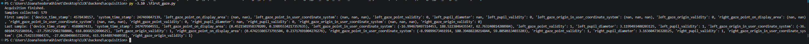
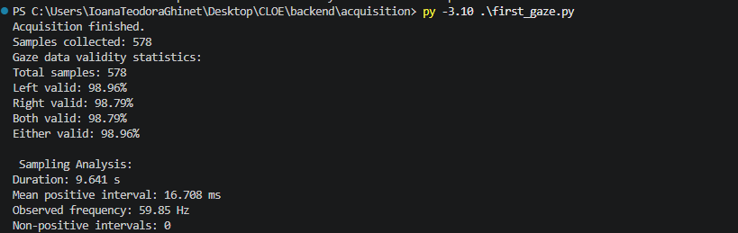
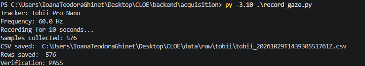
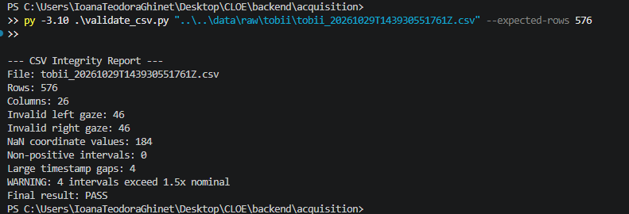
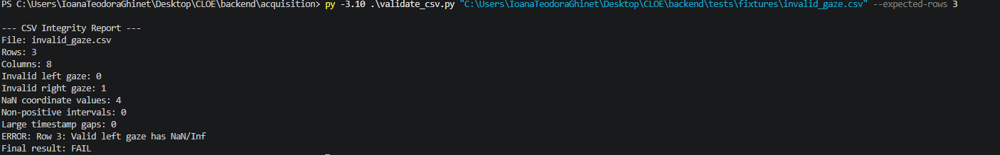

### T01-  Eye Tracker Identification

**Objective:** Verify that the Python application can discover the connected eye tracker and retrieve its properties.

**Environment:**
- Python: 3.10.11
- SDK: Tobii Pro SDK 2.1.0
- Operating system: Windows 11 Education

**Action:** Execute `check_tracker.py` using the Python 3.10 interpreter.

**Observed output:**


*Figure 1. Tobii Pro Nano successfully identified through the Python SDK, reporting a configured frequency of 60.0 Hz.*

**Result:** PASS

**Interpretation:**

The Python application successfully discovered the connected Tobii Pro Nano and retrieved its model and configured gaze-output frequency.

The device name was empty, but this did not prevent successful discovery or property retrieval.

The reported 60.0 Hz frequency is the configured gaze-output frequency, not yet an experimentally measured sampling rate.


### T02 — First Gaze Data Acquisition

**Objective:** Verify that the Tobii Pro Nano can stream gaze measurements to a Python application using SDK callbacks.

**Environment:**
- Python 3.10.11
- Tobii Pro SDK 2.1.0
- Tobii Pro Nano
- Configured sampling frequency: 60 Hz

**Procedure:**

1. Discover the connected Tobii Pro Nano.
2. Subscribe to the gaze-data stream using a Python callback.
3. Collect data for a requested duration of 10 seconds.
4. Unsubscribe from the stream.
5. Inspect the first and last received samples.

**Expected:**

Approximately 600 samples during a nominal 10-second recording.

**Observed:**

- Samples collected: 579
- First sample: Invalid gaze coordinates (`NaN`), gaze-point validity `0` for both eyes.
- Last sample: Numerical gaze coordinates, gaze-point validity `1` for both eyes.
- Both device and system timestamps were present.
- Pupil diameter and gaze-origin fields were available.
- The acquisition process completed successfully.

**Result: PASS**

**Interpretation:**

The Python callback successfully received gaze-data samples from the connected Tobii Pro Nano.

The first received sample contained invalid gaze coordinates, while the last sample contained valid measurements.

This demonstrates the need to verify sample validity before calculating gaze statistics.

The application received 579 samples, compared with a nominal expectation of approximately 600. This difference does not independently establish sample loss.

**Limitations:**

- The actual acquisition duration based on timestamps has not yet been calculated.
- The observed sampling frequency has not yet been measured.
- Overall gaze-data validity has not yet been calculated.
- Data was stored temporarily in memory rather than exported to a persistent file.



*Figure 2. Initial gaze acquisition showing 579 received samples and the difference between invalid and valid gaze measurements.*


### Learning Exercise — Single-Eye Validity and Sensor Fusion

If the left eye provides an invalid gaze point but the right eye provides valid data, the entire sample should not automatically be discarded.

The valid right-eye gaze point can still provide useful information about where the user is looking.

For the initial CLOE implementation, I propose using the valid eye when only one eye is tracked, averaging the two gaze points when both are valid, and marking the gaze position as unavailable when neither eye provides valid data.

I also considered using an external webcam to measure facial geometry and the distance between the eyes.

However, eye distance alone is insufficient to reconstruct gaze direction. The Tobii SDK already provides calibrated gaze estimates for each eye.

The webcam will therefore be used as a complementary sensor for blink detection, head-pose estimation, and posture-related features.

This introduces the concept of sensor fusion, where measurements from different sensors are combined while accounting for their quality and limitations.


### T03 — Gaze Data Quality Analysis

**Date:** 2026-10-29  
**Status:** PASS  
**Experiment:** M0-02  
**Hardware:** Tobii Pro Nano  
**Python:** 3.10.11  
**SDK:** Tobii Pro SDK 2.1.0

#### Objective

Evaluate the validity and temporal characteristics of gaze-data samples acquired using the Tobii Pro Nano.

#### Methodology

A Python application subscribed to the Tobii gaze-data stream using an SDK callback for a requested recording period of 10 seconds.

The application collected raw samples in memory and analyzed their gaze-point validity indicators.

Four metrics were computed:

- Left-eye gaze-point validity rate.
- Right-eye gaze-point validity rate.
- Both-eyes validity rate.
- Either-eye validity rate.

Device timestamps were used to calculate the duration between the first and last received samples, the mean positive sampling interval, and the observed average frequency.

#### Expected Results (THEORETICAL)

| Metric | Expected value |
|---|---|
| Nominal frequency | 60 Hz |
| Nominal interval | 16.667 ms |
| Samples over 10 seconds | Approximately 600 |

#### Observed Results (MEASURED)

| Metric | Observed value |
|---|---:|
| Samples collected | 578 |
| Left-eye valid | 98.96% (572 samples) |
| Right-eye valid | 98.79% (571 samples) |
| Both-eyes valid | 98.79% (571 samples) |
| Either-eye valid | 98.96% (572 samples) |
| Neither-eye valid | 6 samples |
| Timestamp-based duration | 9.641 s |
| Mean positive interval | 16.708 ms |
| Observed average frequency | 59.85 Hz |
| Non-positive timestamp intervals | 0 |

#### Analysis and Interpretation

The experiment confirmed that the Tobii Pro Nano can provide gaze-data samples through the Python SDK at an observed average frequency close to its nominal 60 Hz configuration.

The acquired stream exhibited a high proportion of valid gaze points, with 98.79% of samples containing valid measurements for both eyes.

One additional sample was valid only for the left eye, supporting the decision to retain usable single-eye gaze measurements rather than automatically discarding all partially invalid samples.

Six samples had no valid gaze point for either eye.

The mean positive sampling interval was 16.708 ms, close to the theoretical 16.667 ms.

All consecutive device timestamps were increasing.

The recorded timestamp duration was 9.641 seconds, compared with the requested 10-second acquisition period. Further investigation is required to determine the contribution of subscription startup, callback timing, and acquisition boundaries.

#### Limitations

This experiment represents a single short recording under one set of conditions.

High gaze-point validity does not automatically imply high spatial accuracy, reliable fixation detection, or accurate cognitive-state estimation.

The experiment did not yet evaluate:

- Minimum and maximum timestamp intervals.
- Sampling jitter and potential temporal gaps.
- Spatial gaze accuracy.
- Long-duration acquisition stability.
- Performance under head movement or temporary occlusion.

#### Conclusion

**Result: PASS**

The Python application successfully acquired and analyzed gaze data from the Tobii Pro Nano.

The observed results demonstrate high gaze-point availability and an average sampling frequency close to the nominal device configuration under the tested conditions.

Further experiments are required before making broader reliability claims.

#### Evidence



*Figure 3. Observed gaze-data validity statistics and timestamp-based sampling analysis from the Tobii Pro Nano.*

### Learning Exercise — Missing vs. Invalid Gaze Samples

When analyzing gaze data, I can use the time difference between consecutive samples to estimate how many sampling intervals have passed.

For example, if two valid samples are 50 ms apart and the nominal sampling interval is 16.67 ms, approximately three sampling intervals have passed. This suggests two intermediate sample positions without valid measurements.

However, I must distinguish between invalid samples, which were received but contain unusable gaze measurements, and missing samples, which were not received.

For this reason, CLOE should preserve the original timestamps and validity indicators instead of permanently deleting invalid measurements.

This allows the system to perform more reliable temporal analysis and assess the quality of the acquired data.

### T04 — Persistent Gaze Data Recording

**Date:** 2026-10-29  
**Status:** PASS  
**Script:** `backend/acquisition/record_gaze.py`

#### Objective

Implement and validate persistent CSV recording of gaze-data samples acquired from the Tobii Pro Nano through the official Python SDK.

#### Methodology

The application subscribed to the Tobii gaze-data stream using an SDK callback.

Received samples were temporarily stored in memory during a requested 10-second acquisition period.

After unsubscribing from the stream, the application flattened tuple-valued measurements into individual CSV columns and wrote the collected samples to a uniquely named file.

A separate read operation was performed to verify that the number of saved CSV data rows matched the number of collected samples.

#### Expected Results

- Tobii Pro Nano discovered successfully.
- A CSV file created in `data/raw/tobii/`.
- Raw gaze measurements exported without intentionally removing invalid samples.
- CSV row count equal to the collected sample count.
- No existing recording overwritten.

#### Observed Results (MEASURED)

| Metric | Observed value |
|---|---|
| Tracker model | Tobii Pro Nano |
| Configured frequency | 60.0 Hz |
| Requested recording duration | 10 seconds |
| Samples collected | 576 |
| CSV filename | `tobii_20261029T143930551761Z.csv` |
| CSV rows saved | 576 |
| Row-count verification | PASS |
| Acquisition errors | None reported |
| Field-level data integrity | Not yet independently verified |
| Invalid samples preserved | Implemented by design; pending CSV inspection |

#### Analysis and Interpretation

The Python application successfully acquired gaze-data samples and exported them to a persistent CSV file.

The number of saved data rows matched the number of received samples (576), confirming that no row-count discrepancy was detected during export.

The recording mechanism provides a reproducible foundation for future eye-tracking experiments.

However, row-count verification alone does not establish the correctness of every exported value.

#### Limitations

- Samples are buffered in memory until recording finishes.
- The application does not yet support continuous disk writing.
- Timestamp integrity has not yet been independently verified from the saved CSV.
- Field-level consistency remains to be tested.
- Recording duration has not yet been independently measured using the saved timestamps.

#### Conclusion

**Result: PASS**

The initial persistent CSV recording mechanism was successfully implemented and verified at the row-count level.
uuu
#### Evidence



*Figure 4. Successful acquisition and CSV export of 576 Tobii Pro Nano gaze-data samples.*

#### Next Action

Perform independent CSV integrity validation, including header verification, row counts, timestamps, validity indicators, and missing-value preservation.

### T05 — CSV Integrity Validation

**Date:** 2026-10-29  
**Status:** PASS  
**Script:** `backend/acquisition/validate_csv.py`

#### Objective

Validate the structural consistency and temporal characteristics of the CSV recording produced during T04.

Additionally, verify that the validator correctly rejects deliberately invalid data.

#### Methodology

Two validation tests were performed:

1. **Positive test:** Validate the actual Tobii Pro Nano recording containing 576 samples.
2. **Negative test:** Validate a deliberately corrupted CSV containing a gaze point marked as valid despite having `NaN` coordinates.

The validator checked required columns, numerical representations, validity indicators, timestamp ordering, gaze coordinate consistency, and potentially abnormal sampling intervals.

#### Observed Results — Positive Test

| Metric | Observed value |
|---|---:|
| CSV rows | 576 |
| CSV columns | 26 |
| Invalid left-eye gaze samples | 46 |
| Invalid right-eye gaze samples | 46 |
| Left-eye gaze validity | 92.01% |
| Right-eye gaze validity | 92.01% |
| NaN coordinate values | 184 |
| Non-positive timestamp intervals | 0 |
| Large timestamp gaps | 4 |
| Final validation result | PASS |

**Interpretation:**

The original CSV passed all implemented integrity checks.

The validator identified four intervals exceeding 1.5 times the nominal sampling interval. These were classified as warnings because they do not necessarily indicate data corruption.

The observed left-eye and right-eye validity rates were approximately 92.01%.

The results do not yet establish the percentage of samples in which both eyes or at least one eye were valid.

#### Observed Results — Negative Test

**Input:** `invalid_gaze.csv`

**Expected:** The validator should reject a sample marked as valid when its gaze coordinates contain `NaN`.

**Observed:**

```text
ERROR: Row 3: Valid left gaze has NaN/Inf
Final result: FAIL
```

**Test outcome: PASS**

The validator correctly rejected the deliberately corrupted file.

#### Limitations

- The validator does not verify every SDK field.
- The original in-memory samples were not compared directly with their exported representations.
- The detected temporal gaps require further investigation.
- Measurement accuracy was not evaluated.
- The negative test covers one deliberately introduced error type.

#### Conclusion

**T05 Result: PASS**

Both the positive and negative validation tests behaved as expected.

The results demonstrate that the validator can identify selected structural and numerical inconsistencies while distinguishing temporal warnings from validation errors.

#### Evidence





