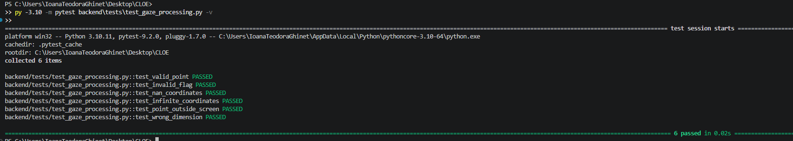
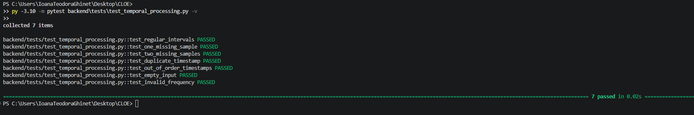

# CLOE — M0.3: Gaze Processing & Feature Extraction

**Project:** Cognitive Load Occlusion Engine  
**Milestone:** M0.3 — Gaze Processing & Feature Extraction  
**Date opened:** 2026-11-03  
**Status:** IN PROGRESS

## 1. Objective

Develop independently testable gaze-processing functions that transform raw Tobii measurements into validated and interpretable data, without modifying the original recordings.

## 2. T01 — Gaze Point Validation

**Objective:** Implement a function that determines whether an individual two-dimensional gaze point is usable for subsequent processing.

### Design

The function accepts:

- A two-dimensional gaze point `(x, y)`.
- A validity indicator provided by the Tobii SDK.

A point is considered usable when its validity indicator equals 1 and both coordinates are finite numeric values.

Coordinates outside the normalized display interval are not automatically classified as invalid.

### Implementation

**Source file:** `backend/processing/gaze_processing.py`

**Function:** `is_valid_eye(point, validity)`

### Test Cases

| Test | Expected |
|---|---|
| Finite point, validity = 1 | True |
| Finite point, validity = 0 | False |
| NaN coordinate, validity = 1 | False |
| Infinite coordinate, validity = 1 | False |
| Finite point outside display bounds | True |
| Incorrect coordinate count | False |

### Observed Results

- Tests collected: 6
- Tests passed: 6
- Tests failed: 0 (all six test cases reported PASSED)

### Interpretation:

The `is_valid_eye()` function passed all six defined unit tests.

The initial test suite revealed a misunderstanding between tracking validity and display boundaries. After clarifying the function's responsibility, the incorrect test expectation was corrected.

The tests confirm that the function distinguishes invalid numerical coordinates from finite gaze positions, including coordinates outside the normalized display area.

### Conclusion: T01 completed successfully.

### T02 — Binocular Gaze Fusion

**Date:** 2026-11-03  
**Status:** PASS  
**Implementation:** `backend/processing/gaze_processing.py`  
**Tests:** `backend/tests/test_gaze_processing.py`

#### Objective

Implement and validate an initial strategy for combining left-eye and right-eye gaze points while preserving information about the source of the resulting estimate.

#### Methodology

The `combine_gaze()` function uses the previously implemented `is_valid_eye()` function to evaluate each eye independently.

The processing rules are:

- Both eyes valid: calculate the arithmetic mean of the two gaze points.
- Only left eye valid: use the left-eye gaze point.
- Only right eye valid: use the right-eye gaze point.
- Neither eye valid: return `None`.

The function also returns a source label: `BOTH`, `LEFT`, `RIGHT`, or `NONE`.

#### Observed Results

| Test case | Result |
|---|---|
| Both eyes valid | PASS |
| Only left eye valid | PASS |
| Only right eye valid | PASS |
| Neither eye valid | PASS |

**Test environment:** Python 3.10.11, pytest 9.2.0.

**Full suite:** 10 tests passed in 0.03 seconds.

#### Interpretation

The initial gaze-fusion algorithm behaved as expected for all four defined validity scenarios.

The source label provides information about which eye measurements contributed to the combined gaze estimate.

However, the source label does not directly represent measurement accuracy or confidence.

Although two valid gaze measurements may provide additional information, the arithmetic mean is not guaranteed to be more accurate than either individual estimate.

#### Limitations

- The fusion algorithm uses equal weighting for both eyes.
- It does not yet evaluate discrepancies between left-eye and right-eye gaze points.
- It has been tested using synthetic inputs, not yet validated against ground-truth gaze targets.
- It does not estimate spatial gaze accuracy.

#### Conclusion

**T02 Result: PASS**

The initial binocular gaze-fusion implementation passed all defined unit tests.

Further evaluation using actual recordings is required.

#### Evidence

*Figure 2. Successful execution of ten unit tests covering gaze validation and binocular gaze fusion.*

### T03 — Missing Data & Temporal Gap Detection

**Date:** 2026-11-03  
**Status:** UNIT TESTS PASSED — Real Data Validation Pending  
**Implementation:** `backend/processing/temporal_processing.py`  
**Tests:** `backend/tests/test_temporal_processing.py`

#### Objective

Develop a reusable algorithm that identifies temporal irregularities in eye-tracking measurements and estimates potentially missing sampling positions.

#### Unit Test Results (OBSERVED)

| Test | Result |
|---|---|
| Regular sampling intervals | PASS |
| One estimated missing sample | PASS |
| Two estimated missing samples | PASS |
| Duplicate timestamp | PASS |
| Out-of-order timestamps | PASS |
| Empty input | PASS |
| Invalid sampling frequency | PASS |

**Total:** 7 tests passed in 0.02 seconds.

#### Interpretation

The temporal-processing function behaved as expected for all seven synthetic test cases.

The implementation can identify non-positive timestamp intervals and flag intervals exceeding the configured diagnostic threshold.

The number of potentially missing samples is estimated using the nominal sampling frequency.

These results verify the tested algorithmic behavior but do not establish performance on real eye-tracking recordings.

#### Remaining Validation

- Run the function on the CSV recording obtained during M0.2.
- Compare detected large gaps against the previous CSV validator.
- Inspect individual gap durations.
- Estimate potentially missing sampling positions.
- Investigate whether detected gaps correspond to acquisition irregularities.

**Current result:** UNIT TESTS PASSED — EXPERIMENT IN PROGRESS.
