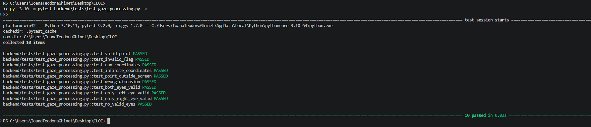
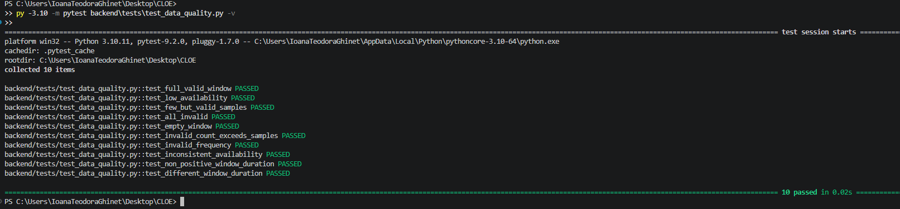
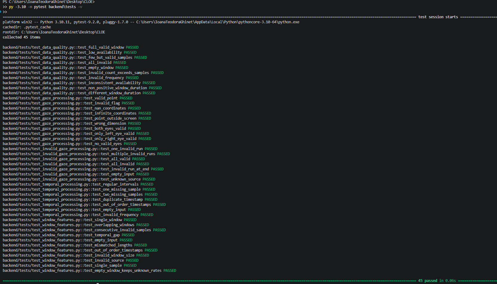
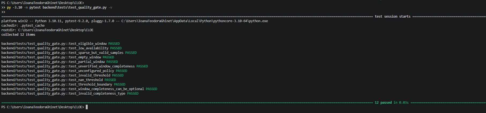
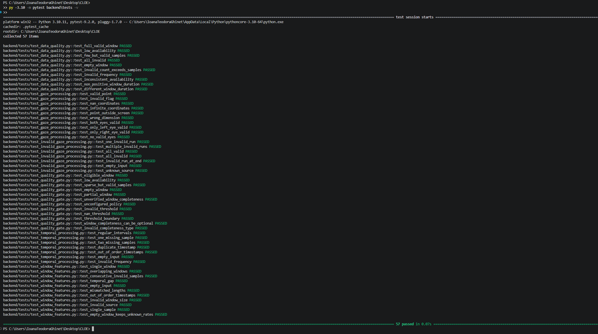
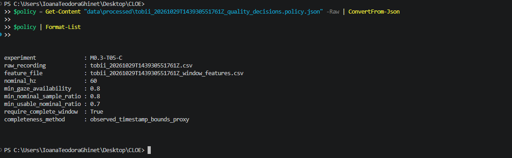
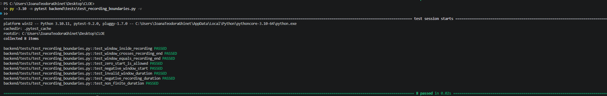
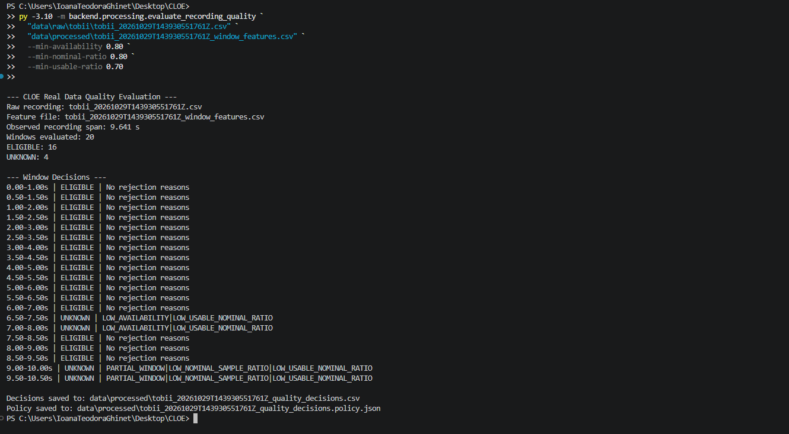
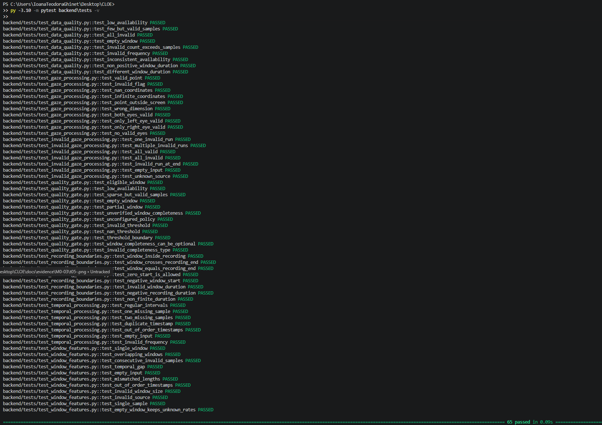
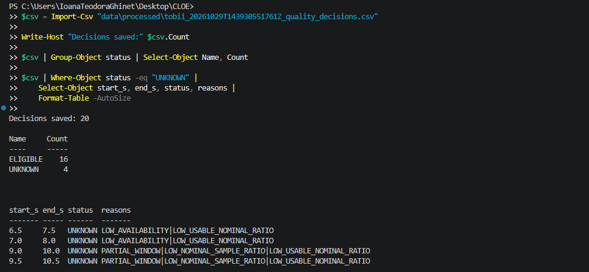

# CLOE — M0.3: Gaze Processing & Feature Extraction

**Project:** Cognitive Load Occlusion Engine

**Milestone:** M0.3 — Gaze Processing & Feature Extraction  
**Date opened:** 2026-11-03  
**Date completed:** 2026-11-10  
**Status:** COMPLETED — Initial Software and Real-Data Validation


## 1. Objective

Develop independently testable gaze-processing functions that transform raw Tobii measurements into validated and interpretable data, without modifying the original recordings.

## 2. T01 — Gaze Point Validation

**Objective:** Implement a function that determines whether an individual two-dimensional gaze point is usable for subsequent processing.

### Design

The function accepts:

- A two-dimensional gaze point `(x, y)`.
- A validity indicator provided by the Tobii SDK.

A point is considered usable when its validity indicator equals 1 and both coordinates are finite numeric values.

Coordinates outside the normalized display interval are not automatically classified as invalid.

### Implementation

**Source file:** `backend/processing/gaze_processing.py`

**Function:** `is_valid_eye(point, validity)`

### Test Cases

| Test | Expected |
|---|---|
| Finite point, validity = 1 | True |
| Finite point, validity = 0 | False |
| NaN coordinate, validity = 1 | False |
| Infinite coordinate, validity = 1 | False |
| Finite point outside display bounds | True |
| Incorrect coordinate count | False |

### Observed Results

- Tests collected: 6
- Tests passed: 6
- Tests failed: 0 (all six test cases reported PASSED)


### Interpretation:

The `is_valid_eye()` function passed all six defined unit tests.

The initial test suite revealed a misunderstanding between tracking validity and display boundaries. After clarifying the function's responsibility, the incorrect test expectation was corrected.

The tests confirm that the function distinguishes invalid numerical coordinates from finite gaze positions, including coordinates outside the normalized display area.

### Conclusion: T01 completed successfully.

## 3. T02 — Binocular Gaze Fusion

**Date:** 2026-11-03

**Status:** PASS

**Implementation:** `backend/processing/gaze_processing.py`

**Tests:** `backend/tests/test_gaze_processing.py`

#### Objective

Implement and validate an initial strategy for combining left-eye and right-eye gaze points while preserving information about the source of the resulting estimate.

#### Methodology

The `combine_gaze()` function uses the previously implemented `is_valid_eye()` function to evaluate each eye independently.

The processing rules are:

- Both eyes valid: calculate the arithmetic mean of the two gaze points.
- Only left eye valid: use the left-eye gaze point.
- Only right eye valid: use the right-eye gaze point.
- Neither eye valid: return `None`.

The function also returns a source label: `BOTH`, `LEFT`, `RIGHT`, or `NONE`.

#### Observed Results

| Test case | Result |
|---|---|
| Both eyes valid | PASS |
| Only left eye valid | PASS |
| Only right eye valid | PASS |
| Neither eye valid | PASS |

**Test environment:** Python 3.10.11, pytest 9.2.0.

**Full suite:** 10 tests passed in 0.03 seconds.

#### Interpretation

The initial gaze-fusion algorithm behaved as expected for all four defined validity scenarios.

The source label provides information about which eye measurements contributed to the combined gaze estimate.

However, the source label does not directly represent measurement accuracy or confidence.

Although two valid gaze measurements may provide additional information, the arithmetic mean is not guaranteed to be more accurate than either individual estimate.

#### Limitations

- The fusion algorithm uses equal weighting for both eyes.
- It does not yet evaluate discrepancies between left-eye and right-eye gaze points.
- It has been tested using synthetic inputs, not yet validated against ground-truth gaze targets.
- It does not estimate spatial gaze accuracy.

#### Conclusion

**T02 Result: PASS**

The initial binocular gaze-fusion implementation passed all defined unit tests.

Further evaluation using actual recordings is required.

#### Evidence



*Figure 2. Successful execution of ten unit tests covering gaze validation and binocular gaze fusion.*

## 4. T03 — Missing Data & Temporal Gap Detection

**Date:** 2026-11-03

**Status:** IN PROGRESS — T01–T04 verified; T05 pending

**Implementation:** `backend/processing/temporal_processing.py`

**Tests:** `backend/tests/test_temporal_processing.py`

#### Objective

Develop a reusable algorithm that identifies temporal irregularities in eye-tracking measurements and estimates potentially missing sampling positions.

#### Unit Test Results (OBSERVED)

| Test | Result |
|---|---|
| Regular sampling intervals | PASS |
| One estimated missing sample | PASS |
| Two estimated missing samples | PASS |
| Duplicate timestamp | PASS |
| Out-of-order timestamps | PASS |
| Empty input | PASS |
| Invalid sampling frequency | PASS |

**Total:** 7 tests passed in 0.02 seconds.

#### Interpretation

The temporal-processing function behaved as expected for all seven synthetic test cases.

The implementation can identify non-positive timestamp intervals and flag intervals exceeding the configured diagnostic threshold.

The number of potentially missing samples is estimated using the nominal sampling frequency.

These unit tests verify the defined algorithmic behavior. Initial real-recording diagnostic consistency was subsequently verified in T03-B.

#### Follow-up Validation (initial tasks completed in T03-B)

- Run the function on the CSV recording obtained during M0.2.
- Compare detected large gaps against the previous CSV validator.
- Inspect individual gap durations.
- Estimate potentially missing sampling positions.
- Investigate whether detected gaps correspond to acquisition irregularities.

**Current result:** PASS — Unit tests and initial real recording consistency verified in T03-B.


#### T03-B — Real Recording Temporal Analysis

**Date:** 2026-11-05

**Status:** PASS — Diagnostic consistency verified

**Script:** `backend/processing/analyze_recording.py`

**Objective:** Apply the temporal gap detection algorithm to a real Tobii Pro Nano recording and compare the results with the previous CSV integrity validation.

**Recording:** `tobii_20261029T143930551761Z.csv`

**Nominal sampling frequency:** 60 Hz

**Nominal sampling interval:** approximately 16.67 ms

**Diagnostic gap threshold:** 1.5 × nominal interval

### Observed Results

| Metric | Result |
|---|---:|
| Samples analyzed | 576 |
| Non-positive intervals | 0 |
| Large temporal gaps | 4 |
| Estimated missing samples | 4 |

### Individual Gap Analysis

| Sample index | Duration | Estimated missing samples |
|---|---:|---:|
| 2 | 31.236 ms | 1 |
| 4 | 34.042 ms | 1 |
| 432 | 31.749 ms | 1 |
| 434 | 34.042 ms | 1 |

### Interpretation

Four intervals exceeded the configured temporal gap threshold. Each interval was approximately twice the nominal sampling period and was associated with one potentially missing sampling position.

The detected intervals were concentrated in two regions of the recording: near sample indices 2–4 and 432–434.

The results were consistent with the previous M0.2 CSV integrity report, which also identified four large timestamp gaps and zero non-positive intervals.

### Limitations

- The missing-sample count is an estimate, not a confirmed count of dropped measurements.
- The algorithm assumes a nominal sampling frequency of 60 Hz.
- The gap threshold is heuristic and has not yet been experimentally optimized.
- The cause of the temporal irregularities remains unknown.
- The recording has not yet been evaluated against external timing ground truth.

### Conclusion

**Result: PASS — Diagnostic consistency verified.**

The temporal processing algorithm successfully analyzed the real recording and reproduced the gap count previously reported by the CSV integrity validator.

Further work is required to characterize invalid gaze periods and establish rules for handling discontinuous data during feature extraction.

### Evidence


### T03-C — Consecutive Invalid Gaze Detection

**Project:** CLOE — Cognitive Load Occlusion Engine

**Milestone:** M0.3 — Gaze Processing & Feature Extraction

**Experiment:** T03-C — Consecutive Invalid Gaze Detection

**Date:** 2026-11-05

**Status:** PASS — Initial Real Data Integration Verified

**---**

#### 1. Objective

Develop and test an algorithm that identifies consecutive sequences of eye-tracking samples in which neither eye provides a usable gaze point.

The algorithm aims to characterize periods of unavailable gaze information while preserving the original measurements.

This functionality will support future data-quality assessment and feature extraction within CLOE.

#### 2. Background

During eye-tracking acquisition, the Tobii Pro Nano may produce samples in which gaze coordinates are unavailable or invalid.

An invalid gaze sample is different from a missing sample:

- **Invalid gaze sample:** A measurement was received, but neither eye provided a usable gaze point.
- **Potentially missing sample:** A temporal irregularity suggests that an expected sampling position may not have a corresponding recorded measurement.

T03-B addressed temporal gaps and estimated potentially missing sampling positions.

T03-C focuses on identifying consecutive received samples with invalid gaze information.

Importantly, invalid gaze samples cannot automatically be interpreted as blinks. They may result from eye closure, tracking limitations, occlusion, or other acquisition conditions.

#### 3. Implementation

**Source file:** `backend/processing/invalid_gaze_processing.py`

**Function:** `detect_invalid_runs(sources)`

The function receives a sequence of gaze source labels generated by the binocular gaze-fusion logic developed in T02.

Supported source labels:

| Label | Meaning |
|---|---|
| `BOTH` | Both eyes provide usable gaze points |
| `LEFT` | Only the left eye provides a usable gaze point |
| `RIGHT` | Only the right eye provides a usable gaze point |
| `NONE` | Neither eye provides a usable gaze point |

The algorithm searches for consecutive occurrences of `NONE`.

For each detected sequence, the function returns a dictionary containing:

| Field | Description |
|---|---|
| `start_index` | Index of the first invalid sample |
| `end_index` | Index of the last invalid sample (inclusive) |
| `sample_count` | Number of consecutive invalid samples |

**Example input:**

```python

sources = [

    "BOTH", "NONE", "NONE",

    "LEFT", "NONE", "RIGHT"

]

```

**Expected output:**

```python

[

    {

        "start_index": 1,

        "end_index": 2,

        "sample_count": 2

    },

    {

        "start_index": 4,

        "end_index": 4,

        "sample_count": 1

    }

]

```

#### 4. Algorithm Description

The algorithm uses a sequential scan to identify runs of invalid samples.

1. Initialize an empty list to store detected runs.
2. Initialize `start = None`, indicating that no invalid run is currently active.
3. Iterate through the gaze source labels.
4. When `NONE` is encountered, record its index if no invalid run is active.
5. When a usable source is encountered after an invalid run, record the run's start index, end index, and sample count.
6. Reset `start` to `None` after closing the run.
7. After iteration, record any invalid run that extends to the end of the sequence.
8. Return the detected runs.

The algorithm does not modify the input sequence.

**Time complexity:** O(n), where n is the number of samples.

**Auxiliary space complexity:** O(k), where k is the number of detected invalid runs, excluding the input.

#### 5. Unit Testing

**Test file:** `backend/tests/test_invalid_gaze_processing.py`

**Test environment:**

- Operating system: Windows 11 Education, 64-bit
- Python: 3.10.11
- pytest: 9.2.0

**Execution command:**

```powershell

py -3.10 -m pytest backend\tests\test_invalid_gaze_processing.py -v

```

Seven unit tests were implemented to verify the algorithm under different input conditions.

#### 6. Observed Test Results

| Test | Expected behavior | Result |
|---|---|---|
| `test_one_invalid_run` | Detect one consecutive invalid sequence | PASS |
| `test_multiple_invalid_runs` | Detect multiple independent invalid sequences | PASS |
| `test_all_valid` | Return an empty list | PASS |
| `test_all_invalid` | Identify one run covering all samples | PASS |
| `test_invalid_run_at_end` | Correctly close a run at the end of the input | PASS |
| `test_empty_input` | Return an empty list | PASS |
| `test_unknown_source` | Raise `ValueError` for an unsupported label | PASS |

**Final observed result:**

```text

collected 7 items

test_one_invalid_run PASSED

test_multiple_invalid_runs PASSED

test_all_valid PASSED

test_all_invalid PASSED

test_invalid_run_at_end PASSED

test_empty_input PASSED

test_unknown_source PASSED

7 passed in 0.02s

```

**Unit testing status: PASS**

All seven unit tests passed successfully.

#### 7. Troubleshooting

**Issue 1 — Inconsistent Output Dictionary Keys**

During the initial test execution, three tests failed because the implementation returned the dictionary key `length`, while the test cases expected `sample_count`.

**Observed result:** 4 passed, 3 failed.

**Cause:** The output structure did not match the function contract.

**Resolution:** Replaced `length` with `sample_count` in both branches responsible for recording invalid runs.

**Engineering lesson:** Output field names form part of a function's interface contract. Consistent naming is essential for reliable integration between components.

**Issue 2 — Python Indentation Error**

After modifying the implementation, test collection failed with:

```text

IndentationError: unexpected indent

```

**Location:** `backend/processing/invalid_gaze_processing.py`, line 34.

**Cause:** Incorrect code indentation prevented Python from importing the module.

**Resolution:** Corrected the indentation of the conditional blocks and verified that `start = None` was positioned within the branch handling the end of an invalid run.

**Final verification:** All seven tests passed after correction.

**Engineering lesson:** Python uses indentation to define program structure. Syntax errors can prevent tests from being collected, even before the algorithm is executed.

#### 8. Design Decisions

The following decisions were adopted:

- Preserve the original gaze measurements without modification.
- Treat `NONE` as unavailable gaze information, not as confirmed eye closure.
- Store invalid-run boundaries using zero-based sample indices.
- Use the explicit field name `sample_count` to distinguish sample counts from temporal duration.
- Detect consecutive invalid measurements separately from temporal sampling gaps.
- Avoid automatic gaze interpolation at this stage.
- Keep the detector independent of Tobii hardware and CSV parsing.
- Reject unsupported source labels instead of silently processing unknown values.

These decisions support reproducibility, modularity, and traceability.

#### 9. Interpretation

The successful unit tests demonstrate that the algorithm correctly identifies consecutive invalid gaze sequences for the seven tested synthetic scenarios.

The detector can distinguish isolated invalid samples from longer consecutive sequences.

This is important for CLOE because continuous availability of gaze information cannot be assumed during eye-tracking acquisition.

The generated run metadata may later support quality assessment over temporal windows.

However, the number of invalid samples alone does not establish the exact duration or cause of a tracking interruption.

#### 10. Limitations

The current implementation has several limitations:

1. The algorithm operates on gaze source labels rather than directly on raw Tobii CSV measurements.
2. Temporal durations are not calculated.
3. It assumes that the input sequence preserves the original acquisition order.
4. Invalid runs are defined by consecutive received samples; temporal gaps between samples are not yet incorporated into run segmentation.
5. It cannot identify the physical cause of invalid gaze measurements.
6. The core function was unit-tested with synthetic sequences; subsequent integration was exercised on one real Tobii recording.

These limitations will be addressed in subsequent processing and validation steps.

#### 11. Evidence

**Unit test screenshot:**


The screenshot documents the successful execution of all seven unit tests using Python 3.10.11 and pytest 9.2.0.

#### 12. Conclusion

**Result: PASS — Unit Testing**

The consecutive invalid gaze detection algorithm was implemented and successfully tested.

All seven unit tests passed, confirming the expected behavior across the defined synthetic scenarios.

The implementation preserves source information, identifies consecutive invalid samples, and provides structured metadata for downstream analysis.

Real-data integration was subsequently completed and documented in the following T03-C subsection.

#### T03-C — Real Data Integration and Validation

**Date:** 2026-11-05

**Status:** PASS — Real Data Integration Verified

**Script:** `backend/processing/analyze_invalid_gaze.py`

**Recording:** `tobii_20261029T143930551761Z.csv`

##### Objective

Validate the integration of binocular gaze fusion and consecutive invalid-run detection using a real Tobii Pro Nano recording.

The experiment aims to characterize gaze-data availability, identify consecutive periods of invalid measurements, and investigate their relationship with previously detected temporal irregularities.

##### Methodology

The integration script performed the following operations:

1. Loaded 576 samples from the original Tobii CSV recording.
2. Extracted the left-eye and right-eye gaze coordinates and validity indicators.
3. Applied the previously tested `combine_gaze()` function to classify each sample as `BOTH`, `LEFT`, `RIGHT`, or `NONE`.
4. Calculated the distribution of gaze source labels.
5. Applied `detect_invalid_runs()` to identify consecutive `NONE` samples.
6. Associated each invalid run with its original device timestamps.
7. Calculated the observed timestamp span between the first and last invalid sample in each run.

The original recording was not modified.

##### Observed Results

| Metric | Result |
|---|---:|
| Total received samples | 576 |
| BOTH | 528 (91.67%) |
| LEFT | 2 (0.35%) |
| RIGHT | 2 (0.35%) |
| NONE | 44 (7.64%) |
| Samples with usable gaze | 532 (92.36%) |
| Invalid runs detected | 7 |
| Longest invalid run | 27 samples |
| Longest observed invalid-run span | 465.505 ms |

##### Individual Invalid Runs

| Start index | End index | Sample count | Observed span |
|---:|---:|---:|---:|
| 0 | 4 | 5 | 98.588 ms |
| 382 | 385 | 4 | 49.964 ms |
| 395 | 395 | 1 | 0.000 ms |
| 399 | 399 | 1 | 0.000 ms |
| 403 | 404 | 2 | 16.655 ms |
| 419 | 445 | 27 | 465.505 ms |
| 507 | 510 | 4 | 49.964 ms |

##### Consistency Checks

**Check 1 — Source distribution**

528 + 2 + 2 + 44 = 576

All received samples were assigned to exactly one source category.

**Result: PASS**

**Check 2 — Invalid-run sample counts**

5 + 4 + 1 + 1 + 2 + 27 + 4 = 44

The total number of samples belonging to invalid runs matches the number of `NONE` samples.

**Result: PASS**

**Check 3 — Previous CSV validation**

The previous M0.2 CSV integrity analysis reported 46 invalid gaze measurements for each eye.

The current source distribution is consistent with these values:

- Left-eye invalid samples: 44 NONE + 2 RIGHT = 46.
- Right-eye invalid samples: 44 NONE + 2 LEFT = 46.

**Result: PASS**

##### Relationship With Temporal Gaps

The preceding T03-B experiment identified four large timestamp intervals at sample indices 2, 4, 432, and 434.

All four gap indices fall within invalid gaze runs:

- Indices 2 and 4 occur within the invalid run spanning indices 0–4.
- Indices 432 and 434 occur within the invalid run spanning indices 419–445.

This establishes an observed overlap between temporal irregularities and periods of unavailable gaze data.

However, the relationship is observational and does not establish causation.

##### Interpretation

The recording contained usable gaze measurements in 532 out of 576 received samples (92.36%).

Most usable measurements were binocular, while four samples relied on only one eye.

The algorithm detected seven separate sequences of consecutive invalid gaze measurements.

The longest sequence contained 27 invalid samples, with an observed timestamp span of 465.505 ms.

These findings demonstrate why aggregate validity percentages alone are insufficient for characterizing eye-tracking data quality. Even when the overall proportion of usable samples is high, invalid measurements may be concentrated in relatively long consecutive sequences.

Such sequences may affect algorithms that rely on temporally continuous gaze measurements.

##### Limitations

- Invalid runs cannot automatically be classified as blinks.
- The observed timestamp span does not equal the exact duration of tracking loss.
- The analysis does not determine the physical cause of invalid gaze measurements.
- The script does not reconstruct or interpolate missing measurements.
- Source labels do not represent calibrated measurement confidence.
- The integration has been exercised on one recorded dataset; broader validation remains necessary.

##### Engineering Decisions

1. Preserve all original measurements and timestamps.
2. Maintain the distinction between invalid received samples and potentially missing samples.
3. Track source provenance through `BOTH`, `LEFT`, `RIGHT`, and `NONE`.
4. Report both invalid sample counts and timestamp-based spans.
5. Avoid interpreting invalid runs as physiological events without additional evidence.
6. Incorporate data-availability checks before future fixation analysis and cognitive-load estimation.

##### Conclusion

**Result: PASS — Real Data Integration Verified**

The integrated processing pipeline successfully classified all 576 recorded samples and detected seven consecutive invalid gaze sequences.

The results were internally consistent and agreed with previously observed per-eye validity counts.

The experiment provides evidence that CLOE can identify unavailable gaze information and preserve its temporal structure for subsequent processing.

##### Evidence


### T03-D — Processing Pipeline Regression Testing

**Date:** 2026-11-05

**Status:** PASS

#### Objective

Verify that all previously implemented gaze-processing components remain functional after the integration of temporal gap detection and consecutive invalid gaze analysis.

#### Test Execution

```powershell

py -3.10 -m pytest backend\tests -v

```

#### Observed Results

| Component | Passed | Failed |
|---|---:|---:|
| Gaze Point Validation (T01) | 6 | 0 |
| Binocular Gaze Fusion (T02) | 4 | 0 |
| Temporal Processing (T03-B) | 7 | 0 |
| Invalid Gaze Detection (T03-C) | 7 | 0 |
| **Total** | **24** | **0** |

**Environment:** Python 3.10.11, pytest 9.2.0

**Execution time:** 0.04 seconds

#### Interpretation

All 24 unit tests passed during the combined regression test execution.

The results confirm that the tested processing components retain their expected behavior following the recent implementation changes.

The previous test-collection error caused by incorrect Python indentation was resolved.

In addition to unit testing, the temporal analysis and invalid gaze detection components were exercised against a real Tobii Pro Nano CSV recording containing 576 received samples.

#### Limitations

Passing unit tests does not establish physiological validity, spatial gaze accuracy, or the correctness of future cognitive-load estimates.

The current evidence supports the tested software functionality and initial integration behavior.

#### Conclusion

**Result: PASS**

The M0.3 processing components successfully passed the complete regression test suite.

**Evidence:** 

## 5. T04 — Sliding Window Feature Extraction

**Project:** CLOE — Cognitive Load Occlusion Engine

**Milestone:** M0.3 — Gaze Processing & Feature Extraction

**Experiment:** T04 — Sliding Window Feature Extraction

**Date:** 2026-11-10

**Status:** PASS — 11 unit tests, real-recording integration and full regression suite completed

**---**

### 1. Objective

Develop and validate a reusable sliding-window feature extraction module that summarizes eye-tracking data quality over short temporal intervals.

The objective is to transform individual gaze measurements into structured numerical features that can support subsequent processing stages within CLOE.

Unlike global recording statistics, sliding-window analysis enables the system to characterize variations in gaze-data availability over time.

At this stage, the extracted features describe **data quality and availability**, not cognitive load, fatigue, attention, or other physiological states.

### 2. Background and Motivation

Previous M0.3 experiments established the following capabilities:

- T01: Gaze point validation.
- T02: Binocular gaze fusion.
- T03-B: Temporal gap detection.
- T03-C: Consecutive invalid gaze detection.

The real Tobii Pro Nano recording contained 576 received samples, of which 532 contained usable gaze information.

Although the overall gaze availability rate was 92.36%, the invalid samples were not uniformly distributed.

Seven invalid gaze sequences were detected, with the longest containing 27 consecutive samples and an observed timestamp span of 465.505 ms.

These findings demonstrate that global validity statistics may hide local periods of unavailable gaze information.

Sliding-window analysis addresses this limitation by calculating features independently over successive temporal intervals.

### 3. Sliding Window Concept

A sliding window is a fixed-duration interval that moves through time according to a configurable step size.

Unlike a tumbling window, which processes consecutive non-overlapping intervals, a sliding window permits overlap between consecutive analysis intervals.

For example:

| Window | Start | End |
|---|---|---|
| W1 | 0.0 s | 1.0 s |
| W2 | 0.5 s | 1.5 s |
| W3 | 1.0 s | 2.0 s |
| W4 | 1.5 s | 2.5 s |

This approach allows more frequent updates of extracted features.

Overlapping windows also mean that a single sample may contribute to multiple feature vectors. Therefore, the resulting windows must not be treated as statistically independent observations.

### 4. Experimental Configuration

The following parameters were selected for the initial implementation:

| Parameter | Configuration |
|---|---|
| Window duration | 1,000,000 µs (1 second) |
| Step duration | 500,000 µs (0.5 seconds) |
| Window overlap | 50% |
| Nominal sampling frequency | 60 Hz |
| Timestamp source | `device_time_stamp` |
| Timestamp unit | Microseconds |
| Window boundary convention | Half-open interval `[start, end)` |
| Empty-window availability rates | `None` |

The window duration and step size are initial engineering choices and have not yet been optimized or scientifically validated for cognitive-load estimation.

### 5. Implementation

**Source file:** `backend/processing/window_features.py`

**Main function:** `extract_window_features()`

The function receives:

- `timestamps`: a sequence of device timestamps.
- `sources`: a sequence of gaze source labels.
- `window_us`: window duration in microseconds.
- `step_us`: sliding step in microseconds.
- `nominal_hz`: expected sampling frequency.

The gaze source labels are inherited from T02:

| Source | Meaning |
|---|---|
| `BOTH` | Both eyes provide usable gaze coordinates |
| `LEFT` | Only the left eye provides usable gaze coordinates |
| `RIGHT` | Only the right eye provides usable gaze coordinates |
| `NONE` | Neither eye provides usable gaze coordinates |

The implementation reuses:

- `detect_invalid_runs()` from `invalid_gaze_processing.py`.
- `analyze_timestamps()` from `temporal_processing.py`.

This preserves modularity and avoids duplicating existing processing logic.

### 6. Algorithm Description

The algorithm performs the following operations:

1. Validate that timestamps and source labels have equal lengths.
2. Validate positive window duration, step duration, and nominal sampling frequency.
3. Reject unsupported source labels.
4. Verify that device timestamps are strictly increasing.
5. Handle an empty input recording by returning an empty result list.
6. Initialize the first window at the timestamp of the first received sample.
7. Select samples belonging to the current half-open temporal interval.
8. Calculate gaze availability and binocular availability rates.
9. Count invalid measurements.
10. Detect the longest consecutive invalid sequence inside the window.
11. Detect large temporal gaps between samples located within the window.
12. Store the calculated features.
13. Advance the window by the configured step size.
14. Repeat until the window start exceeds the last recorded timestamp.

Each output record represents one temporal analysis window.

The algorithm does not modify the original input measurements.

### 7. Extracted Features

The following features are produced for each window:

| Feature | Description |
|---|---|
| `start_s` | Window start relative to the first sample, in seconds |
| `end_s` | Window end relative to the first sample, in seconds |
| `sample_count` | Number of received samples within the window |
| `gaze_availability_rate` | Fraction of samples with at least one usable eye |
| `binocular_availability_rate` | Fraction of samples with both eyes usable |
| `invalid_sample_count` | Number of samples classified as `NONE` |
| `longest_invalid_run` | Maximum number of consecutive invalid samples within the window |
| `temporal_gap_count` | Number of large timestamp intervals detected between samples inside the window |

#### 7.1 Gaze Availability Rate

The gaze availability rate is calculated as:

$$
GAR = \frac{N_{\text{BOTH}} + N_{\text{LEFT}} + N_{\text{RIGHT}}}{N_{\text{total}}}
$$

where:

- $N_{\text{BOTH}}$ represents samples with both eyes valid.
- $N_{\text{LEFT}}$ represents samples with only the left eye valid.
- $N_{\text{RIGHT}}$ represents samples with only the right eye valid.
- $N_{\text{total}}$ represents the number of received samples in the window.

This metric measures the proportion of received samples containing at least one usable gaze point.

It does not directly measure spatial accuracy.

#### 7.2 Binocular Availability Rate

The binocular availability rate is calculated as:

$$
BAR = \frac{N_{\text{BOTH}}}{N_{\text{total}}}
$$

This metric describes the proportion of samples in which both eyes provide usable gaze information.

It does not represent a calibrated confidence score.

#### 7.3 Invalid Sample Count

The invalid sample count is:

$$
N_{\text{invalid}} = N_{\text{NONE}}
$$

It represents the number of received samples for which neither eye provides usable gaze coordinates.

#### 7.4 Longest Invalid Run

The longest invalid run represents the maximum number of consecutive samples classified as `NONE` within the current window.

The result is expressed in samples rather than milliseconds.

The algorithm does not infer an exact interruption duration from sample count alone.

#### 7.5 Temporal Gap Count

The temporal gap count represents the number of consecutive timestamp intervals exceeding the configured diagnostic threshold.

The initial implementation uses 1.5 times the nominal sampling period.

At 60 Hz:

$$
T_{\text{nominal}} \approx 16.67\text{ ms}
$$

Therefore, the diagnostic threshold is approximately 25 ms.

Only gaps whose two endpoint samples are included in the current window are detected by the window-local analysis.

### 8. Handling Missing or Invalid Information

The implementation explicitly distinguishes between unavailable and invalid information.

**Empty windows**

When no measurements fall inside a window:

- `sample_count` is zero.
- `gaze_availability_rate` is `None`.
- `binocular_availability_rate` is `None`.

This avoids incorrectly representing the absence of measurements as a measured availability rate of zero.

**All-invalid windows**

When samples are received but all are classified as `NONE`, the gaze availability rate is `0.0`.

The distinction is important because an empty window contains no received evidence, whereas an all-invalid window contains evidence of unsuccessful gaze measurement.

**Temporal irregularities**

Timestamp gaps are identified without creating synthetic samples or modifying the original recording.

### 9. Unit Testing

**Test file:** `backend/tests/test_window_features.py`

**Execution environment:**

- Operating system: Windows 11 Education, 64-bit.
- Python version: 3.10.11.
- pytest version: 9.2.0.
- pluggy version: 1.7.0.

**Execution command:**

```powershell

py -3.10 -m pytest backend\tests\test_window_features.py -v

```

Eleven unit tests were implemented.

### 10. Observed Unit Test Results

| Test | Purpose | Result |
|---|---|---|
| `test_single_window` | Verify feature calculation within a window | PASS |
| `test_overlapping_windows` | Verify window overlap and progression | PASS |
| `test_consecutive_invalid_samples` | Detect invalid sequences within a window | PASS |
| `test_temporal_gap` | Detect large timestamp intervals | PASS |
| `test_empty_input` | Handle empty recordings | PASS |
| `test_mismatched_lengths` | Reject mismatched inputs | PASS |
| `test_out_of_order_timestamps` | Reject unordered timestamps | PASS |
| `test_invalid_window_size` | Reject non-positive window duration | PASS |
| `test_invalid_source` | Reject unsupported source labels | PASS |
| `test_single_sample` | Process a single measurement | PASS |
| `test_empty_window_keeps_unknown_rates` | Preserve unavailable rates for empty windows | PASS |

**Observed test summary:**

```text

collected 11 items

11 passed in 0.03s

```

**Result: PASS — Unit Testing**

All eleven defined tests passed.

The results demonstrate correct behavior for the tested synthetic scenarios.

They do not yet demonstrate successful execution of feature extraction on a real Tobii CSV recording.

### 11. Troubleshooting

#### Issue 1 — Incorrect Module Import

**Error:**

```text

ImportError: cannot import name 'detect_invalid_runs'

```

**Cause:**

The `detect_invalid_runs()` function was imported from `gaze_processing.py` instead of its implementation module, `invalid_gaze_processing.py`.

**Resolution:**

Corrected the import to:

```python

from backend.processing.invalid_gaze_processing import detect_invalid_runs

```

**Learning outcome:**

Python module organization must match the implemented responsibilities of each component.

#### Issue 2 — Undefined Sample Count Variable

**Observed initial results:** 5 passed, 6 failed.

**Error:**

```text

NameError: name 'sample_count' is not defined

```

**Cause:**

The implementation assigned the number of samples to `simple_count`, while the feature dictionary referenced `sample_count`.

**Resolution:**

Standardized the variable name:

```python

sample_count = len(indices)

```

**Final verification:**

All eleven unit tests passed after correction.

**Learning outcome:**

A single shared implementation defect may cause multiple tests to fail. Consistent variable naming is essential for reliable processing.

### 12. Engineering Decisions

The following decisions were adopted:

1. Use actual device timestamps instead of assuming that every 60 rows represent exactly one second.
2. Implement overlapping windows with configurable durations.
3. Preserve original raw recordings without modification.
4. Keep feature extraction independent of hardware acquisition.
5. Reuse existing processing functions rather than duplicate algorithms.
6. Reject unordered timestamps rather than silently sorting them.
7. Return unavailable rates as `None` for empty windows.
8. Distinguish gaze availability from spatial accuracy and measurement confidence.
9. Avoid interpreting unavailable gaze data as evidence of fatigue, blinking, or increased cognitive load.
10. Preserve all experimental parameters for future reproducibility.

### 13. Computational Considerations

The initial implementation scans the input timestamps to select the samples belonging to each window.

For $n$ input samples and $w$ generated windows, this results in approximately:

$$
O(nw)
$$

time complexity for window selection and processing.

The output requires storage proportional to the number of generated windows. Temporary storage is also used for the samples selected within each window.

For the current short recordings, the implementation is suitable for initial experimentation.

For larger recordings or real-time processing, a more efficient approach could use sliding indices or two-pointer techniques to avoid repeatedly scanning the entire input.

### 14. Limitations

The current implementation has several limitations:

- Window size and step size have not been experimentally optimized.
- Unit testing has been performed using synthetic inputs.
- Initial real-recording integration has been completed on one recording; broader validation remains pending.
- Temporal gaps crossing window boundaries may not be counted.
- Invalid runs spanning multiple windows are represented by window-local segments.
- Overlapping windows introduce statistical dependence between consecutive feature vectors.
- Availability rates are calculated from received samples and therefore do not directly account for samples potentially missing from the recording.
- The final window may contain only a small number of samples, limiting comparability with full windows.
- No cognitive-load classification is performed.
- No thresholds for determining whether a window contains sufficient information have been validated.

### 15. Real Data Integration and Validation

**Date:** 2026-11-10

**Status:** PASS — Initial Real Data Integration

**Script:** `backend/processing/analyze_window_features.py`

#### 15.1 Objective

Validate the sliding-window feature extraction pipeline using a real Tobii Pro Nano recording and examine how gaze-data availability varies across temporal windows.

#### 15.2 Dataset and Configuration

**Input:** `tobii_20261029T143930551761Z.csv`

| Parameter | Value |
|---|---|
| Recorded samples | 576 |
| Nominal sampling frequency | 60 Hz |
| Window duration | 1.0 s |
| Step duration | 0.5 s |
| Overlap | 50% |
| Timestamp source | `device_time_stamp` |
| Generated windows | 20 |

**Execution command:**

```powershell

py -3.10 -m backend.processing.analyze_window_features "data\raw\tobii\tobii_20261029T143930551761Z.csv"

```

#### 15.3 Methodology

The integration script performed the following operations:

1. Loaded the original Tobii Pro Nano CSV recording.
2. Extracted individual eye measurements and device timestamps.
3. Classified gaze samples into `BOTH`, `LEFT`, `RIGHT`, and `NONE`.
4. Applied the sliding-window feature extraction algorithm.
5. Calculated data-quality features for each window.
6. Displayed the resulting window statistics.
7. Reported saving the processed feature vectors to a separate CSV file.

No modifications were made to the original recording.

#### 15.4 Observed Results

| Metric | Result |
|---|---:|
| Input samples | 576 |
| Generated windows | 20 |
| Minimum gaze availability | 46.55% |
| Maximum gaze availability | 100.00% |
| Windows containing invalid samples | 7 |
| Windows containing reported temporal gaps | 3 |
| Output CSV | Save operation reported successful |

#### 15.5 Window-Level Results

| Window (s) | Samples | Availability | Invalid | Gaps |
|---|---:|---:|---:|---:|
| 0.00–1.00 | 59 | 91.53% | 5 | 2 |
| 0.50–1.50 | 60 | 100.00% | 0 | 0 |
| 1.00–2.00 | 60 | 100.00% | 0 | 0 |
| 1.50–2.50 | 60 | 100.00% | 0 | 0 |
| 2.00–3.00 | 60 | 100.00% | 0 | 0 |
| 2.50–3.50 | 60 | 100.00% | 0 | 0 |
| 3.00–4.00 | 60 | 100.00% | 0 | 0 |
| 3.50–4.50 | 60 | 100.00% | 0 | 0 |
| 4.00–5.00 | 60 | 100.00% | 0 | 0 |
| 4.50–5.50 | 60 | 100.00% | 0 | 0 |
| 5.00–6.00 | 60 | 100.00% | 0 | 0 |
| 5.50–6.50 | 60 | 93.33% | 4 | 0 |
| 6.00–7.00 | 60 | 86.67% | 8 | 0 |
| 6.50–7.50 | 58 | 46.55% | 31 | 2 |
| 7.00–8.00 | 58 | 53.45% | 27 | 2 |
| 7.50–8.50 | 60 | 100.00% | 0 | 0 |
| 8.00–9.00 | 60 | 93.33% | 4 | 0 |
| 8.50–9.50 | 60 | 93.33% | 4 | 0 |
| 9.00–10.00 | 39 | 100.00% | 0 | 0 |
| 9.50–10.50 | 9 | 100.00% | 0 | 0 |

#### 15.6 Key Findings

**Finding 1 — Temporal variation in gaze availability**

Gaze availability varied substantially between windows, despite the global recording availability of 92.36%.

The lowest observed availability was 46.55% in the window spanning 6.50–7.50 seconds.

This window contained 58 received samples, of which 31 were invalid.

**Finding 2 — Concentrated invalid gaze measurements**

Reduced gaze availability was concentrated primarily around 6.50–8.00 seconds.

This observation is consistent with the long invalid gaze sequence previously detected in T03-C.

**Finding 3 — Temporal irregularities**

The windows spanning 0.00–1.00, 6.50–7.50, and 7.00–8.00 seconds contained detected large temporal gaps.

Because windows overlap, individual temporal gaps may contribute to multiple window-level results.

Consequently, gap counts must not be summed across overlapping windows to estimate unique recording-level events.

**Finding 4 — Partial windows**

The final window contained only nine received samples.

Although all nine samples were usable, the resulting 100% availability rate does not imply sufficient temporal coverage for downstream cognitive analysis.

Sample availability and sampling completeness must be evaluated separately.

#### 15.7 Consistency With Previous Experiments

T03-C identified seven invalid gaze sequences, with the longest containing 27 consecutive invalid samples.

T04 localized substantially reduced availability to overlapping windows around the same region of the recording.

T03-B previously identified four large temporal gaps in the recording.

The sliding-window results are compatible with these earlier findings.

The experiments provide complementary descriptions of recording quality:

- T03-B characterizes temporal irregularities.
- T03-C identifies consecutive invalid gaze samples.
- T04 summarizes data quality within overlapping temporal windows.

#### 15.8 Limitations

- The analysis uses a single real recording.
- The output CSV has not yet been independently re-read and verified.
- The full 35-test regression suite was subsequently confirmed and is documented below.
- Overlapping windows share samples and are not independent observations.
- A high availability rate does not guarantee adequate temporal coverage.
- Window-local gap counting may omit irregularities crossing window boundaries.
- Feature availability does not establish gaze accuracy or cognitive-load validity.
- The 1-second window and 0.5-second step are experimental parameters.

#### 15.9 Conclusion

**Result: PASS — Initial Real Data Integration**

The sliding-window feature extraction pipeline successfully processed 576 received Tobii samples and generated 20 temporal feature vectors.

The analysis identified substantial variations in local gaze availability, including windows with availability below 55%.

The results demonstrate that window-level analysis reveals localized periods of unavailable gaze information that are not apparent from global recording statistics alone.

Further validation is required before using these features for downstream cognitive-load estimation.

#### 15.10 Evidence

**Unit test screenshot:**


**Real recording integration screenshot:**


**Regression testing screenshot:**


**Processed data:**

`data/processed/tobii_20261029T143930551761Z_window_features.csv`

Independent read-back of the processed CSV remains pending.

### 16. Final Regression Testing

**Date:** 2026-11-10

**Status:** PASS

#### Objective

Verify that the implementation of sliding-window feature extraction does not introduce regressions in previously developed gaze-processing components.

#### Test Execution

```powershell

py -3.10 -m pytest backend\tests -v

```

#### Observed Results

| Component | Tests passed | Tests failed |
|---|---:|---:|
| Gaze Point Validation | 6 | 0 |
| Binocular Gaze Fusion | 4 | 0 |
| Temporal Processing | 7 | 0 |
| Consecutive Invalid Gaze Detection | 7 | 0 |
| Sliding Window Feature Extraction | 11 | 0 |
| **Total** | **35** | **0** |

**Environment:** Windows 11 Education, Python 3.10.11, pytest 9.2.0.

**Execution time:** 0.06 seconds.

#### Interpretation

All 35 unit tests passed during the complete regression test execution.

The results support the expected behavior of the tested processing modules, including gaze validation, binocular fusion, temporal analysis, invalid-run detection, and sliding-window feature extraction.

The sliding-window integration script was also executed successfully against a real Tobii Pro Nano recording containing 576 received samples, generating 20 feature windows.

#### Limitations

Passing all regression tests does not establish gaze-estimation accuracy, physiological validity, or cognitive-load estimation performance.

Independent verification of the generated processed CSV and broader testing across recordings remain necessary.

#### Conclusion

**Result: PASS — Complete Regression Test Suite**

The tested M0.3 processing modules passed all 35 unit tests.

**Evidence:** 


### 17.Processed CSV Read-Back Verification

**Date:** 2026-11-10  
**Status:** PASS

#### Objective

Verify that the processed CSV generated by the sliding-window feature extraction pipeline can be successfully loaded and contains the expected number of feature windows.

#### Methodology

The generated CSV was independently loaded using PowerShell's `Import-Csv` command.

The number of records, column names, and first three feature vectors were inspected.

#### Observed Results

| Verification | Result |
|---|---|
| Processed CSV readable | PASS |
| Expected number of windows | 20 |
| Actual number of windows | 20 |
| Expected feature columns present | PASS |
| First three feature vectors inspected | PASS |
| Full regression suite | 35/35 PASSED |

#### Interpretation

The processed CSV was successfully loaded and contained 20 feature vectors, matching the number reported by the feature extraction script.

The inspected records were consistent with the previously displayed window-level results.

This verifies basic output persistence and structural integrity.

It does not independently establish the mathematical correctness of every feature value.

#### Conclusion

**Result: PASS — Processed CSV Read-Back Verified**

The T04 implementation has passed unit testing, full regression testing, initial real-recording integration, and processed CSV read-back verification.

#### Evidence


## T05 — Data Quality Assessment & UNKNOWN State

**Date opened:** 2026-11-10  
**Status:** IN PROGRESS

#### T05-A — Unit Testing and Regression Validation

**Date:** 2026-11-10  
**Status:** PASS

**Implementation:** `backend/processing/data_quality.py`  
**Tests:** `backend/tests/test_data_quality.py`

##### Observed Results

| Verification | Result |
|---|---|
| Data quality unit tests | 10/10 PASSED |
| Full backend regression suite | 45/45 PASSED |
| Unit test execution time | 0.02 s |
| Regression execution time | 0.06 s |
| Python version | 3.10.11 |
| pytest version | 9.2.0 |

##### Interpretation

The data-quality assessment function passed all ten unit tests, including scenarios involving fully valid windows, low gaze availability, sparse but valid measurements, empty windows, inconsistent input values, and variable window durations.

The complete processing test suite also passed, indicating that the newly introduced functionality did not introduce regressions detectable by the existing tests.

##### Limitations

The metrics have been verified using synthetic test inputs. Integration with the real processed Tobii recording remains pending.

The nominal sample ratio does not prove that missing measurements were dropped by the tracker. Partial recording boundaries and temporal irregularities must be considered separately.

No cognitive-load inference or validated data-quality threshold has been implemented.

##### Conclusion

**Result: PASS — Unit Testing and Regression Validation**

T05-A is ready for real-data integration.

##### Evidence

**Unit tests:**



**Regression tests:**



#### T05-B — Unit Testing and Regression Validation

**Date:** 2026-11-10  
**Status:** PASS — Unit Testing and Regression Validation

**Implementation:** `backend/processing/quality_gate.py`  
**Tests:** `backend/tests/test_quality_gate.py`

##### Objective

Verify that the configurable quality gate correctly evaluates data-quality policies and returns interpretable eligibility decisions.

##### Observed Test Results

| Test | Result |
|---|---|
| Eligible window | PASS |
| Low availability | PASS |
| Sparse but valid samples | PASS |
| Empty window | PASS |
| Partial window | PASS |
| Unverified window completeness | PASS |
| Unconfigured policy | PASS |
| Invalid threshold | PASS |
| NaN threshold | PASS |
| Threshold boundary | PASS |
| Optional window completeness | PASS |
| Invalid completeness type | PASS |

**Unit tests:** 12/12 PASSED in 0.03 seconds.

**Full regression suite:** 57/57 PASSED in 0.07 seconds.

**Environment:** Windows 11 Education, Python 3.10.11, pytest 9.2.0.

##### Interpretation

All twelve quality-gate unit tests passed.

The results demonstrate that the implementation behaves as expected for the tested configurations, including eligible windows, insufficient data, incomplete windows, unconfigured policies, and invalid threshold values.

The complete backend regression suite also passed, indicating no regressions detected by the existing tests.

##### Limitations

The tests use synthetic quality measurements and illustrative policy thresholds.

The quality gate has not yet been evaluated against the complete real-recording feature dataset.

Window completeness is supplied externally and is not independently determined by the current quality gate.

The implementation does not estimate cognitive load, and passing the quality gate does not guarantee the correctness of downstream inference.

##### Conclusion

**Result: PASS — Unit Testing and Regression Validation**

The configurable quality gate is ready for initial real-data integration.

##### Evidence

**Quality-gate unit tests:**



**Full regression suite:**



### T05-C — Real Data Quality Gate Evaluation

**Date:** 2026-11-10  
**Status:** PASS — Initial Real Data Evaluation Verified

**Implementation:**
- `backend/processing/recording_boundaries.py`
- `backend/processing/evaluate_recording_quality.py`

**Tests:** `backend/tests/test_recording_boundaries.py`

#### 1. Objective

Evaluate the configurable data-quality gate against real Tobii Pro Nano recordings and verify that insufficient evidence results in an explicit `UNKNOWN` decision.

The experiment also aims to preserve diagnostic reasons and the policy configuration used during evaluation.

#### 2. Input Data

**Raw recording:** `tobii_20261029T143930551761Z.csv`

**Processed features:** `tobii_20261029T143930551761Z_window_features.csv`

| Parameter | Observed value |
|---|---:|
| Raw samples | 576 |
| Feature windows | 20 |
| Observed recording span | 9.641 s |
| Window duration | 1.0 s |
| Sliding step | 0.5 s |
| Nominal sampling frequency | 60 Hz |

#### 3. Experimental Quality Policy

| Parameter | Value |
|---|---:|
| Minimum gaze availability | 0.80 |
| Minimum nominal sample ratio | 0.80 |
| Minimum usable nominal ratio | 0.70 |
| Require complete window | True |

These values are illustrative engineering thresholds used to verify the quality-gate implementation. They are not validated cognitive-load inference requirements.

#### 4. Methodology

The evaluation pipeline performed the following operations:

1. Loaded the real Tobii recording and calculated the observed timestamp span.
2. Loaded the 20 previously extracted feature windows.
3. Calculated data-quality metrics using `assess_window_quality()`.
4. Evaluated each window against observed recording boundaries.
5. Applied the configurable `QualityPolicy`.
6. Generated an `ELIGIBLE` or `UNKNOWN` decision.
7. Recorded rejection reasons for every `UNKNOWN` window.
8. Saved the resulting decisions to a processed CSV.
9. Reported saving the experiment policy to JSON.
10. Re-read the decision CSV independently using PowerShell.
11. Executed unit tests and the complete regression suite.

#### 5. Observed Results

| Metric | Result |
|---|---:|
| Windows evaluated | 20 |
| ELIGIBLE windows | 16 |
| UNKNOWN windows | 4 |
| ELIGIBLE percentage | 80% |
| UNKNOWN percentage | 20% |
| Windows outside observed recording bounds | 2 |
| Decision CSV read-back | PASS — 20 rows |
| Boundary unit tests | 8/8 PASSED |
| Full regression suite | 65/65 PASSED |

#### 6. UNKNOWN Window Analysis

| Window (s) | Status | Rejection reasons |
|---|---|---|
| 6.50–7.50 | UNKNOWN | LOW_AVAILABILITY, LOW_USABLE_NOMINAL_RATIO |
| 7.00–8.00 | UNKNOWN | LOW_AVAILABILITY, LOW_USABLE_NOMINAL_RATIO |
| 9.00–10.00 | UNKNOWN | PARTIAL_WINDOW, LOW_NOMINAL_SAMPLE_RATIO, LOW_USABLE_NOMINAL_RATIO |
| 9.50–10.50 | UNKNOWN | PARTIAL_WINDOW, LOW_NOMINAL_SAMPLE_RATIO, LOW_USABLE_NOMINAL_RATIO |

The other 16 windows satisfied the configured experimental policy.

#### 7. Interpretation

**Finding 1 — Reduced gaze availability**

Two overlapping windows between 6.50 and 8.00 seconds failed the quality assessment because they contained insufficient usable gaze information relative to the configured thresholds.

These results are consistent with the long invalid gaze sequence previously identified during T03-C.

**Finding 2 — Partial observation**

The windows spanning 9.00–10.00 and 9.50–10.50 seconds exceeded the observed recording timestamp span.

They were marked `UNKNOWN` because the boundary-based completeness requirement was not satisfied and their nominal sample ratios fell below the configured thresholds.

**Finding 3 — Explainable decisions**

Every rejected window was associated with explicit diagnostic reason codes.

This provides traceability and supports future evaluation of the quality-gate behavior.

**Finding 4 — Quality versus cognitive state**

The quality gate produced no cognitive-load predictions.

`ELIGIBLE` indicates that the configured quality checks were satisfied.

`UNKNOWN` indicates insufficient evidence under the experimental policy.

Neither status represents a physiological or cognitive-load classification.

#### 8. Unit Testing

**Command:**

```powershell
py -3.10 -m pytest backend\tests\test_recording_boundaries.py -v
```

**Observed result:** 8 passed in 0.02 seconds.

The tests covered valid and invalid window boundaries, recording-end intersections, zero-based starts, negative values, and non-finite inputs.

#### 9. Regression Testing

**Command:**

```powershell
py -3.10 -m pytest backend\tests -v
```

**Observed result:** 65 passed in 0.09 seconds.

**Environment:** Windows 11 Education, Python 3.10.11, pytest 9.2.0.

No regressions were detected by the existing test suite.

#### 10. Output Verification

**Decision CSV:**

`data/processed/tobii_20261029T143930551761Z_quality_decisions.csv`

The file was successfully loaded using PowerShell's `Import-Csv`.

The independent read-back confirmed:

- 20 saved decision records.
- 16 records with status `ELIGIBLE`.
- 4 records with status `UNKNOWN`.
- The expected rejection reasons for all four UNKNOWN windows.

**Result: PASS — Decision CSV Read-Back**

**Policy configuration:**

`data/processed/tobii_20261029T143930551761Z_quality_decisions.policy.json`

The integration script reported successfully saving this file. Independent JSON read-back verification remains pending.

#### Policy JSON Read-Back Verification

**Date:** 2026-11-10  
**Status:** PASS

**File:** `data/processed/tobii_20261029T143930551761Z_quality_decisions.policy.json`

**Verification method:** PowerShell `Get-Content -Raw` and `ConvertFrom-Json`.

**Observed results:**

| Parameter | Verified value |
|---|---|
| Experiment | M0.3-T05-C |
| Nominal frequency | 60 Hz |
| Minimum gaze availability | 0.80 |
| Minimum nominal sample ratio | 0.80 |
| Minimum usable nominal ratio | 0.70 |
| Require complete window | True |
| Completeness method | observed_timestamp_bounds_proxy |

**Interpretation:**

The policy configuration was successfully loaded from the generated JSON file.

The stored parameters match the experimental configuration supplied during quality-gate execution.

This confirms basic policy persistence and read-back integrity.

**Limitations:**

The verification does not establish the scientific validity of the experimental thresholds or the correctness of future cognitive-load predictions.

**Conclusion:** PASS — Policy JSON Read-Back Verified.

**Evidence:**


#### 11. Design Decisions

- Keep quality eligibility independent of cognitive-load estimation.
- Require explicit experimental threshold configuration.
- Preserve diagnostic reasons for rejected windows.
- Evaluate recording-boundary information separately from gaze availability.
- Preserve raw and previously processed datasets.
- Save results and policy configuration in separate files.
- Treat `ELIGIBLE` as permission to attempt downstream processing, not proof of correct inference.
- Treat `UNKNOWN` as insufficient evidence, not as a cognitive state.

#### 12. Limitations

The experiment used a single real Tobii recording.

The configured policy thresholds have not been scientifically validated.

The recording-boundary check is a proxy for window completeness and does not prove continuous acquisition.

Overlapping windows share samples and are not independent observations.

The quality gate does not detect all possible measurement errors or guarantee spatial gaze accuracy.

No cognitive-load inference was performed.

Decision-level integration tests with independently specified expected outputs remain a future improvement.

#### 13. Evidence

**Boundary unit tests:**



**Real data quality evaluation:**



**Full regression suite:**



**Decision CSV read-back:**



#### 14. Conclusion

**Result: PASS — Initial Real Data Quality Gate Evaluation**

The configurable quality gate successfully evaluated 20 real sliding-window feature vectors and produced 16 ELIGIBLE and 4 UNKNOWN decisions.

All eight boundary unit tests and all 65 regression tests passed.

The decision CSV was independently re-read, confirming the expected decision counts and rejection reasons.

The experiment provides initial evidence that CLOE can prevent downstream processing when input data fail explicitly configured quality criteria.

Further experiments are required to validate operational thresholds, improve window-completeness assessment, and evaluate the quality gate across additional recordings.
