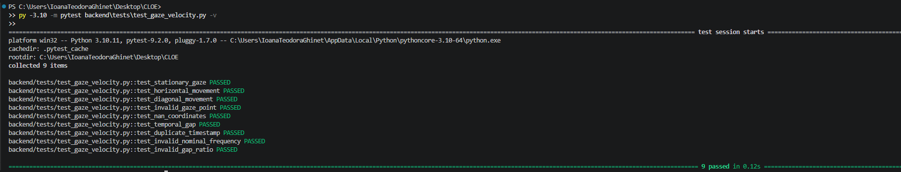
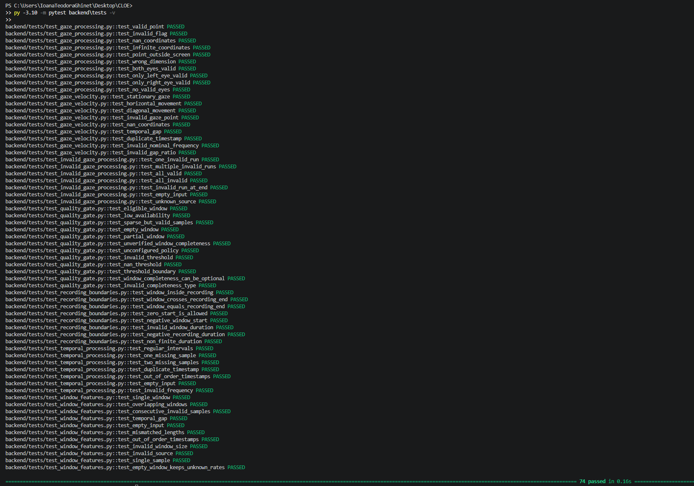
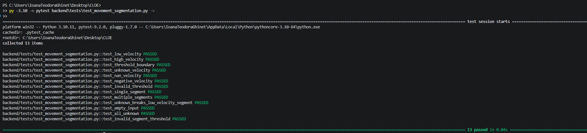
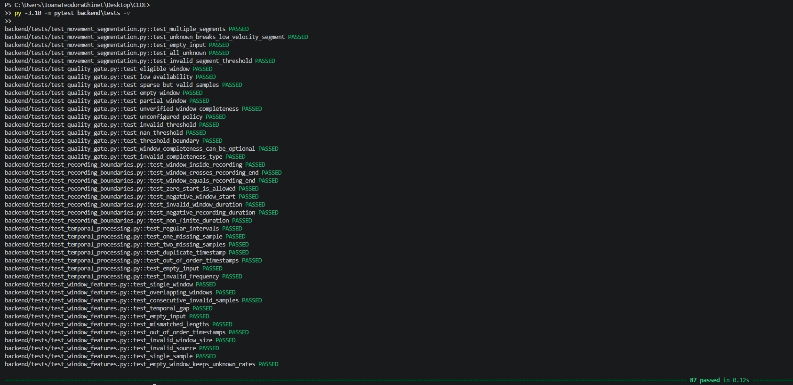
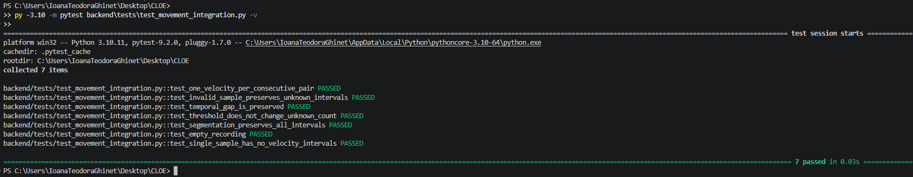
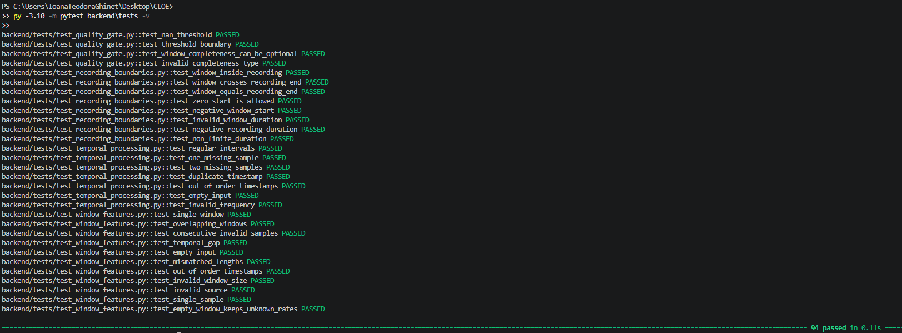
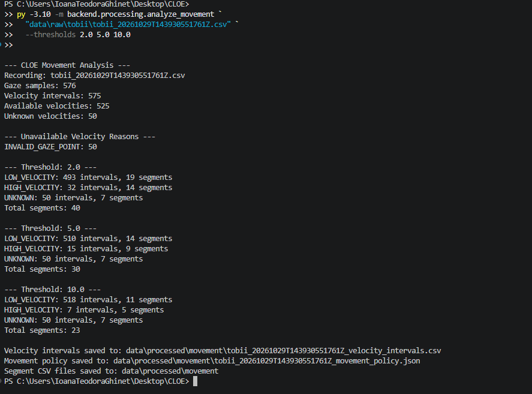
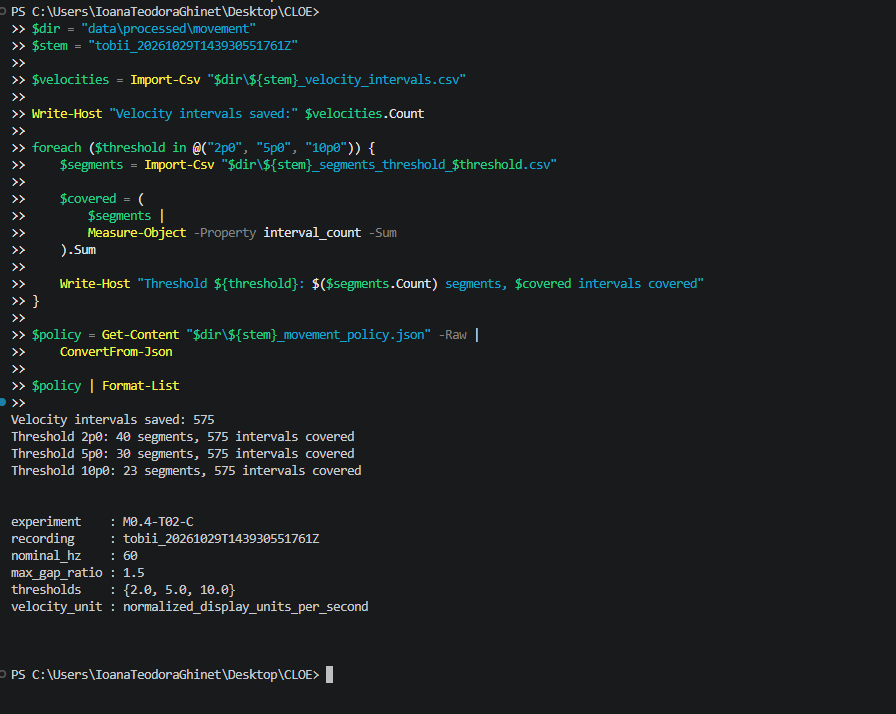

# CLOE — M0.4: Oculomotor Feature Extraction

**Project:** Cognitive Load Occlusion Engine  
**Milestone:** M0.4 — Oculomotor Feature Extraction  
**Date opened:** 2026-11-11  
**Status:** IN PROGRESS — T01, T02-A and T02-B Software Validation Completed

---

## 1. Milestone Objective

Develop, test, and evaluate algorithms for extracting preliminary oculomotor features from Tobii Pro Nano eye-tracking recordings.

This milestone builds upon the acquisition, gaze validation, binocular fusion, temporal processing, sliding-window feature extraction, and data-quality assessment components implemented during M0.2 and M0.3.

The goal is to characterize gaze movement patterns while maintaining strict separation between observed eye-tracking measurements, algorithmically derived movement features, and cognitive-load inference.

Oculomotor features are not treated as direct or independently validated measurements of cognitive load.

### 1.1 Milestone Progress

| Task | Description | Status |
|---|---|---|
| T01 | Gaze Velocity Calculation | PASS — Unit and regression testing |
| T02-A | Velocity State Classification | PASS — Unit and regression testing |
| T02-B | Consecutive State Segmentation | PASS — Unit and regression testing |
| T02-C | Real Recording Integration | PENDING |
| T03 | Oculomotor Feature Extraction | PLANNED |
| T04 | Window-Level Integration | PLANNED |
| T05 | Real Data Validation | PLANNED |

---

## 2. T01 — Gaze Velocity Calculation

**Date:** 2026-11-11  
**Status:** PASS — Software Validation

**Implementation:** `backend/processing/gaze_velocity.py`  
**Tests:** `backend/tests/test_gaze_velocity.py`

### 2.1 Objective

Implement and validate a reusable function that calculates average gaze displacement velocity between consecutive gaze measurements.

The function must handle invalid coordinates, non-positive timestamp intervals, and temporal gaps without generating misleading velocity values.

### 2.2 Methodology

The algorithm receives two gaze points and their associated device timestamps.

Gaze coordinates are expressed in normalized display-area coordinates.

Timestamps are expressed in microseconds.

The Euclidean displacement between two gaze points is calculated as:

$$
d = \sqrt{(x_2-x_1)^2 + (y_2-y_1)^2}
$$

Average displacement velocity is then calculated as:

$$
v = \frac{d}{\Delta t}
$$

where the elapsed time is converted from microseconds to seconds.

The resulting velocity is expressed in normalized display units per second.

This value must not be interpreted as angular eye velocity in degrees per second.

### 2.3 Data Validation

Before calculating velocity, the implementation verifies:

1. The nominal sampling frequency is positive and finite.
2. The maximum temporal gap ratio is valid.
3. The timestamp interval is positive.
4. Both gaze points contain two finite numerical coordinates.
5. The temporal interval does not exceed the configured diagnostic gap threshold.

If a velocity cannot be calculated, the function returns an unavailable result together with a diagnostic reason.

Supported reasons include:

| Reason | Description |
|---|---|
| `INVALID_GAZE_POINT` | At least one gaze point contains unusable coordinates |
| `NON_POSITIVE_INTERVAL` | Timestamp interval is zero or negative |
| `TEMPORAL_GAP` | Timestamp interval exceeds the configured diagnostic threshold |

Invalid measurements are not replaced with artificial coordinates.

### 2.4 Experimental Configuration

| Parameter | Value |
|---|---|
| Nominal sampling frequency | 60 Hz |
| Nominal sampling interval | Approximately 16.67 ms |
| Maximum temporal gap ratio | 1.5 |
| Diagnostic temporal gap threshold | Approximately 25 ms |
| Velocity unit | Normalized display units/second |

The gap threshold is an engineering heuristic adopted for the initial implementation.

It is not a scientifically validated threshold for identifying physiological eye-movement events.

### 2.5 Unit Testing

**Execution command:**

```powershell
py -3.10 -m pytest backend\tests\test_gaze_velocity.py -v
```

**Observed results:**

| Test | Expected behavior | Result |
|---|---|---|
| `test_stationary_gaze` | Zero velocity for identical points | PASS |
| `test_horizontal_movement` | Correct horizontal displacement velocity | PASS |
| `test_diagonal_movement` | Correct Euclidean displacement velocity | PASS |
| `test_invalid_gaze_point` | Unavailable velocity | PASS |
| `test_nan_coordinates` | Reject unusable numerical coordinates | PASS |
| `test_temporal_gap` | Reject velocity across a large timestamp gap | PASS |
| `test_duplicate_timestamp` | Reject non-positive timestamp interval | PASS |
| `test_invalid_nominal_frequency` | Raise `ValueError` | PASS |
| `test_invalid_gap_ratio` | Raise `ValueError` | PASS |

**Unit test result: 9/9 PASSED in 0.12 seconds.**

### 2.6 Evidence — Unit Testing



*Figure 1. Successful execution of all nine gaze velocity unit tests.*

### 2.7 Regression Testing

**Execution command:**

```powershell
py -3.10 -m pytest backend\tests -v
```

**Observed result:** 74/74 tests PASSED in 0.16 seconds.

**Test environment:**

- Operating system: Windows 11 Education, 64-bit.
- Python: 3.10.11.
- pytest: 9.2.0.

No regressions were detected by the existing test suite.

### 2.8 Evidence — Regression Testing



*Figure 2. Complete backend regression suite after T01 — 74 tests passed.*

### 2.9 Interpretation

The implementation behaved as expected across all nine defined synthetic test scenarios.

It correctly calculated average displacement velocity for valid measurements and prevented velocity calculation across invalid or temporally unreliable pairs.

The regression results indicate that the new functionality did not introduce failures detectable by the existing tests.

### 2.10 Limitations

- The function estimates average displacement velocity between discrete samples, not instantaneous eye velocity.
- The calculated velocity is expressed in normalized display units per second, not visual degrees per second.
- The temporal gap threshold is heuristic.
- The implementation does not directly classify fixation or saccade events.
- The tests use synthetic input values.
- Real Tobii recording integration remains pending.
- Performance against annotated eye-movement events has not been established.

### 2.11 Conclusion

**Result: PASS — Software Validation**

The gaze velocity calculation function passed all nine unit tests and the complete 74-test regression suite.

The implementation is ready for integration with real recorded gaze measurements.

---

## 3. T02 — Gaze Movement State Segmentation

**Date:** 2026-11-12  
**Status:** PASS — T02-A and T02-B Software Validation

**Implementation:** `backend/processing/movement_segmentation.py`  
**Tests:** `backend/tests/test_movement_segmentation.py`

### 3.1 Objective

Develop an algorithm that classifies individual gaze displacement velocities and groups consecutive classifications into temporal movement-state segments.

The algorithm aims to characterize relatively slow and fast gaze movement patterns without assigning unvalidated physiological fixation or saccade labels.

T02 consists of three sub-experiments:

| Subtask | Description | Status |
|---|---|---|
| T02-A | Velocity State Classification | PASS |
| T02-B | Consecutive State Segmentation | PASS |
| T02-C | Real Tobii Recording Integration | PENDING |

---

## 3.2 T02-A — Velocity State Classification

### Objective

Implement a reusable function that assigns movement-state labels to individual gaze displacement velocities using an explicitly configured experimental threshold.

### Implementation

**Function:** `classify_velocity(velocity, threshold)`

The function receives:

- A velocity value expressed in normalized display units per second.
- A positive, finite velocity threshold.

It returns one of three states:

| State | Interpretation |
|---|---|
| `LOW_VELOCITY` | Velocity is below the configured threshold |
| `HIGH_VELOCITY` | Velocity is equal to or above the configured threshold |
| `UNKNOWN` | Velocity is unavailable or non-finite |

### Classification Rules

For a valid velocity \(v\) and threshold \(\theta\):

$$
v < \theta \Rightarrow \text{LOW\_VELOCITY}
$$

$$
v \geq \theta \Rightarrow \text{HIGH\_VELOCITY}
$$

Unavailable velocity measurements are classified as `UNKNOWN`.

Negative velocity values are rejected because displacement speed cannot be negative.

### Design Decisions

1. Require the classification threshold to be explicitly supplied.
2. Reject non-positive or non-finite thresholds.
3. Preserve unavailable measurements as `UNKNOWN`.
4. Avoid converting unavailable velocity values into zero.
5. Keep classification independent of hardware acquisition.
6. Use descriptive state labels instead of physiological event labels.
7. Avoid cognitive-load inference at this stage.

### Interpretation

The classification function provides a deterministic mapping from numerical velocity values to movement-state labels.

However, the threshold has not been experimentally calibrated.

Consequently, `LOW_VELOCITY` and `HIGH_VELOCITY` must not be interpreted as confirmed fixations or saccades.

---

## 3.3 T02-B — Consecutive State Segmentation

### Objective

Identify and group consecutive velocity intervals that share the same movement-state classification.

### Implementation

**Function:** `segment_velocity_states(velocity_results, threshold)`

The function receives a sequence of velocity results produced by `calculate_gaze_velocity()`.

For each velocity result, the algorithm:

1. Obtains the velocity value.
2. Applies the classification function from T02-A.
3. Preserves unavailable intervals as `UNKNOWN`.
4. Groups consecutive intervals with identical states.
5. Records each segment's start index, end index, and interval count.

### Segment Structure

Each detected segment contains:

| Field | Description |
|---|---|
| `state` | LOW_VELOCITY, HIGH_VELOCITY, or UNKNOWN |
| `start_interval_index` | Index of the first velocity interval |
| `end_interval_index` | Index of the last velocity interval (inclusive) |
| `interval_count` | Number of consecutive velocity intervals |

### Example

**Input velocities:**

```python
[2.0, 3.0, 1.0, 12.0, 15.0, None, 2.0, 3.0]
```

**Illustrative threshold:** `10.0` normalized display units/second.

**Expected segmentation:**

| Segment | State | Interval indices | Interval count |
|---|---|---|---:|
| 1 | LOW_VELOCITY | 0–2 | 3 |
| 2 | HIGH_VELOCITY | 3–4 | 2 |
| 3 | UNKNOWN | 5 | 1 |
| 4 | LOW_VELOCITY | 6–7 | 2 |

The unavailable interval interrupts the movement sequence.

The algorithm does not automatically merge segments across `UNKNOWN` intervals.

### Interval Indexing

Movement segments refer to velocity intervals rather than individual gaze sample indices.

For \(n\) consecutive gaze samples, there are at most \(n-1\) velocity intervals.

For example:

```text
Sample 0 ---- Sample 1 ---- Sample 2 ---- Sample 3
       V0             V1             V2
```

A segment spanning velocity interval indices 1–2 corresponds to the two intervals connecting samples 1, 2, and 3.

Segment duration cannot be determined reliably from interval count alone when timestamps are irregular.

### Computational Complexity

The algorithm classifies velocities and groups consecutive states through sequential processing.

**Time complexity:** `O(n)`

**Auxiliary space complexity:** `O(n)`

Here, \(n\) represents the number of velocity intervals.

### Design Decisions

- Preserve the original ordering of velocity measurements.
- Use interval-based indexing.
- Keep state classification separate from segmentation.
- Preserve `UNKNOWN` interruptions.
- Avoid interpolation across invalid intervals.
- Do not merge disconnected low-velocity segments.
- Defer minimum-duration rules, smoothing, and hysteresis until further evaluation.

### Interpretation

The implementation produces structured movement-state segments that can later support extraction of candidate oculomotor features.

The algorithm does not yet determine exact event durations or identify physiological fixation and saccade events.

---

## 3.4 T02-A/B — Unit Testing

**Test file:** `backend/tests/test_movement_segmentation.py`

**Execution command:**

```powershell
py -3.10 -m pytest backend\tests\test_movement_segmentation.py -v
```

### Observed Results

| Test | Expected behavior | Result |
|---|---|---|
| `test_low_velocity` | Identify LOW_VELOCITY | PASS |
| `test_high_velocity` | Identify HIGH_VELOCITY | PASS |
| `test_threshold_boundary` | Handle velocity equal to threshold | PASS |
| `test_unknown_velocity` | Preserve unavailable velocity as UNKNOWN | PASS |
| `test_nan_velocity` | Handle non-finite velocity | PASS |
| `test_negative_velocity` | Reject negative velocity | PASS |
| `test_invalid_threshold` | Reject invalid threshold | PASS |
| `test_single_segment` | Correctly identify one segment | PASS |
| `test_multiple_segments` | Identify consecutive state transitions | PASS |
| `test_unknown_breaks_low_velocity_segment` | Preserve UNKNOWN interruptions | PASS |
| `test_empty_input` | Handle an empty sequence | PASS |
| `test_all_unknown` | Detect one UNKNOWN segment | PASS |
| `test_invalid_segment_threshold` | Reject invalid segmentation threshold | PASS |

**Observed unit test result: 13/13 PASSED in 0.04 seconds.**

### Evidence — Unit Testing



*Figure 3. Successful execution of all thirteen movement segmentation unit tests.*

---

## 3.5 T02-A/B — Regression Testing

**Execution command:**

```powershell
py -3.10 -m pytest backend\tests -v
```

**Observed result: 87/87 PASSED in 0.12 seconds.**

**Environment:** Windows 11 Education, Python 3.10.11, pytest 9.2.0.

The complete regression suite passed after integrating the new movement-state classification and segmentation functions.

No regressions were detected by the current tests.

### Evidence — Regression Testing



*Figure 4. Complete backend regression suite after T02-A/B — 87 tests passed.*

---

## 3.6 T02-A/B — Interpretation

The algorithms successfully passed the defined synthetic test scenarios.

T02-A correctly classified individual velocity values according to an explicitly configured threshold.

T02-B correctly grouped consecutive movement-state classifications into segments and preserved interruptions caused by unavailable velocity measurements.

The results demonstrate the expected software behavior for the tested inputs.

However, the experimental threshold has not been calibrated against annotated eye-movement events.

The current movement-state labels are preliminary algorithmic categories rather than physiologically validated fixation or saccade labels.

---

## 3.7 T02-A/B — Limitations

The following limitations remain:

1. The classification threshold is experimental and has not been validated.
2. The algorithm uses normalized display displacement velocity rather than angular eye velocity.
3. Measurements were tested using synthetic sequences.
4. Segmentation has not yet been evaluated against real Tobii gaze recordings.
5. The current implementation does not enforce minimum event durations.
6. Smoothing and hysteresis have not been implemented.
7. Short fluctuations around the threshold may produce fragmented segments.
8. No ground-truth comparison has been performed.
9. No fixation or saccade detection accuracy can currently be reported.
10. No cognitive-load classification is performed.

---

## 3.8 T02-A/B — Conclusion

**Result: PASS — Unit Testing and Regression Validation**

The velocity classification and consecutive state segmentation algorithms were successfully implemented and tested.

All thirteen unit tests passed.

The complete backend regression suite also passed, with 87 successful tests.

The implementation is ready for initial integration with real Tobii Pro Nano gaze measurements.

---

## 4. T02-C — Real Tobii Recording Integration

**Date:** 2026-11-12  
**Status:** PASS — Initial Real Data Integration and Regression Testing

**Implementation:** `backend/processing/analyze_movement.py`  
**Integration tests:** `backend/tests/test_movement_integration.py`

### 4.1 Objective

Integrate binocular gaze fusion, average gaze displacement velocity calculation, and movement-state segmentation into a reusable processing workflow.

Evaluate the implementation using a real Tobii Pro Nano recording and investigate how experimental velocity thresholds influence movement-state classification.

### 4.2 Input Recording

**Recording:** `tobii_20261029T143930551761Z.csv`

| Property | Observed value |
|---|---:|
| Recorded gaze samples | 576 |
| Nominal sampling frequency | 60 Hz |
| Invalid gaze samples | 44 |
| Invalid gaze runs | 7 |
| Previously detected large timestamp gaps | 4 |

### 4.3 Methodology

1. Load the original Tobii CSV without modifying its contents.
2. Preserve the original sample order and device timestamps.
3. Combine left-eye and right-eye gaze measurements using the existing binocular fusion algorithm.
4. Calculate displacement velocity between consecutive samples.
5. Preserve unavailable velocities with diagnostic reasons.
6. Apply velocity-state classification using three experimental thresholds.
7. Group consecutive classifications into movement-state segments.
8. Export velocity intervals, segmentation results, and experimental configuration metadata.
9. Execute integration unit tests and full regression testing.

### 4.4 Experimental Configuration

| Parameter | Value |
|---|---|
| Nominal frequency | 60 Hz |
| Maximum temporal gap ratio | 1.5 |
| Velocity unit | Normalized display units/second |
| Experimental thresholds | 2.0, 5.0, 10.0 |
| Classification states | LOW_VELOCITY, HIGH_VELOCITY, UNKNOWN |

The thresholds are experimental engineering values and have not been calibrated against annotated fixation or saccade events.

### 4.5 Observed Velocity Results

| Metric | Result |
|---|---:|
| Input gaze samples | 576 |
| Velocity intervals | 575 |
| Available velocities | 525 |
| Unavailable velocities | 50 |
| Available velocity percentage | 91.30% |
| Unavailable velocity percentage | 8.70% |
| Unavailability reason: INVALID_GAZE_POINT | 50 |
| Unavailability reason: TEMPORAL_GAP | 0, as separately reported |

The previous M0.3 experiment detected four large timestamp gaps. These do not appear as independent `TEMPORAL_GAP` reasons in the current velocity analysis because the corresponding intervals also involve invalid gaze measurements.

Diagnostic reasons are assigned according to the validation order implemented by the velocity calculation function.

### 4.6 Movement-State Results

| Metric | Threshold 2.0 | Threshold 5.0 | Threshold 10.0 |
|---|---:|---:|---:|
| LOW_VELOCITY intervals | 493 | 510 | 518 |
| HIGH_VELOCITY intervals | 32 | 15 | 7 |
| UNKNOWN intervals | 50 | 50 | 50 |
| LOW_VELOCITY segments | 19 | 14 | 11 |
| HIGH_VELOCITY segments | 14 | 9 | 5 |
| UNKNOWN segments | 7 | 7 | 7 |
| Total segments | 40 | 30 | 23 |

### 4.7 Consistency Checks

**Check 1 — Number of velocity intervals**

576 recorded gaze samples produced 575 consecutive sample pairs.

**Result: PASS**

**Check 2 — Velocity availability**

525 available + 50 unavailable = 575 total intervals.

**Result: PASS**

**Check 3 — State classification**

Each experimental threshold classified all 575 intervals into exactly one of the three movement states.

**Result: PASS**

**Check 4 — UNKNOWN invariance**

The UNKNOWN interval count remained 50 across all three experimental thresholds.

**Result: PASS**

**Check 5 — Segment counts**

The reported segment counts were internally consistent with their LOW, HIGH, and UNKNOWN categories for each threshold.

**Result: PASS**

### 4.8 Key Findings

**Finding 1 — Sensitivity to classification thresholds**

As the experimental threshold increased, more velocity intervals were classified as LOW_VELOCITY.

HIGH_VELOCITY interval counts decreased from 32 at threshold 2.0 to 7 at threshold 10.0.

The total number of detected segments decreased from 40 to 23.

This demonstrates sensitivity of movement-state segmentation to the selected threshold.

**Finding 2 — Preserved data-quality interruptions**

The number of UNKNOWN intervals remained unchanged across threshold configurations.

This is consistent with the intended separation between unavailable velocity measurements and threshold-based movement classification.

**Finding 3 — Relationship with invalid gaze samples**

The recording contained 44 invalid gaze samples grouped into seven invalid runs.

Because velocity is calculated between consecutive samples, an invalid sample can make multiple adjacent velocity intervals unavailable.

The 50 UNKNOWN intervals were therefore compatible with the previously observed invalid-run structure.

**Finding 4 — Diagnostic reason precedence**

All unavailable velocities were reported with the reason `INVALID_GAZE_POINT`.

Previously detected temporal gaps overlapped regions of unavailable gaze data.

The velocity calculation function reports one diagnostic reason per interval, so temporal irregularities may be masked by earlier validity checks.

### 4.9 Integration Testing

**Command:**

```powershell
py -3.10 -m pytest backend\tests\test_movement_integration.py -v
```

**Observed result:** 7/7 PASSED in 0.03 seconds.

The tests covered consecutive sample-pair processing, invalid gaze interruptions, temporal gaps, threshold invariance of UNKNOWN intervals, complete segment coverage, empty inputs, and single-sample recordings.

### 4.10 Regression Testing

**Command:**

```powershell
py -3.10 -m pytest backend\tests -v
```

**Observed result:** 94/94 PASSED in 0.11 seconds.

**Environment:** Windows 11 Education, Python 3.10.11, pytest 9.2.0.

No regressions were detected by the existing tests.

### 4.11 Output Artifacts

**Generated directory:** `data/processed/movement/`

The integration script reported saving:


- Interval-level gaze velocity CSV.
- Segment CSV files for thresholds 2.0, 5.0, and 10.0.
- Experimental movement policy JSON.

Independent file read-back verification remains pending.

### 4.12 Limitations

- The experiment uses one Tobii Pro Nano recording.
- Classification thresholds have not been empirically calibrated.
- Velocity is expressed in normalized display units/second, not visual degrees/second.
- Movement states do not represent confirmed physiological fixation or saccade events.
- The analysis does not implement minimum event durations, hysteresis, or smoothing.
- Segments have not been compared against ground-truth eye-movement annotations.
- The single-reason diagnostic approach does not preserve every simultaneously applicable data-quality issue.
- Generated output files have not yet undergone independent read-back verification.
- No cognitive-load inference is performed.

### 4.13 Evidence

**Integration unit tests:**



**Real Tobii movement analysis:**



**Full regression suite:**



### 4.14 Conclusion

**Result: PASS — Initial Real Data Integration and Regression Testing**

The movement analysis pipeline successfully processed 576 recorded gaze samples, generated 575 velocity intervals, and evaluated movement-state segmentation using three experimental thresholds.

All seven integration tests and the complete 94-test regression suite passed.

The results demonstrate the expected software behavior and the sensitivity of segmentation to threshold selection.

Further work is required to verify the exported artifacts, assess temporal segment durations, evaluate threshold selection, and establish physiological event validity.

### 4.15 Output Artifact Read-Back Verification

**Date:** 2026-11-12  
**Status:** PASS

#### Objective

Independently verify that the movement-analysis output files were saved successfully and contain the expected number of velocity intervals and movement-state segments.

#### Methodology

The exported CSV files were loaded using PowerShell's `Import-Csv` command.

The number of velocity records and segment records was inspected for all three experimental thresholds.

For each segmentation output, the `interval_count` values were summed to verify complete interval coverage.

The experimental policy JSON was independently loaded using `Get-Content -Raw` and `ConvertFrom-Json`.

#### Observed Results

| Verification | Result |
|---|---|
| Velocity interval CSV | PASS — 575 records |
| Threshold 2.0 segmentation | PASS — 40 segments |
| Threshold 5.0 segmentation | PASS — 30 segments |
| Threshold 10.0 segmentation | PASS — 23 segments |
| Threshold 2.0 interval coverage | PASS — 575 intervals |
| Threshold 5.0 interval coverage | PASS — 575 intervals |
| Threshold 10.0 interval coverage | PASS — 575 intervals |
| Policy JSON read-back | PASS |

#### Verified Policy Configuration

| Parameter | Value |
|---|---|
| Experiment | M0.4-T02-C |
| Nominal sampling frequency | 60 Hz |
| Maximum temporal gap ratio | 1.5 |
| Experimental thresholds | 2.0, 5.0, 10.0 |
| Velocity unit | normalized_display_units_per_second |

#### Interpretation

The output files were successfully read back and contained the expected record counts.

For each experimental threshold, the sum of all segment interval counts equaled the total number of velocity intervals.

This supports the completeness of the exported segmentation counts.

The verification does not independently validate every segment boundary or the physiological meaning of the movement-state labels.

#### Conclusion

**Result: PASS — Output Read-Back Verification**

The movement-analysis results and experimental configuration were successfully persisted and independently inspected.

Together with the previously observed integration tests and regression results, this completes the planned initial software and real-data validation of T02-C.

#### Evidence

