# CLOE — M0.4: Oculomotor Feature Extraction

**Project:** Cognitive Load Occlusion Engine  
**Milestone:** M0.4 — Oculomotor Feature Extraction  
**Date opened:** 2026-11-11  
**Status:** IN PROGRESS — T01, T02-A and T02-B Software Validation Completed

---

## 1. Milestone Objective

Develop, test, and evaluate algorithms for extracting preliminary oculomotor features from Tobii Pro Nano eye-tracking recordings.

This milestone builds upon the acquisition, gaze validation, binocular fusion, temporal processing, sliding-window feature extraction, and data-quality assessment components implemented during M0.2 and M0.3.

The goal is to characterize gaze movement patterns while maintaining strict separation between observed eye-tracking measurements, algorithmically derived movement features, and cognitive-load inference.

Oculomotor features are not treated as direct or independently validated measurements of cognitive load.

### 1.1 Milestone Progress

| Task | Description | Status |
|---|---|---|
| T01 | Gaze Velocity Calculation | PASS — Unit and regression testing |
| T02-A | Velocity State Classification | PASS — Unit and regression testing |
| T02-B | Consecutive State Segmentation | PASS — Unit and regression testing |
| T02-C | Real Recording Integration | PENDING |
| T03 | Oculomotor Feature Extraction | PLANNED |
| T04 | Window-Level Integration | PLANNED |
| T05 | Real Data Validation | PLANNED |

---

## 2. T01 — Gaze Velocity Calculation

**Date:** 2026-11-11  
**Status:** PASS — Software Validation

**Implementation:** `backend/processing/gaze_velocity.py`  
**Tests:** `backend/tests/test_gaze_velocity.py`

### 2.1 Objective

Implement and validate a reusable function that calculates average gaze displacement velocity between consecutive gaze measurements.

The function must handle invalid coordinates, non-positive timestamp intervals, and temporal gaps without generating misleading velocity values.

### 2.2 Methodology

The algorithm receives two gaze points and their associated device timestamps.

Gaze coordinates are expressed in normalized display-area coordinates.

Timestamps are expressed in microseconds.

The Euclidean displacement between two gaze points is calculated as:

$$
d = \sqrt{(x_2-x_1)^2 + (y_2-y_1)^2}
$$

Average displacement velocity is then calculated as:

$$
v = \frac{d}{\Delta t}
$$

where the elapsed time is converted from microseconds to seconds.

The resulting velocity is expressed in normalized display units per second.

This value must not be interpreted as angular eye velocity in degrees per second.

### 2.3 Data Validation

Before calculating velocity, the implementation verifies:

1. The nominal sampling frequency is positive and finite.
2. The maximum temporal gap ratio is valid.
3. The timestamp interval is positive.
4. Both gaze points contain two finite numerical coordinates.
5. The temporal interval does not exceed the configured diagnostic gap threshold.

If a velocity cannot be calculated, the function returns an unavailable result together with a diagnostic reason.

Supported reasons include:

| Reason | Description |
|---|---|
| `INVALID_GAZE_POINT` | At least one gaze point contains unusable coordinates |
| `NON_POSITIVE_INTERVAL` | Timestamp interval is zero or negative |
| `TEMPORAL_GAP` | Timestamp interval exceeds the configured diagnostic threshold |

Invalid measurements are not replaced with artificial coordinates.

### 2.4 Experimental Configuration

| Parameter | Value |
|---|---|
| Nominal sampling frequency | 60 Hz |
| Nominal sampling interval | Approximately 16.67 ms |
| Maximum temporal gap ratio | 1.5 |
| Diagnostic temporal gap threshold | Approximately 25 ms |
| Velocity unit | Normalized display units/second |

The gap threshold is an engineering heuristic adopted for the initial implementation.

It is not a scientifically validated threshold for identifying physiological eye-movement events.

### 2.5 Unit Testing

**Execution command:**

```powershell
py -3.10 -m pytest backend\tests\test_gaze_velocity.py -v
```

**Observed results:**

| Test | Expected behavior | Result |
|---|---|---|
| `test_stationary_gaze` | Zero velocity for identical points | PASS |
| `test_horizontal_movement` | Correct horizontal displacement velocity | PASS |
| `test_diagonal_movement` | Correct Euclidean displacement velocity | PASS |
| `test_invalid_gaze_point` | Unavailable velocity | PASS |
| `test_nan_coordinates` | Reject unusable numerical coordinates | PASS |
| `test_temporal_gap` | Reject velocity across a large timestamp gap | PASS |
| `test_duplicate_timestamp` | Reject non-positive timestamp interval | PASS |
| `test_invalid_nominal_frequency` | Raise `ValueError` | PASS |
| `test_invalid_gap_ratio` | Raise `ValueError` | PASS |

**Unit test result: 9/9 PASSED in 0.12 seconds.**

### 2.6 Evidence — Unit Testing

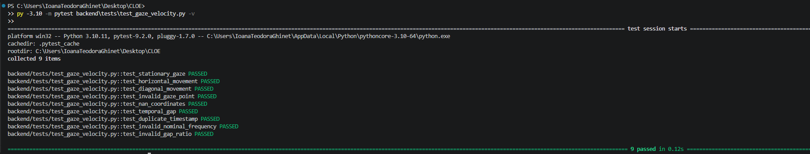

*Figure 1. Successful execution of all nine gaze velocity unit tests.*

### 2.7 Regression Testing

**Execution command:**

```powershell
py -3.10 -m pytest backend\tests -v
```

**Observed result:** 74/74 tests PASSED in 0.16 seconds.

**Test environment:**

- Operating system: Windows 11 Education, 64-bit.
- Python: 3.10.11.
- pytest: 9.2.0.

No regressions were detected by the existing test suite.

### 2.8 Evidence — Regression Testing

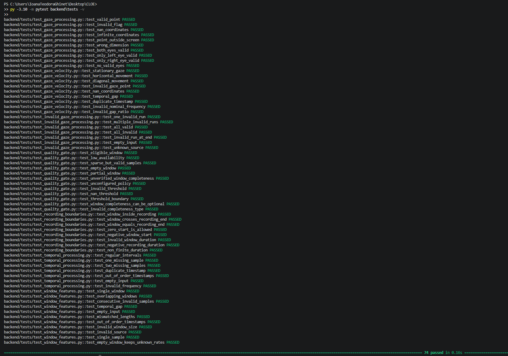

*Figure 2. Complete backend regression suite after T01 — 74 tests passed.*

### 2.9 Interpretation

The implementation behaved as expected across all nine defined synthetic test scenarios.

It correctly calculated average displacement velocity for valid measurements and prevented velocity calculation across invalid or temporally unreliable pairs.

The regression results indicate that the new functionality did not introduce failures detectable by the existing tests.

### 2.10 Limitations

- The function estimates average displacement velocity between discrete samples, not instantaneous eye velocity.
- The calculated velocity is expressed in normalized display units per second, not visual degrees per second.
- The temporal gap threshold is heuristic.
- The implementation does not directly classify fixation or saccade events.
- The tests use synthetic input values.
- Real Tobii recording integration remains pending.
- Performance against annotated eye-movement events has not been established.

### 2.11 Conclusion

**Result: PASS — Software Validation**

The gaze velocity calculation function passed all nine unit tests and the complete 74-test regression suite.

The implementation is ready for integration with real recorded gaze measurements.

---

## 3. T02 — Gaze Movement State Segmentation

**Date:** 2026-11-12  
**Status:** PASS — T02-A and T02-B Software Validation

**Implementation:** `backend/processing/movement_segmentation.py`  
**Tests:** `backend/tests/test_movement_segmentation.py`

### 3.1 Objective

Develop an algorithm that classifies individual gaze displacement velocities and groups consecutive classifications into temporal movement-state segments.

The algorithm aims to characterize relatively slow and fast gaze movement patterns without assigning unvalidated physiological fixation or saccade labels.

T02 consists of three sub-experiments:

| Subtask | Description | Status |
|---|---|---|
| T02-A | Velocity State Classification | PASS |
| T02-B | Consecutive State Segmentation | PASS |
| T02-C | Real Tobii Recording Integration | PENDING |

---

## 3.2 T02-A — Velocity State Classification

### Objective

Implement a reusable function that assigns movement-state labels to individual gaze displacement velocities using an explicitly configured experimental threshold.

### Implementation

**Function:** `classify_velocity(velocity, threshold)`

The function receives:

- A velocity value expressed in normalized display units per second.
- A positive, finite velocity threshold.

It returns one of three states:

| State | Interpretation |
|---|---|
| `LOW_VELOCITY` | Velocity is below the configured threshold |
| `HIGH_VELOCITY` | Velocity is equal to or above the configured threshold |
| `UNKNOWN` | Velocity is unavailable or non-finite |

### Classification Rules

For a valid velocity \(v\) and threshold \(\theta\):

$$
v < \theta \Rightarrow \text{LOW\_VELOCITY}
$$

$$
v \geq \theta \Rightarrow \text{HIGH\_VELOCITY}
$$

Unavailable velocity measurements are classified as `UNKNOWN`.

Negative velocity values are rejected because displacement speed cannot be negative.

### Design Decisions

1. Require the classification threshold to be explicitly supplied.
2. Reject non-positive or non-finite thresholds.
3. Preserve unavailable measurements as `UNKNOWN`.
4. Avoid converting unavailable velocity values into zero.
5. Keep classification independent of hardware acquisition.
6. Use descriptive state labels instead of physiological event labels.
7. Avoid cognitive-load inference at this stage.

### Interpretation

The classification function provides a deterministic mapping from numerical velocity values to movement-state labels.

However, the threshold has not been experimentally calibrated.

Consequently, `LOW_VELOCITY` and `HIGH_VELOCITY` must not be interpreted as confirmed fixations or saccades.

---

## 3.3 T02-B — Consecutive State Segmentation

### Objective

Identify and group consecutive velocity intervals that share the same movement-state classification.

### Implementation

**Function:** `segment_velocity_states(velocity_results, threshold)`

The function receives a sequence of velocity results produced by `calculate_gaze_velocity()`.

For each velocity result, the algorithm:

1. Obtains the velocity value.
2. Applies the classification function from T02-A.
3. Preserves unavailable intervals as `UNKNOWN`.
4. Groups consecutive intervals with identical states.
5. Records each segment's start index, end index, and interval count.

### Segment Structure

Each detected segment contains:

| Field | Description |
|---|---|
| `state` | LOW_VELOCITY, HIGH_VELOCITY, or UNKNOWN |
| `start_interval_index` | Index of the first velocity interval |
| `end_interval_index` | Index of the last velocity interval (inclusive) |
| `interval_count` | Number of consecutive velocity intervals |

### Example

**Input velocities:**

```python
[2.0, 3.0, 1.0, 12.0, 15.0, None, 2.0, 3.0]
```

**Illustrative threshold:** `10.0` normalized display units/second.

**Expected segmentation:**

| Segment | State | Interval indices | Interval count |
|---|---|---|---:|
| 1 | LOW_VELOCITY | 0–2 | 3 |
| 2 | HIGH_VELOCITY | 3–4 | 2 |
| 3 | UNKNOWN | 5 | 1 |
| 4 | LOW_VELOCITY | 6–7 | 2 |

The unavailable interval interrupts the movement sequence.

The algorithm does not automatically merge segments across `UNKNOWN` intervals.

### Interval Indexing

Movement segments refer to velocity intervals rather than individual gaze sample indices.

For \(n\) consecutive gaze samples, there are at most \(n-1\) velocity intervals.

For example:

```text
Sample 0 ---- Sample 1 ---- Sample 2 ---- Sample 3
       V0             V1             V2
```

A segment spanning velocity interval indices 1–2 corresponds to the two intervals connecting samples 1, 2, and 3.

Segment duration cannot be determined reliably from interval count alone when timestamps are irregular.

### Computational Complexity

The algorithm classifies velocities and groups consecutive states through sequential processing.

**Time complexity:** `O(n)`

**Auxiliary space complexity:** `O(n)`

Here, \(n\) represents the number of velocity intervals.

### Design Decisions

- Preserve the original ordering of velocity measurements.
- Use interval-based indexing.
- Keep state classification separate from segmentation.
- Preserve `UNKNOWN` interruptions.
- Avoid interpolation across invalid intervals.
- Do not merge disconnected low-velocity segments.
- Defer minimum-duration rules, smoothing, and hysteresis until further evaluation.

### Interpretation

The implementation produces structured movement-state segments that can later support extraction of candidate oculomotor features.

The algorithm does not yet determine exact event durations or identify physiological fixation and saccade events.

---

## 3.4 T02-A/B — Unit Testing

**Test file:** `backend/tests/test_movement_segmentation.py`

**Execution command:**

```powershell
py -3.10 -m pytest backend\tests\test_movement_segmentation.py -v
```

### Observed Results

| Test | Expected behavior | Result |
|---|---|---|
| `test_low_velocity` | Identify LOW_VELOCITY | PASS |
| `test_high_velocity` | Identify HIGH_VELOCITY | PASS |
| `test_threshold_boundary` | Handle velocity equal to threshold | PASS |
| `test_unknown_velocity` | Preserve unavailable velocity as UNKNOWN | PASS |
| `test_nan_velocity` | Handle non-finite velocity | PASS |
| `test_negative_velocity` | Reject negative velocity | PASS |
| `test_invalid_threshold` | Reject invalid threshold | PASS |
| `test_single_segment` | Correctly identify one segment | PASS |
| `test_multiple_segments` | Identify consecutive state transitions | PASS |
| `test_unknown_breaks_low_velocity_segment` | Preserve UNKNOWN interruptions | PASS |
| `test_empty_input` | Handle an empty sequence | PASS |
| `test_all_unknown` | Detect one UNKNOWN segment | PASS |
| `test_invalid_segment_threshold` | Reject invalid segmentation threshold | PASS |

**Observed unit test result: 13/13 PASSED in 0.04 seconds.**

### Evidence — Unit Testing

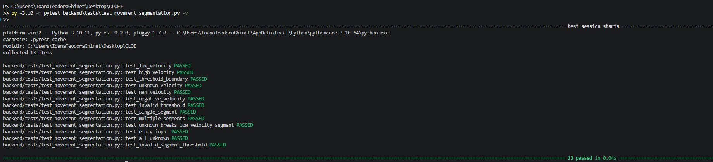

*Figure 3. Successful execution of all thirteen movement segmentation unit tests.*

---

## 3.5 T02-A/B — Regression Testing

**Execution command:**

```powershell
py -3.10 -m pytest backend\tests -v
```

**Observed result: 87/87 PASSED in 0.12 seconds.**

**Environment:** Windows 11 Education, Python 3.10.11, pytest 9.2.0.

The complete regression suite passed after integrating the new movement-state classification and segmentation functions.

No regressions were detected by the current tests.

### Evidence — Regression Testing

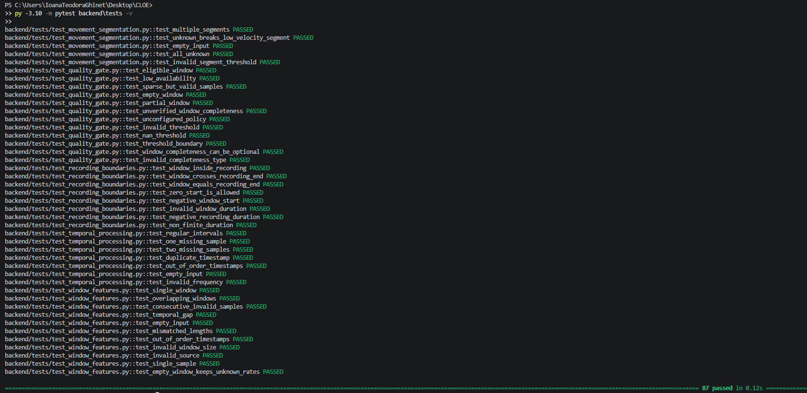

*Figure 4. Complete backend regression suite after T02-A/B — 87 tests passed.*

---

## 3.6 T02-A/B — Interpretation

The algorithms successfully passed the defined synthetic test scenarios.

T02-A correctly classified individual velocity values according to an explicitly configured threshold.

T02-B correctly grouped consecutive movement-state classifications into segments and preserved interruptions caused by unavailable velocity measurements.

The results demonstrate the expected software behavior for the tested inputs.

However, the experimental threshold has not been calibrated against annotated eye-movement events.

The current movement-state labels are preliminary algorithmic categories rather than physiologically validated fixation or saccade labels.

---

## 3.7 T02-A/B — Limitations

The following limitations remain:

1. The classification threshold is experimental and has not been validated.
2. The algorithm uses normalized display displacement velocity rather than angular eye velocity.
3. Measurements were tested using synthetic sequences.
4. Segmentation has not yet been evaluated against real Tobii gaze recordings.
5. The current implementation does not enforce minimum event durations.
6. Smoothing and hysteresis have not been implemented.
7. Short fluctuations around the threshold may produce fragmented segments.
8. No ground-truth comparison has been performed.
9. No fixation or saccade detection accuracy can currently be reported.
10. No cognitive-load classification is performed.

---

## 3.8 T02-A/B — Conclusion

**Result: PASS — Unit Testing and Regression Validation**

The velocity classification and consecutive state segmentation algorithms were successfully implemented and tested.

All thirteen unit tests passed.

The complete backend regression suite also passed, with 87 successful tests.

The implementation is ready for initial integration with real Tobii Pro Nano gaze measurements.

---

## 4. T02-C — Real Tobii Recording Integration

**Date:** 2026-11-12  
**Status:** PASS — Initial Real Data Integration and Regression Testing

**Implementation:** `backend/processing/analyze_movement.py`  
**Integration tests:** `backend/tests/test_movement_integration.py`

### 4.1 Objective

Integrate binocular gaze fusion, average gaze displacement velocity calculation, and movement-state segmentation into a reusable processing workflow.

Evaluate the implementation using a real Tobii Pro Nano recording and investigate how experimental velocity thresholds influence movement-state classification.

### 4.2 Input Recording

**Recording:** `tobii_20261029T143930551761Z.csv`

| Property | Observed value |
|---|---:|
| Recorded gaze samples | 576 |
| Nominal sampling frequency | 60 Hz |
| Invalid gaze samples | 44 |
| Invalid gaze runs | 7 |
| Previously detected large timestamp gaps | 4 |

### 4.3 Methodology

1. Load the original Tobii CSV without modifying its contents.
2. Preserve the original sample order and device timestamps.
3. Combine left-eye and right-eye gaze measurements using the existing binocular fusion algorithm.
4. Calculate displacement velocity between consecutive samples.
5. Preserve unavailable velocities with diagnostic reasons.
6. Apply velocity-state classification using three experimental thresholds.
7. Group consecutive classifications into movement-state segments.
8. Export velocity intervals, segmentation results, and experimental configuration metadata.
9. Execute integration unit tests and full regression testing.

### 4.4 Experimental Configuration

| Parameter | Value |
|---|---|
| Nominal frequency | 60 Hz |
| Maximum temporal gap ratio | 1.5 |
| Velocity unit | Normalized display units/second |
| Experimental thresholds | 2.0, 5.0, 10.0 |
| Classification states | LOW_VELOCITY, HIGH_VELOCITY, UNKNOWN |

The thresholds are experimental engineering values and have not been calibrated against annotated fixation or saccade events.

### 4.5 Observed Velocity Results

| Metric | Result |
|---|---:|
| Input gaze samples | 576 |
| Velocity intervals | 575 |
| Available velocities | 525 |
| Unavailable velocities | 50 |
| Available velocity percentage | 91.30% |
| Unavailable velocity percentage | 8.70% |
| Unavailability reason: INVALID_GAZE_POINT | 50 |
| Unavailability reason: TEMPORAL_GAP | 0, as separately reported |

The previous M0.3 experiment detected four large timestamp gaps. These do not appear as independent `TEMPORAL_GAP` reasons in the current velocity analysis because the corresponding intervals also involve invalid gaze measurements.

Diagnostic reasons are assigned according to the validation order implemented by the velocity calculation function.

### 4.6 Movement-State Results

| Metric | Threshold 2.0 | Threshold 5.0 | Threshold 10.0 |
|---|---:|---:|---:|
| LOW_VELOCITY intervals | 493 | 510 | 518 |
| HIGH_VELOCITY intervals | 32 | 15 | 7 |
| UNKNOWN intervals | 50 | 50 | 50 |
| LOW_VELOCITY segments | 19 | 14 | 11 |
| HIGH_VELOCITY segments | 14 | 9 | 5 |
| UNKNOWN segments | 7 | 7 | 7 |
| Total segments | 40 | 30 | 23 |

### 4.7 Consistency Checks

**Check 1 — Number of velocity intervals**

576 recorded gaze samples produced 575 consecutive sample pairs.

**Result: PASS**

**Check 2 — Velocity availability**

525 available + 50 unavailable = 575 total intervals.

**Result: PASS**

**Check 3 — State classification**

Each experimental threshold classified all 575 intervals into exactly one of the three movement states.

**Result: PASS**

**Check 4 — UNKNOWN invariance**

The UNKNOWN interval count remained 50 across all three experimental thresholds.

**Result: PASS**

**Check 5 — Segment counts**

The reported segment counts were internally consistent with their LOW, HIGH, and UNKNOWN categories for each threshold.

**Result: PASS**

### 4.8 Key Findings

**Finding 1 — Sensitivity to classification thresholds**

As the experimental threshold increased, more velocity intervals were classified as LOW_VELOCITY.

HIGH_VELOCITY interval counts decreased from 32 at threshold 2.0 to 7 at threshold 10.0.

The total number of detected segments decreased from 40 to 23.

This demonstrates sensitivity of movement-state segmentation to the selected threshold.

**Finding 2 — Preserved data-quality interruptions**

The number of UNKNOWN intervals remained unchanged across threshold configurations.

This is consistent with the intended separation between unavailable velocity measurements and threshold-based movement classification.

**Finding 3 — Relationship with invalid gaze samples**

The recording contained 44 invalid gaze samples grouped into seven invalid runs.

Because velocity is calculated between consecutive samples, an invalid sample can make multiple adjacent velocity intervals unavailable.

The 50 UNKNOWN intervals were therefore compatible with the previously observed invalid-run structure.

**Finding 4 — Diagnostic reason precedence**

All unavailable velocities were reported with the reason `INVALID_GAZE_POINT`.

Previously detected temporal gaps overlapped regions of unavailable gaze data.

The velocity calculation function reports one diagnostic reason per interval, so temporal irregularities may be masked by earlier validity checks.

### 4.9 Integration Testing

**Command:**

```powershell
py -3.10 -m pytest backend\tests\test_movement_integration.py -v
```

**Observed result:** 7/7 PASSED in 0.03 seconds.

The tests covered consecutive sample-pair processing, invalid gaze interruptions, temporal gaps, threshold invariance of UNKNOWN intervals, complete segment coverage, empty inputs, and single-sample recordings.

### 4.10 Regression Testing

**Command:**

```powershell
py -3.10 -m pytest backend\tests -v
```

**Observed result:** 94/94 PASSED in 0.11 seconds.

**Environment:** Windows 11 Education, Python 3.10.11, pytest 9.2.0.

No regressions were detected by the existing tests.

### 4.11 Output Artifacts

**Generated directory:** `data/processed/movement/`

The integration script reported saving:


- Interval-level gaze velocity CSV.
- Segment CSV files for thresholds 2.0, 5.0, and 10.0.
- Experimental movement policy JSON.

Independent file read-back verification remains pending.

### 4.12 Limitations

- The experiment uses one Tobii Pro Nano recording.
- Classification thresholds have not been empirically calibrated.
- Velocity is expressed in normalized display units/second, not visual degrees/second.
- Movement states do not represent confirmed physiological fixation or saccade events.
- The analysis does not implement minimum event durations, hysteresis, or smoothing.
- Segments have not been compared against ground-truth eye-movement annotations.
- The single-reason diagnostic approach does not preserve every simultaneously applicable data-quality issue.
- Generated output files have not yet undergone independent read-back verification.
- No cognitive-load inference is performed.

### 4.13 Evidence

**Integration unit tests:**

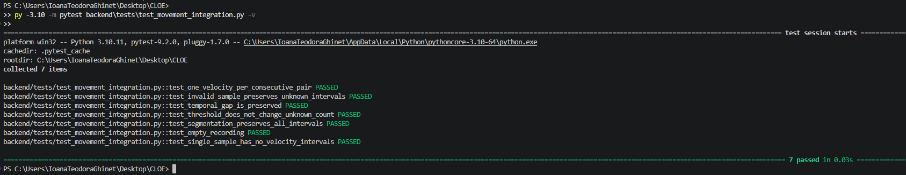

**Real Tobii movement analysis:**

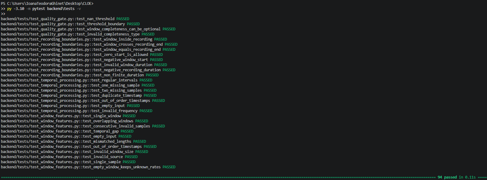

**Full regression suite:**

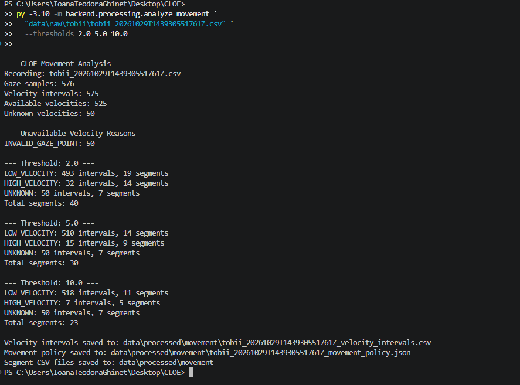

### 4.14 Conclusion

**Result: PASS — Initial Real Data Integration and Regression Testing**

The movement analysis pipeline successfully processed 576 recorded gaze samples, generated 575 velocity intervals, and evaluated movement-state segmentation using three experimental thresholds.

All seven integration tests and the complete 94-test regression suite passed.

The results demonstrate the expected software behavior and the sensitivity of segmentation to threshold selection.

Further work is required to verify the exported artifacts, assess temporal segment durations, evaluate threshold selection, and establish physiological event validity.

### 4.15 Output Artifact Read-Back Verification

**Date:** 2026-11-12  
**Status:** PASS

#### Objective

Independently verify that the movement-analysis output files were saved successfully and contain the expected number of velocity intervals and movement-state segments.

#### Methodology

The exported CSV files were loaded using PowerShell's `Import-Csv` command.

The number of velocity records and segment records was inspected for all three experimental thresholds.

For each segmentation output, the `interval_count` values were summed to verify complete interval coverage.

The experimental policy JSON was independently loaded using `Get-Content -Raw` and `ConvertFrom-Json`.

#### Observed Results

| Verification | Result |
|---|---|
| Velocity interval CSV | PASS — 575 records |
| Threshold 2.0 segmentation | PASS — 40 segments |
| Threshold 5.0 segmentation | PASS — 30 segments |
| Threshold 10.0 segmentation | PASS — 23 segments |
| Threshold 2.0 interval coverage | PASS — 575 intervals |
| Threshold 5.0 interval coverage | PASS — 575 intervals |
| Threshold 10.0 interval coverage | PASS — 575 intervals |
| Policy JSON read-back | PASS |

#### Verified Policy Configuration

| Parameter | Value |
|---|---|
| Experiment | M0.4-T02-C |
| Nominal sampling frequency | 60 Hz |
| Maximum temporal gap ratio | 1.5 |
| Experimental thresholds | 2.0, 5.0, 10.0 |
| Velocity unit | normalized_display_units_per_second |

#### Interpretation

The output files were successfully read back and contained the expected record counts.

For each experimental threshold, the sum of all segment interval counts equaled the total number of velocity intervals.

This supports the completeness of the exported segmentation counts.

The verification does not independently validate every segment boundary or the physiological meaning of the movement-state labels.

#### Conclusion

**Result: PASS — Output Read-Back Verification**

The movement-analysis results and experimental configuration were successfully persisted and independently inspected.

Together with the previously observed integration tests and regression results, this completes the planned initial software and real-data validation of T02-C.

#### Evidence

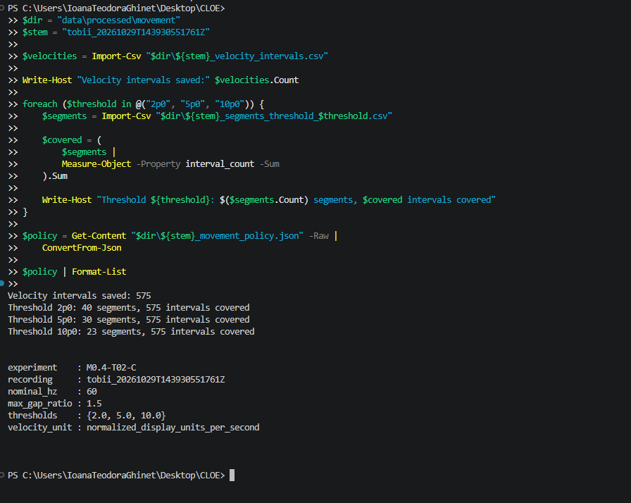

## 5. T03 — Oculomotor Feature Extraction

**Date opened:** 2026-11-17  
**Status:** IN PROGRESS

### 5.1 T03-A — Segment Duration Calculation

**Date:** 2026-11-17  
**Status:** PASS — Unit Testing and Regression Validation

**Implementation:** `backend/processing/segment_features.py`  
**Tests:** `backend/tests/test_segment_features.py`

#### Objective

Implement and validate a reusable function that calculates the observed temporal duration of movement-state segments using original Tobii device timestamps.

The implementation must correctly handle irregular timestamp intervals, validate segment boundaries, and preserve the original input data.

#### Background

The movement segmentation algorithm developed in T02 produces segment boundaries expressed as velocity interval indices.

A segment covering multiple velocity intervals must be associated with its corresponding original timestamps to calculate its duration.

Assuming perfectly regular sampling intervals would introduce inaccuracies when the actual timestamp sequence contains irregularities.

Therefore, T03-A uses the original device timestamps rather than estimating duration from the nominal sampling frequency.

#### Methodology

For each segment, the algorithm:

1. Reads the start and end velocity interval indices.
2. Validates the movement-state label.
3. Verifies index boundaries and interval counts.
4. Retrieves the timestamp associated with the beginning of the first interval.
5. Retrieves the timestamp associated with the end of the last interval.
6. Calculates the observed timestamp difference.
7. Converts the result from microseconds to milliseconds.
8. Returns the original segment information together with the calculated duration.

#### Duration Calculation

For a segment with starting interval index \(s\) and ending interval index \(e\):

$$
D_{\mathrm{ms}} = \frac{t_{e+1} - t_s}{1000}
$$

Where:

- \(D_{\mathrm{ms}}\) represents the observed segment duration in milliseconds.
- \(t_s\) represents the timestamp at the beginning of the first interval.
- \(t_{e+1}\) represents the timestamp at the end of the final interval.

The duration is calculated using actual device timestamps.

No assumption of perfectly regular 60 Hz sampling is required.

**Example:**

For timestamps:

```python
timestamps = [0, 16667, 33334, 50001]
```

A segment covering velocity intervals 1–2 has:

- Start timestamp: 16,667 µs
- End timestamp: 50,001 µs
- Observed duration: 33.334 ms

#### Output Fields

| Field | Description |
|---|---|
| `state` | Movement-state classification |
| `start_interval_index` | First interval index |
| `end_interval_index` | Last interval index, inclusive |
| `interval_count` | Number of intervals |
| `start_timestamp_us` | Timestamp at the beginning of the segment |
| `end_timestamp_us` | Timestamp at the end of the segment |
| `duration_ms` | Observed timestamp span in milliseconds |

#### Design Decisions

- Use original device timestamps instead of nominal intervals.
- Preserve interval-based indexing.
- Validate all segment boundaries and interval counts.
- Reject unknown movement-state labels.
- Reject non-increasing or malformed timestamps.
- Avoid modifying source segment dictionaries.
- Keep segment duration calculation independent of Tobii CSV parsing.
- Avoid interpreting UNKNOWN spans as confirmed durations of tracking loss.
- Avoid interpreting LOW_VELOCITY segment durations as validated fixation durations.

#### Unit Testing

**Execution command:**

```powershell
py -3.10 -m pytest backend\tests\test_segment_features.py -v
```

**Observed results:**

| Test | Expected behavior | Result |
|---|---|---|
| `test_single_interval_duration` | Correct duration for one interval | PASS |
| `test_multiple_interval_duration` | Correct duration across multiple intervals | PASS |
| `test_irregular_timestamps` | Use actual timestamp differences | PASS |
| `test_unknown_segment_has_observed_span` | Calculate observed span for UNKNOWN segment | PASS |
| `test_multiple_segments` | Process multiple independent segments | PASS |
| `test_empty_input` | Return an empty result | PASS |
| `test_segment_without_timestamps` | Reject segments without timestamps | PASS |
| `test_out_of_order_timestamps` | Reject non-increasing timestamps | PASS |
| `test_out_of_bounds_segment` | Reject invalid segment boundaries | PASS |
| `test_inconsistent_interval_count` | Reject inconsistent interval counts | PASS |
| `test_unknown_state_rejected` | Reject unsupported movement-state labels | PASS |
| `test_input_segment_not_modified` | Preserve original segment data | PASS |

**Observed unit test summary:**

```text
collected 12 items

12 passed in 0.03s
```

**Unit testing result: PASS**

All twelve unit tests passed successfully.

#### Evidence — Unit Testing

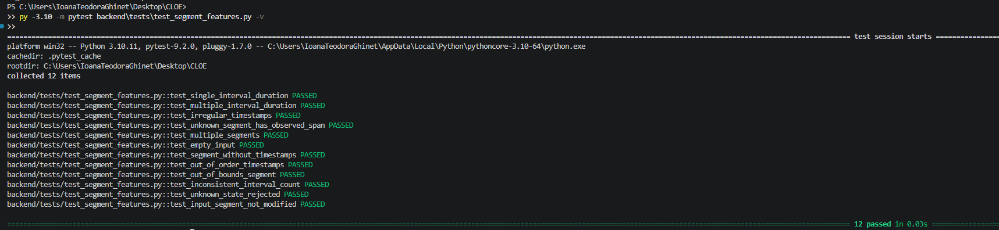

*Figure 5. Successful execution of all twelve segment duration unit tests.*

#### Regression Testing

**Execution command:**

```powershell
py -3.10 -m pytest backend\tests -v
```

**Observed result:** 106/106 PASSED in 0.18 seconds.

**Execution environment:**

- Operating system: Windows 11 Education, 64-bit
- Python version: 3.10.11
- pytest version: 9.2.0

The complete regression suite passed after introducing the segment duration calculation functionality.

No regressions were detected by the existing tests.

#### Evidence — Regression Testing

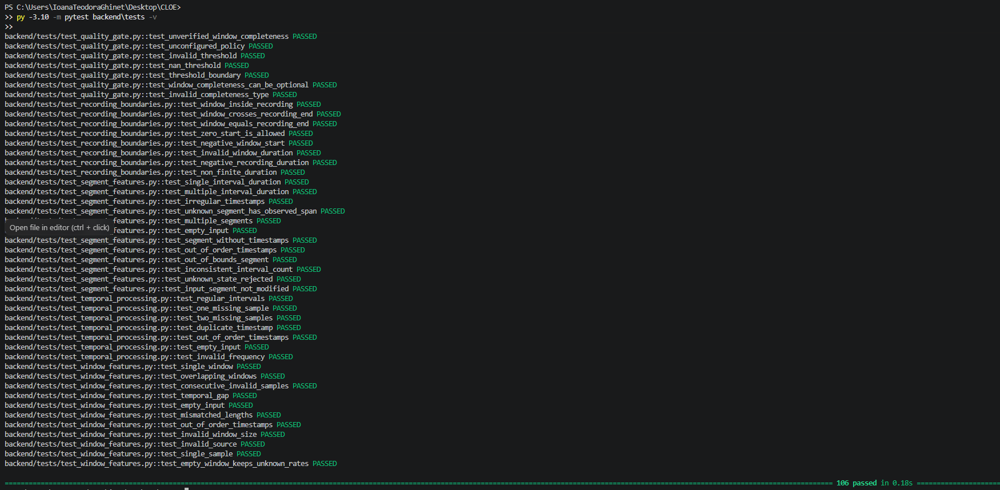

*Figure 6. Complete backend regression suite after T03-A — 106 tests passed.*

#### Interpretation

All twelve segment-duration unit tests passed.

The implementation correctly calculated timestamp-based spans for the defined synthetic scenarios, including irregular sampling intervals.

Input validation prevented invalid segment boundaries, inconsistent interval counts, and unordered timestamp sequences from producing misleading results.

The algorithm also preserved the original input segments without modification.

The successful regression test execution indicates that the new functionality did not introduce regressions detectable by the existing test suite.

#### Limitations

The current implementation calculates timestamp spans, not physiologically validated eye-movement event durations.

UNKNOWN segments may include invalid gaze intervals, temporal gaps, or other unavailable velocity measurements.

The function validates individual segment boundaries but does not independently verify that an entire segment collection is ordered, contiguous, non-overlapping, and complete.

No real-recording integration has yet been performed for segment durations.

The implementation does not estimate cognitive load.

#### Conclusion

**Result: PASS — Unit Testing and Regression Validation**

T03-A was successfully implemented and verified across twelve synthetic test scenarios.

The complete regression suite also passed, with 106 successful tests.

The implementation is ready for integration with real Tobii gaze recordings.

---
### 5.2 T03-B — Segment Velocity Statistics

**Date:** 2026-11-17  
**Status:** PASS — Unit Testing, Regression Testing and Synthetic Integration Validation

**Implementation:** `backend/processing/segment_features.py`  
**Tests:** `backend/tests/test_segment_velocity_stats.py`

---

#### 5.2.1 Objective

Implement and validate a reusable function that calculates descriptive velocity statistics for previously identified gaze movement-state segments.

The implementation must preserve unavailable measurements, reject inconsistent segment data, and remain compatible with the timestamp-based segment duration calculation developed in T03-A.

The resulting features will support subsequent recording-level and window-level oculomotor analysis.

#### 5.2.2 Background

Previous M0.4 experiments established the following processing capabilities:

- **T01:** Average gaze displacement velocity calculation.
- **T02-A:** Velocity-state classification.
- **T02-B:** Consecutive movement-state segmentation.
- **T02-C:** Integration with a real Tobii Pro Nano recording.
- **T03-A:** Timestamp-based segment duration calculation.

T03-B extends the existing processing pipeline by calculating descriptive statistics for the velocities contained within each movement-state segment.

These statistics describe algorithmically identified gaze displacement patterns.

They do not represent direct measurements of cognitive load or physiologically validated fixation and saccade events.

#### 5.2.3 Implementation

**Function:** `calculate_segment_velocity_stats(segments, velocity_results)`

The function is implemented in the existing `segment_features.py` module.

It accepts two inputs:

1. A collection of movement-state segments containing state labels and interval boundaries.
2. A sequence of interval-level velocity results.

Each segment is associated with the velocity intervals defined by its start and end indices.

The function performs the following operations:

1. Validates the segment's movement-state label.
2. Verifies the interval indices and interval count.
3. Extracts the corresponding velocity values.
4. Checks consistency between the segment state and the availability of its velocity values.
5. Calculates descriptive velocity statistics for valid LOW_VELOCITY and HIGH_VELOCITY segments.
6. Preserves unavailable numerical statistics for UNKNOWN segments.
7. Returns a new dictionary containing the original segment information and the calculated features.

The implementation does not modify the original segments or velocity results.

#### 5.2.4 Extracted Features

| Feature | Description | Unit |
|---|---|---|
| `valid_velocity_count` | Number of usable velocity intervals within the segment | Count |
| `mean_velocity` | Arithmetic mean of the segment velocities | Normalized display units/s |
| `min_velocity` | Minimum observed velocity | Normalized display units/s |
| `max_velocity` | Maximum observed velocity | Normalized display units/s |
| `std_velocity` | Population standard deviation of the segment velocities | Normalized display units/s |

The implementation uses arithmetic, non-time-weighted statistics.

This is an explicit methodological choice. Velocity intervals may have slightly different timestamp durations, and time-weighted statistics would require a separate definition and evaluation.

#### 5.2.5 Mathematical Definitions

For a segment containing \(n\) valid velocity values, the following features are calculated.

**Mean velocity**

$$
\bar{v} = \frac{1}{n}\sum_{i=1}^{n}v_i
$$

**Minimum velocity**

$$
v_{\min} = \min(v_1,\ldots,v_n)
$$

**Maximum velocity**

$$
v_{\max} = \max(v_1,\ldots,v_n)
$$

**Population standard deviation**

$$
\sigma_v = \sqrt{\frac{1}{n}\sum_{i=1}^{n}(v_i-\bar{v})^2}
$$

The population standard deviation describes the variation among all available velocity values belonging to the segment.

For a segment containing exactly one valid velocity interval, the population standard deviation is zero.

These calculations describe variability within an algorithmically defined segment and do not establish the underlying physiological eye-movement event.

#### 5.2.6 UNKNOWN Segment Handling

UNKNOWN segments represent intervals for which gaze displacement velocity is unavailable.

The implementation does not replace unavailable velocities with zero and does not generate numerical velocity statistics for these segments.

| Feature | UNKNOWN segment result |
|---|---|
| `valid_velocity_count` | 0 |
| `mean_velocity` | None |
| `min_velocity` | None |
| `max_velocity` | None |
| `std_velocity` | None |

The implementation also verifies consistency between segment labels and input velocities.

If a LOW_VELOCITY or HIGH_VELOCITY segment contains an unavailable, negative, or non-finite velocity, the function raises `ValueError`.

If an UNKNOWN segment contains an available numerical velocity, the function also raises `ValueError`.

These checks prevent inconsistencies between the movement classification and feature extraction stages from being silently accepted.

#### 5.2.7 Design Decisions

The following decisions were adopted:

1. Reuse the existing `segment_features.py` module.
2. Preserve the previously tested T03-A duration calculation.
3. Keep velocity statistics independent of Tobii CSV parsing and hardware acquisition.
4. Preserve velocity units as normalized display units per second.
5. Use arithmetic mean and population standard deviation.
6. Preserve unavailable statistics as `None`.
7. Reject inconsistent or invalid segment data.
8. Preserve the original input dictionaries without modification.
9. Retain fields generated by previous processing stages, including segment duration.
10. Keep velocity statistics separate from cognitive-load inference.

#### 5.2.8 Unit Testing

**Test file:** `backend/tests/test_segment_velocity_stats.py`

**Execution command:**

```powershell
py -3.10 -m pytest backend\tests\test_segment_velocity_stats.py -v
```

Fifteen unit tests were implemented and executed.

**Observed results:**

| Test | Expected behavior | Result |
|---|---|---|
| `test_mean_velocity` | Calculate correct arithmetic mean | PASS |
| `test_min_max_velocity` | Calculate correct minimum and maximum | PASS |
| `test_standard_deviation` | Calculate correct population standard deviation | PASS |
| `test_single_interval` | Return zero standard deviation for one value | PASS |
| `test_unknown_segment` | Preserve unavailable velocity statistics | PASS |
| `test_multiple_segments` | Calculate statistics independently for multiple segments | PASS |
| `test_empty_input` | Return an empty result | PASS |
| `test_invalid_velocity_in_valid_segment` | Reject unavailable velocity in valid segment | PASS |
| `test_nan_velocity_rejected` | Reject non-finite velocity | PASS |
| `test_negative_velocity_rejected` | Reject negative velocity | PASS |
| `test_valid_velocity_in_unknown_segment` | Reject available velocity in UNKNOWN segment | PASS |
| `test_out_of_bounds_segment` | Reject invalid interval boundaries | PASS |
| `test_inconsistent_interval_count` | Reject inconsistent segment interval count | PASS |
| `test_input_not_modified` | Preserve the original inputs | PASS |
| `test_duration_field_preserved` | Retain previously calculated duration | PASS |

**Observed unit test summary:**

```text
collected 15 items

15 passed in 0.09s
```

**Result: PASS — Unit Testing**

All fifteen unit tests passed.

The results confirm the expected behavior for the defined synthetic scenarios, including numerical calculations, UNKNOWN handling, input validation, and preservation of previous segment features.

#### 5.2.9 Evidence — Unit Testing

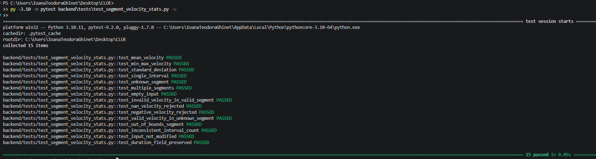

*Figure 7. Successful execution of all fifteen T03-B velocity statistics unit tests.*

#### 5.2.10 Regression Testing

The complete backend test suite was executed to verify compatibility with previously implemented CLOE components.

**Execution command:**

```powershell
py -3.10 -m pytest backend\tests -v
```

**Observed result:** 121/121 PASSED in 0.33 seconds.

**Execution environment:**

- Operating system: Windows 11 Education, 64-bit.
- Python version: 3.10.11.
- pytest version: 9.2.0.

The regression suite included the existing gaze validation, binocular fusion, temporal processing, data-quality assessment, quality gate, movement segmentation, and segment feature tests.

No regressions were detected by the current test suite.

#### 5.2.11 Evidence — Regression Testing

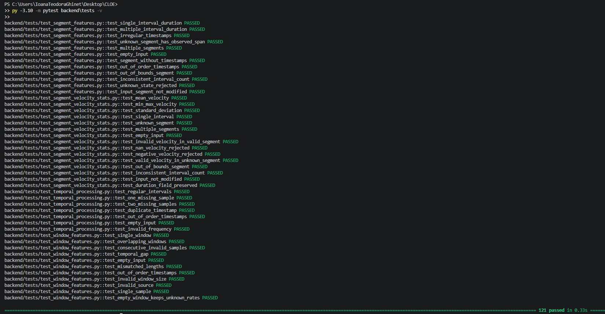

*Figure 8. Complete backend regression suite after T03-B — 121 tests passed.*

#### 5.2.12 T03-A and T03-B Integration Verification

A separate synthetic integration check was performed to verify that timestamp-based segment duration calculation and velocity statistics calculation can operate sequentially.

**Input segment:**

```python
segments = [{
    "state": "LOW_VELOCITY",
    "start_interval_index": 0,
    "end_interval_index": 2,
    "interval_count": 3,
}]
```

**Input timestamps:**

```python
timestamps = [0, 16667, 33334, 50001]
```

**Input velocity values:**

```python
velocities = [
    {"velocity": 2.0},
    {"velocity": 4.0},
    {"velocity": 6.0},
]
```

The segment duration was first calculated using `calculate_segment_durations()`.

The resulting segment was subsequently passed to `calculate_segment_velocity_stats()`.

**Observed results:**

| Feature | Observed value |
|---|---:|
| Segment state | LOW_VELOCITY |
| Start interval index | 0 |
| End interval index | 2 |
| Interval count | 3 |
| Start timestamp | 0 µs |
| End timestamp | 50,001 µs |
| `duration_ms` | 50.001 |
| `valid_velocity_count` | 3 |
| `mean_velocity` | 4.0 |
| `min_velocity` | 2.0 |
| `max_velocity` | 6.0 |
| `std_velocity` | Approximately 1.632993 |

**Verification:**

The duration matches the timestamp difference:

$$
D_{\mathrm{ms}} = \frac{50001-0}{1000}=50.001
$$

The mean velocity matches:

$$
\bar{v}=\frac{2+4+6}{3}=4
$$

The population standard deviation matches:

$$
\sigma_v=\sqrt{\frac{(2-4)^2+(4-4)^2+(6-4)^2}{3}}
=\sqrt{\frac{8}{3}}\approx1.633
$$

The output retained the original segment boundaries and the duration calculated by T03-A.

**Result: PASS — Synthetic Integration Verification**

This confirms that the two feature extraction functions can operate sequentially for the tested input.

It does not yet establish correct operation on the real Tobii recording.

#### 5.2.13 Evidence — Integration Verification

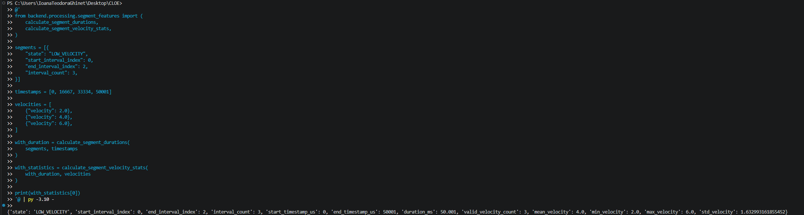

*Figure 9. Successful synthetic integration of segment duration calculation and velocity statistics extraction.*

#### 5.2.14 Interpretation

The results demonstrate that the T03-B function behaves as expected across the fifteen defined synthetic test scenarios.

The implementation calculates arithmetic velocity statistics for valid movement segments and explicitly preserves unavailable values for UNKNOWN segments.

The successful regression suite indicates that T03-B did not introduce failures detectable by the existing automated tests.

The separate integration experiment confirms that segment duration information generated by T03-A is preserved when velocity statistics are subsequently calculated.

These findings support the modularity of the processing pipeline.

However, the resulting statistics remain descriptive features of algorithmically defined gaze movement segments.

They do not independently establish physiological eye-movement event validity or cognitive-load estimation performance.

#### 5.2.15 Limitations

The current implementation has the following limitations:

- The statistics are calculated from average displacement velocities between discrete gaze samples.
- Velocity values are expressed in normalized display units per second rather than visual degrees per second.
- The arithmetic mean does not account for differences in the duration of individual velocity intervals.
- The function does not independently verify that all segments form a contiguous, non-overlapping partition of the recording.
- The implementation assumes that segment indices correspond to the supplied velocity sequence.
- It does not revalidate movement-state labels against the original classification threshold.
- The classification threshold remains experimental and unvalidated.
- The function has not yet been evaluated using real Tobii segment-level data.
- No comparison with annotated fixation or saccade events has been performed.
- No cognitive-load inference is performed.

#### 5.2.16 Conclusion

**Result: PASS — Unit Testing, Regression Testing and Synthetic Integration Validation**

The segment velocity statistics extraction function was successfully implemented and verified using fifteen unit tests.

The complete backend regression suite passed, with 121 successful tests.

A synthetic integration check also confirmed that the function can operate after timestamp-based duration calculation while preserving previously generated segment information.

T03-B is complete at the defined software-validation level.

Real-recording evaluation remains part of T03-D.

---

### 5.3 T03-C — Movement Feature Summary

**Date:** 2026-11-17  
**Status:** PASS — Unit Testing, Regression Testing and Synthetic Integration Validation

**Implementation:** `backend/processing/movement_summary.py`  
**Tests:** `backend/tests/test_movement_summary.py`

---

#### 5.3.1 Objective

Develop and validate a reusable component that aggregates movement-state segments into recording-level descriptive features.

The component must preserve UNKNOWN intervals, calculate movement-state distributions and segment-duration statistics, and verify the structural consistency of the complete segment sequence.

The resulting summary is intended to support subsequent analysis of gaze movement patterns within CLOE.

#### 5.3.2 Background

Previous M0.4 experiments established the following processing capabilities:

- **T01 — Gaze Velocity Calculation:** Calculates average gaze displacement velocity between consecutive gaze measurements.
- **T02 — Movement State Segmentation:** Classifies velocities and groups consecutive states into movement segments.
- **T03-A — Segment Duration Calculation:** Calculates observed segment durations using original device timestamps.
- **T03-B — Segment Velocity Statistics:** Calculates descriptive velocity statistics for individual movement segments.

T03-C builds upon these components by aggregating segment-level measurements into a structured recording-level feature summary.

The resulting features describe algorithmically defined movement states rather than physiologically validated fixation or saccade events.

No cognitive-load estimation is performed.

#### 5.3.3 Implementation

**Function:** `summarize_movement_segments(segments, total_intervals)`

The function receives:

1. A collection of movement-state segments enriched with observed durations.
2. The expected total number of velocity intervals.

The implementation performs the following operations:

1. Validates the total interval count.
2. Verifies that the segment collection is ordered and covers all intervals without gaps or overlaps.
3. Validates movement-state labels, interval boundaries, and interval counts.
4. Verifies that each segment duration is positive and finite.
5. Counts intervals and segments for each movement state.
6. Calculates interval proportions for LOW_VELOCITY, HIGH_VELOCITY, and UNKNOWN.
7. Calculates total, mean, and maximum segment durations by state.
8. Counts transitions between consecutive movement states.
9. Counts direct LOW/HIGH transitions.
10. Identifies internal UNKNOWN segments bounded by available movement states.
11. Returns a structured recording-level summary.

The function does not modify the original segment dictionaries.

#### 5.3.4 Extracted Features

| Feature | Description |
|---|---|
| `total_intervals` | Total number of velocity intervals |
| `segment_count` | Total number of movement-state segments |
| `interval_count_by_state` | Number of intervals classified into each state |
| `interval_share_by_state` | Proportion of intervals associated with each state |
| `segment_count_by_state` | Number of segments associated with each state |
| `total_duration_ms_by_state` | Total observed segment duration for each state |
| `mean_duration_ms_by_state` | Mean observed segment duration for each state |
| `max_duration_ms_by_state` | Maximum observed segment duration for each state |
| `transition_count` | Number of state changes between consecutive segments |
| `direct_low_high_transitions` | Number of direct LOW/HIGH transitions |
| `internal_unknown_runs` | Number of UNKNOWN segments bounded by available movement states |

These features characterize the distribution and temporal organization of algorithmically defined gaze movement states.

They do not provide direct measurements of cognitive load.

#### 5.3.5 Mathematical Definitions

**Interval share**

For a movement state \(s\), the proportion of intervals assigned to that state is:

$$
P_s = \frac{N_s}{N_{\mathrm{total}}}
$$

where:

- \(N_s\) represents the number of velocity intervals classified into state \(s\).
- \(N_{\mathrm{total}}\) represents the total number of evaluated velocity intervals.

The resulting metric represents an interval-based proportion rather than an exact percentage of recording time.

**Mean segment duration**

For a movement state containing \(k\) segments:

$$
\bar{D}_s = \frac{1}{k}\sum_{j=1}^{k}D_j
$$

where \(D_j\) represents the observed timestamp duration of segment \(j\).

If no segments exist for a particular state, its mean duration is represented as `None`.

**Maximum segment duration**

$$
D_{\max,s} = \max(D_1,\ldots,D_k)
$$

The maximum duration is also represented as `None` when the state has no segments.

#### 5.3.6 Structural Validation

The implementation validates the entire movement-segment sequence before returning summary statistics.

A nonempty sequence must cover exactly the interval indices from zero through `total_intervals - 1`.

The function rejects:

- Invalid movement-state labels.
- Non-integer segment boundaries.
- Inconsistent interval counts.
- Missing intervals between segments.
- Overlapping segment intervals.
- Segment boundaries outside the expected interval range.
- Adjacent segments with identical state labels.
- Zero, negative, or non-finite segment durations.
- Invalid total interval counts.

This validation prevents incomplete or inconsistent segment collections from being silently accepted.

#### 5.3.7 UNKNOWN Handling

UNKNOWN segments are preserved throughout the aggregation process.

The implementation distinguishes between:

- UNKNOWN interval count.
- UNKNOWN interval proportion.
- UNKNOWN segment count.
- Total observed UNKNOWN segment duration.
- Mean and maximum observed UNKNOWN segment duration.
- Internal UNKNOWN interruptions between valid movement states.

An internal UNKNOWN run is counted only when the UNKNOWN segment has available movement-state segments immediately before and after it.

UNKNOWN segments located at the beginning or end of a sequence are not counted as internal interruptions.

The observed duration of an UNKNOWN segment represents its timestamp span and does not necessarily correspond to the exact duration of eye-tracking data loss.

No interpolation or merging across UNKNOWN intervals is performed.

#### 5.3.8 Design Decisions

The following decisions were adopted:

1. Keep recording-level aggregation separate from per-segment feature extraction.
2. Validate complete interval coverage before returning summary statistics.
3. Preserve UNKNOWN segments and their interruption boundaries.
4. Distinguish interval-based proportions from time-based proportions.
5. Use actual observed segment durations rather than nominal sampling intervals.
6. Represent unavailable mean and maximum durations as `None`.
7. Reject inconsistent segment collections instead of silently correcting them.
8. Preserve original segment information without modification.
9. Avoid interpreting LOW/HIGH movement-state counts as fixation or saccade counts.
10. Avoid cognitive-load inference.

#### 5.3.9 Unit Testing

**Test file:** `backend/tests/test_movement_summary.py`

**Execution command:**

```powershell
py -3.10 -m pytest backend\tests\test_movement_summary.py -v
```

Sixteen unit tests were implemented and executed.

**Observed results:**

| Test | Expected behavior | Result |
|---|---|---|
| `test_total_segment_count` | Correctly count total segments | PASS |
| `test_interval_distribution` | Calculate interval counts and proportions | PASS |
| `test_segment_duration_statistics` | Calculate total, mean, and maximum durations | PASS |
| `test_transition_counts` | Count movement-state transitions | PASS |
| `test_internal_unknown_run` | Identify internal UNKNOWN interruptions | PASS |
| `test_empty_recording` | Handle empty input | PASS |
| `test_nonempty_recording_without_segments` | Reject missing segments | PASS |
| `test_missing_final_interval` | Reject incomplete final coverage | PASS |
| `test_gap_between_segments` | Reject gaps between segments | PASS |
| `test_overlapping_segments` | Reject overlapping intervals | PASS |
| `test_adjacent_duplicate_states` | Reject adjacent identical states | PASS |
| `test_inconsistent_interval_count` | Reject inconsistent interval counts | PASS |
| `test_invalid_duration` | Reject invalid duration values | PASS |
| `test_invalid_state` | Reject unsupported state labels | PASS |
| `test_invalid_total_intervals` | Reject invalid interval counts | PASS |
| `test_input_is_not_modified` | Preserve original input data | PASS |

**Observed unit test summary:**

```text
collected 16 items

16 passed in 0.04s
```

**Result: PASS — Unit Testing**

All sixteen test scenarios passed successfully.

The results confirm the expected behavior of the summary component for the defined synthetic inputs, including movement-state distributions, duration statistics, transition analysis, UNKNOWN handling, and structural validation.

#### 5.3.10 Evidence — Unit Testing

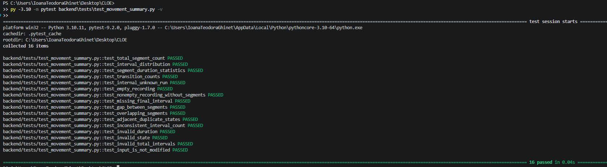

*Figure 10. Successful execution of all sixteen movement summary unit tests.*

#### 5.3.11 Regression Testing

The complete backend test suite was executed after integrating the movement summary component.

**Execution command:**

```powershell
py -3.10 -m pytest backend\tests -v
```

**Observed result:** 137/137 PASSED in 0.16 seconds.

**Execution environment:**

- Operating system: Windows 11 Education, 64-bit.
- Python version: 3.10.11.
- pytest version: 9.2.0.

The regression suite included existing gaze validation, temporal processing, data-quality assessment, quality gate, velocity calculation, movement segmentation, segment duration, segment velocity statistics, and movement summary tests.

No regressions were detected by the current test suite.

#### 5.3.12 Evidence — Regression Testing

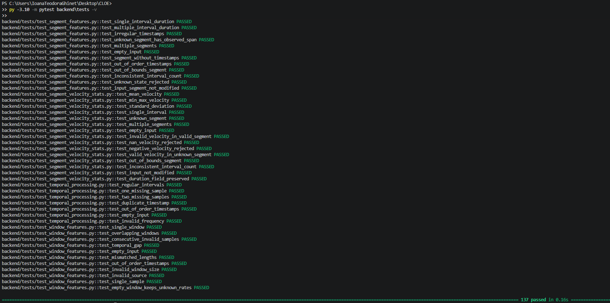

*Figure 11. Complete backend regression suite after T03-C — 137 tests passed.*

#### 5.3.13 T03-A/B/C — Synthetic Integration Verification

A separate synthetic integration experiment was performed to verify that the three processing components could operate sequentially.

**Processing sequence:**

```text
Movement-state segments
        |
        v
calculate_segment_durations()
        |
        v
calculate_segment_velocity_stats()
        |
        v
summarize_movement_segments()
        |
        v
Recording-level movement feature summary
```

**Input data:**

```python
timestamps = [0, 10000, 20000, 30000, 40000]

segments = [
    {
        "state": "LOW_VELOCITY",
        "start_interval_index": 0,
        "end_interval_index": 1,
        "interval_count": 2,
    },
    {
        "state": "HIGH_VELOCITY",
        "start_interval_index": 2,
        "end_interval_index": 3,
        "interval_count": 2,
    },
]

velocities = [
    {"velocity": 2.0},
    {"velocity": 4.0},
    {"velocity": 12.0},
    {"velocity": 16.0},
]
```

The original segments were first enriched with observed timestamp durations.

Segment-level velocity statistics were subsequently calculated.

The enriched segments were then aggregated into a recording-level summary.

**Observed integration results:**

| Feature | Observed value |
|---|---|
| `total_intervals` | 4 |
| `segment_count` | 2 |
| LOW_VELOCITY intervals | 2 |
| HIGH_VELOCITY intervals | 2 |
| UNKNOWN intervals | 0 |
| LOW_VELOCITY interval share | 0.5 |
| HIGH_VELOCITY interval share | 0.5 |
| UNKNOWN interval share | 0.0 |
| LOW_VELOCITY segment count | 1 |
| HIGH_VELOCITY segment count | 1 |
| UNKNOWN segment count | 0 |
| LOW_VELOCITY total duration | 20.0 ms |
| HIGH_VELOCITY total duration | 20.0 ms |
| UNKNOWN total duration | 0 ms |
| LOW_VELOCITY mean duration | 20.0 ms |
| HIGH_VELOCITY mean duration | 20.0 ms |
| LOW_VELOCITY maximum duration | 20.0 ms |
| HIGH_VELOCITY maximum duration | 20.0 ms |
| `transition_count` | 1 |
| `direct_low_high_transitions` | 1 |
| `internal_unknown_runs` | 0 |

The mean and maximum UNKNOWN durations were reported as `None`, since no UNKNOWN segments were present.

**Verification**

The interval counts are consistent with the input:

$$
2 + 2 + 0 = 4
$$

The interval proportions sum to one:

$$
0.5 + 0.5 + 0.0 = 1.0
$$

The LOW_VELOCITY segment duration is:

$$
D_{\mathrm{LOW}} = \frac{20000 - 0}{1000} = 20\text{ ms}
$$

The HIGH_VELOCITY segment duration is:

$$
D_{\mathrm{HIGH}} = \frac{40000 - 20000}{1000} = 20\text{ ms}
$$

The sequence contains one direct transition:

```text
LOW_VELOCITY → HIGH_VELOCITY
```

No UNKNOWN interruptions are present.

**Result: PASS — Synthetic Integration Verification**

The three components successfully operated sequentially for the defined synthetic input.

The generated summary was consistent with the expected interval distribution, segment durations, and transition counts.

This verifies initial component interoperability but does not yet establish correct behavior on real Tobii recordings.

#### 5.3.14 Evidence — Synthetic Integration

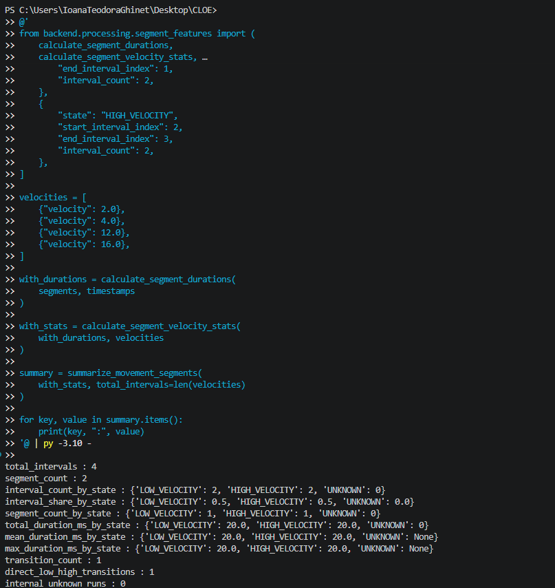

*Figure 12. Successful sequential integration of segment duration calculation, velocity statistics, and movement summary extraction.*

#### 5.3.15 Interpretation

The unit testing results demonstrate that `summarize_movement_segments()` behaves as expected for the sixteen defined synthetic scenarios.

The implementation correctly calculates movement-state distributions, segment-duration statistics, and state transitions while preserving UNKNOWN intervals.

The structural validation checks detect missing, overlapping, or otherwise inconsistent movement segments.

The complete backend regression suite passed, indicating that no regressions were detected by the existing tests.

The synthetic integration experiment demonstrated successful sequential processing through T03-A, T03-B, and T03-C.

These findings support the modularity and initial correctness of the recording-level feature aggregation component for the tested cases.

However, the resulting movement-state statistics remain algorithmic descriptions rather than validated physiological eye-movement features.

#### 5.3.16 Limitations

The current implementation has the following limitations:

- The movement states are derived from experimental velocity thresholds.
- The velocity thresholds have not been validated against annotated fixation or saccade events.
- Interval proportions do not represent exact proportions of recording time.
- UNKNOWN segment durations represent observed timestamp spans and may include temporal gaps.
- The implementation relies on segment durations calculated by the preceding processing stage.
- The function does not independently verify original gaze coordinates or timestamp provenance.
- The summary does not directly compute recording-level mean or maximum velocity.
- The synthetic integration test does not establish correct operation on real Tobii recordings.
- No cognitive-load classification or estimation is performed.

#### 5.3.17 Conclusion

**Result: PASS — Unit Testing, Regression Testing and Synthetic Integration Validation**

The movement feature summary component was successfully implemented and verified using sixteen unit tests.

The complete backend regression suite passed, with 137 successful tests.

A separate synthetic integration experiment demonstrated that T03-A, T03-B, and T03-C can operate sequentially and produce a consistent recording-level feature summary.

T03-C is complete at the defined software-validation level.

Real Tobii recording evaluation remains part of T03-D.

---

### 5.4 T03-D — Real Data Oculomotor Feature Integration

**Date:** 2026-11-17  
**Status:** PASS — Integration Testing, Regression Testing, Real Data Evaluation and Output Verification

**Implementation:** `backend/processing/analyze_oculomotor_features.py`  
**Tests:** `backend/tests/test_oculomotor_integration.py`

---

#### 5.4.1 Objective

Integrate the previously developed gaze velocity, movement segmentation, segment duration, segment velocity statistics, and recording-level movement summary components into a complete offline processing pipeline.

The experiment aims to evaluate the combined implementation using a real Tobii Pro Nano recording and produce reproducible oculomotor feature datasets.

The extracted features describe algorithmically defined gaze movement patterns rather than physiologically validated fixation or saccade events.

No cognitive-load estimation is performed during this experiment.

#### 5.4.2 Background

Previous M0.4 experiments established the following capabilities:

- **T01 — Gaze Velocity Calculation:** Calculates average gaze displacement velocity between consecutive measurements.
- **T02-A — Velocity State Classification:** Classifies available velocities as LOW_VELOCITY or HIGH_VELOCITY.
- **T02-B — Consecutive State Segmentation:** Groups consecutive movement states into segments.
- **T02-C — Real Tobii Recording Integration:** Applies velocity calculation and segmentation to real gaze measurements.
- **T03-A — Segment Duration Calculation:** Calculates segment durations using original device timestamps.
- **T03-B — Segment Velocity Statistics:** Calculates descriptive statistics for individual movement segments.
- **T03-C — Movement Feature Summary:** Aggregates movement segments into recording-level features.

T03-D connects these components into a complete feature extraction workflow and evaluates their interoperability using real recorded gaze data.

#### 5.4.3 Input Recording

**Recording:** `tobii_20261029T143930551761Z.csv`

**Source directory:** `data/raw/tobii/`

The experiment uses the same Tobii Pro Nano recording analyzed during previous M0.3 and M0.4 experiments.

**Observed recording characteristics:**

| Property | Value |
|---|---:|
| Recorded gaze samples | 576 |
| Nominal sampling frequency | 60 Hz |
| Consecutive velocity intervals | 575 |
| Available velocity intervals | 525 |
| UNKNOWN velocity intervals | 50 |
| Available velocity percentage | 91.30% |
| UNKNOWN velocity percentage | 8.70% |
| Observed timestamp span | 9,640.897 ms |

The results are consistent with the previous T02-C movement segmentation experiment.

#### 5.4.4 Experimental Configuration

The following parameters were used:

| Parameter | Value |
|---|---|
| Experiment identifier | M0.4-T03-D |
| Nominal sampling frequency | 60 Hz |
| Maximum temporal gap ratio | 1.5 |
| Experimental velocity thresholds | 2.0, 5.0, 10.0 |
| Velocity unit | Normalized display units/second |
| Duration unit | Milliseconds |
| Duration calculation method | Device timestamp difference |
| Threshold validation status | Illustrative, not validated |

The experimental thresholds were selected to investigate the sensitivity of the algorithmic movement classifications.

They are not physiologically validated thresholds for fixation or saccade identification.

#### 5.4.5 Processing Architecture

The integration pipeline uses the following processing sequence:

```text
Raw Tobii Pro Nano CSV
         |
         v
Binocular Gaze Fusion
         |
         v
Gaze Velocity Calculation
         |
         v
Movement-State Segmentation
         |
         v
Segment Duration Calculation
         |
         v
Segment Velocity Statistics
         |
         v
Recording-Level Movement Summary
         |
         v
Segment CSV + Summary JSON + Policy JSON
```

Existing processing functions are reused instead of reimplementing their algorithms.

The original raw recording remains unchanged.

#### 5.4.6 Methodology

The processing pipeline performs the following operations:

1. Reads the original Tobii Pro Nano recording.
2. Extracts gaze measurements and original device timestamps.
3. Combines available left-eye and right-eye gaze coordinates.
4. Calculates displacement velocities for consecutive received samples.
5. Preserves unavailable velocity measurements.
6. Generates movement-state segments for each configured experimental threshold.
7. Calculates observed segment durations using original device timestamps.
8. Calculates descriptive velocity statistics for available movement segments.
9. Aggregates segments into recording-level movement summaries.
10. Validates interval coverage and velocity availability.
11. Exports enriched segment-level features to CSV.
12. Exports recording-level summaries to JSON.
13. Saves the experimental policy, processing parameters, and source-file SHA-256.
14. Executes integration and regression tests.
15. Independently reads back the generated output files.

#### 5.4.7 Extracted Segment-Level Features

Each movement-state segment contains the following fields:

| Feature | Description |
|---|---|
| `state` | LOW_VELOCITY, HIGH_VELOCITY, or UNKNOWN |
| `start_interval_index` | First velocity interval |
| `end_interval_index` | Final velocity interval, inclusive |
| `interval_count` | Number of velocity intervals represented |
| `start_timestamp_us` | Original segment start timestamp |
| `end_timestamp_us` | Original segment end timestamp |
| `duration_ms` | Observed timestamp span in milliseconds |
| `valid_velocity_count` | Number of available velocity measurements |
| `mean_velocity` | Arithmetic mean velocity |
| `min_velocity` | Minimum observed velocity |
| `max_velocity` | Maximum observed velocity |
| `std_velocity` | Population standard deviation of velocity |

For UNKNOWN segments, numerical velocity statistics remain unavailable.

#### 5.4.8 Extracted Recording-Level Features

The recording-level summary includes:

- Total velocity interval count.
- Total movement segment count.
- LOW_VELOCITY interval count and proportion.
- HIGH_VELOCITY interval count and proportion.
- UNKNOWN interval count and proportion.
- Segment counts by movement state.
- Total observed segment durations by state.
- Mean segment durations by state.
- Maximum segment durations by state.
- Total movement-state transition count.
- Direct LOW/HIGH transition count.
- Internal UNKNOWN interruption count.

The recording-level summary represents descriptive properties of the extracted movement states.

It does not estimate cognitive load.

---

#### 5.4.9 Integration Unit Testing

**Test file:** `backend/tests/test_oculomotor_integration.py`

**Execution command:**

```powershell
py -3.10 -m pytest backend\tests\test_oculomotor_integration.py -v
```

Nine integration tests were executed.

**Observed results:**

| Test | Expected behavior | Result |
|---|---|---|
| `test_full_pipeline` | Correct sequential processing | PASS |
| `test_duration_coverage` | Segment durations cover observed timestamp span | PASS |
| `test_velocity_statistics_integration` | Preserve correct velocity statistics | PASS |
| `test_unknown_intervals_are_preserved` | Preserve unavailable velocity intervals | PASS |
| `test_unknown_count_invariant_across_thresholds` | UNKNOWN count independent of threshold | PASS |
| `test_empty_recording` | Correct handling of empty input | PASS |
| `test_mismatched_velocity_count` | Reject inconsistent sample/velocity counts | PASS |
| `test_duplicate_thresholds_rejected` | Reject duplicate threshold configurations | PASS |
| `test_export_readback` | Successfully export and reload synthetic results | PASS |

**Observed summary:**

```text
collected 9 items

9 passed in 0.10s
```

**Result: PASS — Integration Unit Testing**

All nine integration tests passed.

These tests verify the expected software behavior using defined synthetic scenarios.

#### 5.4.10 Evidence — Integration Testing

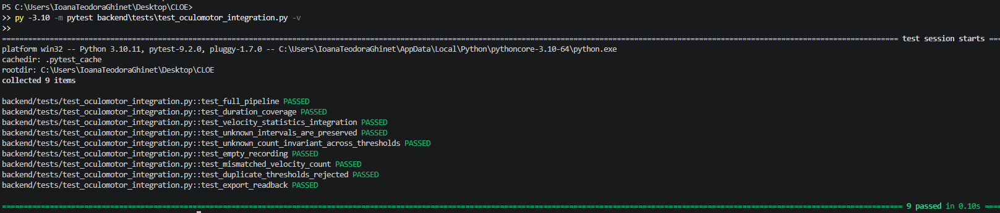

*Figure 13. Successful execution of all nine T03-D integration tests.*

---

#### 5.4.11 Regression Testing

The complete backend regression suite was executed after integrating the new oculomotor feature extraction pipeline.

**Execution command:**

```powershell
py -3.10 -m pytest backend\tests -v
```

**Observed result:** 146/146 PASSED in 0.19 seconds.

**Execution environment:**

- Operating system: Windows 11 Education, 64-bit.
- Python version: 3.10.11.
- pytest version: 9.2.0.

The test suite included the previously implemented gaze processing, temporal processing, data-quality assessment, movement segmentation, segment feature extraction, and movement summary components.

No regressions were detected by the existing automated tests.

**Result: PASS — Regression Testing**

#### 5.4.12 Evidence — Regression Testing

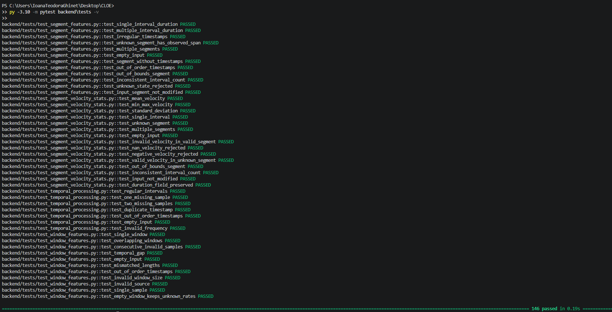

*Figure 14. Complete backend regression suite after T03-D — 146 tests passed.*

---

#### 5.4.13 Real Tobii Recording Evaluation

The integrated feature extraction pipeline was executed using the real Tobii recording.

**Execution command:**

```powershell
py -3.10 -m backend.processing.analyze_oculomotor_features `
  "data\raw\tobii\tobii_20261029T143930551761Z.csv" `
  --thresholds 2.0 5.0 10.0
```

**Observed general results:**

| Metric | Value |
|---|---:|
| Gaze samples processed | 576 |
| Velocity intervals generated | 575 |
| Available velocities | 525 |
| UNKNOWN velocities | 50 |
| Threshold configurations evaluated | 3 |

The observed values match the interval and availability counts previously reported during T02-C.

#### 5.4.14 Movement-State Distribution

The experiment produced the following results:

| Metric | Threshold 2.0 | Threshold 5.0 | Threshold 10.0 |
|---|---:|---:|---:|
| LOW_VELOCITY intervals | 493 | 510 | 518 |
| HIGH_VELOCITY intervals | 32 | 15 | 7 |
| UNKNOWN intervals | 50 | 50 | 50 |
| Total intervals | 575 | 575 | 575 |
| Total segments | 40 | 30 | 23 |

**Finding 1 — Classification threshold sensitivity**

Increasing the experimental velocity threshold resulted in more intervals classified as LOW_VELOCITY and fewer intervals classified as HIGH_VELOCITY.

The number of HIGH_VELOCITY intervals decreased from 32 at threshold 2.0 to 7 at threshold 10.0.

The total number of movement segments decreased from 40 to 23.

These findings demonstrate that the generated movement-state distributions depend on the selected classification threshold.

**Finding 2 — UNKNOWN invariance**

The UNKNOWN interval count remained constant at 50 across all three threshold configurations.

This is consistent with the intended separation between velocity availability and velocity-threshold classification.

#### 5.4.15 Observed Segment Duration Results

The feature extraction pipeline calculated the cumulative observed timestamp spans associated with each movement state.

**Observed durations:**

| Movement state | Threshold 2.0 | Threshold 5.0 | Threshold 10.0 |
|---|---:|---:|---:|
| LOW_VELOCITY | 8,210.762 ms | 8,493.890 ms | 8,627.128 ms |
| HIGH_VELOCITY | 532.949 ms | 249.821 ms | 116.583 ms |
| UNKNOWN | 897.186 ms | 897.186 ms | 897.186 ms |
| **Total observed span** | **9,640.897 ms** | **9,640.897 ms** | **9,640.897 ms** |

**Finding 3 — Duration redistribution**

Increasing the experimental velocity threshold redistributed observed segment durations from HIGH_VELOCITY toward LOW_VELOCITY.

For example, the cumulative HIGH_VELOCITY duration decreased from 532.949 ms at threshold 2.0 to 116.583 ms at threshold 10.0.

The cumulative LOW_VELOCITY duration increased accordingly.

This is consistent with the classification rules implemented in T02.

**Finding 4 — Preserved UNKNOWN duration**

The cumulative UNKNOWN observed timestamp span remained constant at 897.186 ms for all three thresholds.

This indicates that the classification threshold did not alter the temporal coverage of intervals with unavailable velocities.

The UNKNOWN duration is not equivalent to a confirmed 897.186 ms period of gaze loss.

It represents the cumulative timestamp spans of intervals for which the algorithm could not produce usable velocity measurements.

#### 5.4.16 Movement-State Transitions

The recording-level summaries also reported movement-state transitions.

| Feature | Threshold 2.0 | Threshold 5.0 | Threshold 10.0 |
|---|---:|---:|---:|
| Total segments | 40 | 30 | 23 |
| Total transitions | 39 | 29 | 22 |
| Direct LOW/HIGH transitions | 26 | 16 | 9 |
| Internal UNKNOWN runs | 6 | 6 | 6 |

**Finding 5 — Transition sensitivity**

The number of movement-state transitions decreased as the experimental velocity threshold increased.

This behavior is consistent with the reduced number of alternating LOW_VELOCITY and HIGH_VELOCITY segments.

**Finding 6 — UNKNOWN interruptions**

Six internal UNKNOWN runs were identified across all three threshold configurations.

These represent unavailable movement segments bounded by available movement states.

They are not interpreted as confirmed blink events or physiological interruptions.

#### 5.4.17 Consistency Verification

Several properties were checked against the observed results.

**Check 1 — Velocity interval count**

The recording contained 576 gaze samples and produced 575 consecutive velocity intervals.

**Result: PASS**

**Check 2 — Availability accounting**

525 available + 50 UNKNOWN = 575 velocity intervals.

**Result: PASS**

**Check 3 — Complete interval coverage**

Each threshold configuration represented exactly 575 intervals across all movement segments.

**Result: PASS**

**Check 4 — Consistent observed duration**

For threshold 2.0:

$$
8210.762+532.949+897.186=9640.897\text{ ms}
$$

For threshold 5.0:

$$
8493.890+249.821+897.186=9640.897\text{ ms}
$$

For threshold 10.0:

$$
8627.128+116.583+897.186=9640.897\text{ ms}
$$

All three configurations produced the same total observed recording span.

**Result: PASS**

**Check 5 — UNKNOWN invariance**

UNKNOWN interval count: 50 for all thresholds.

UNKNOWN cumulative observed duration: 897.186 ms for all thresholds.

**Result: PASS**

**Check 6 — Transition consistency**

For each configuration, the number of transitions equaled the total number of segments minus one.

**Result: PASS**

These checks support internal consistency of the extracted feature data.

They do not independently validate the physiological correctness of the movement segmentation algorithm.

#### 5.4.18 Evidence — Real Recording Evaluation

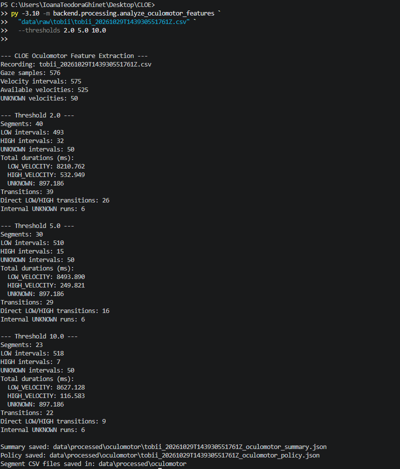

*Figure 15. Real Tobii Pro Nano feature extraction results for experimental thresholds 2.0, 5.0, and 10.0.*

---

#### 5.4.19 Output Artifacts

The processing script generated output files in:

`data/processed/oculomotor/`

**Segment-level datasets:**

```text
tobii_20261029T143930551761Z_features_2p0.csv
tobii_20261029T143930551761Z_features_5p0.csv
tobii_20261029T143930551761Z_features_10p0.csv
```

**Recording-level summary:**

```text
tobii_20261029T143930551761Z_oculomotor_summary.json
```

**Experimental metadata:**

```text
tobii_20261029T143930551761Z_oculomotor_policy.json
```

The metadata contains the original recording identifier, processing parameters, experimental thresholds, and a SHA-256 digest of the source recording.

The digest supports identification of the input file used for the experiment.

It does not validate physiological accuracy or anonymize the dataset.

#### 5.4.20 Independent Output Read-Back Verification

The generated CSV and JSON files were independently accessed using PowerShell.

**Verification method:**

- `Import-Csv` for segment-level datasets.
- `Measure-Object -Sum` for interval coverage and observed duration totals.
- `Get-Content -Raw` and `ConvertFrom-Json` for JSON files.
- `Format-List` for inspection of experimental metadata.

**Observed results:**

| Verification | Observed result |
|---|---|
| Threshold 2.0 segment CSV | 40 records |
| Threshold 5.0 segment CSV | 30 records |
| Threshold 10.0 segment CSV | 23 records |
| Threshold 2.0 interval coverage | 575 intervals |
| Threshold 5.0 interval coverage | 575 intervals |
| Threshold 10.0 interval coverage | 575 intervals |
| Threshold 2.0 total duration | 9,640.897 ms |
| Threshold 5.0 total duration | 9,640.897 ms |
| Threshold 10.0 total duration | 9,640.897 ms |
| Summary JSON read-back | Successful |
| Policy JSON read-back | Successful |

**Result: PASS — Output Read-Back and Aggregate Consistency Verification**

The segment-level datasets were successfully reloaded and contained the expected record counts.

The sum of represented interval counts equaled 575 for each threshold.

The sum of observed segment durations equaled 9,640.897 ms for each threshold.

The experimental policy JSON was also successfully parsed and inspected.

The PowerShell output displayed `Summaries saved: 1`. This may reflect an outer JSON array being handled as a single PowerShell object. The number of individual threshold summary entries has not yet been independently confirmed and remains a follow-up verification item.

#### Summary JSON Entry Verification

**Date:** 2026-11-17  
**Status:** PASS — Independent JSON Read-Back

**File:** `data/processed/oculomotor/tobii_20261029T143930551761Z_oculomotor_summary.json`

**Method:** PowerShell `Get-Content -Raw`, `ConvertFrom-Json`, and iteration over the parsed JSON array.

**Observed results:**

| Threshold | Segments | Velocity intervals |
|---|---:|---:|
| 2.0 | 40 | 575 |
| 5.0 | 30 | 575 |
| 10.0 | 23 | 575 |

**Number of summary entries:** 3

**Interpretation:**

The exported JSON file was successfully loaded and parsed.

The parsed structure contained three distinct threshold configurations, matching the experimental parameters.

Each configuration reported the expected segment count and 575 total velocity intervals.

This confirms that the recording-level feature summaries for all three threshold configurations were persisted and can be retrieved independently.

**Limitations:**

This read-back verification confirms the presence and structural consistency of the summary entries. It does not independently recalculate every numerical feature or establish the physiological validity of the movement classifications.

**Conclusion: PASS — Summary JSON Entry Verification**

**Evidence:**

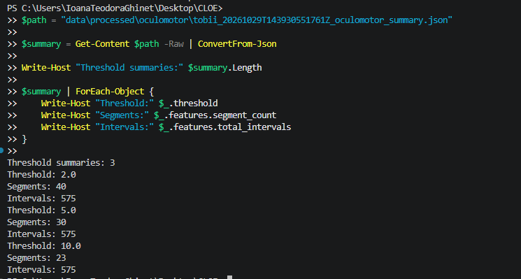

#### 5.4.21 Verified Experimental Metadata

The following parameters were recovered from the generated JSON policy:

| Parameter | Verified value |
|---|---|
| Experiment | M0.4-T03-D |
| Source recording | `tobii_20261029T143930551761Z.csv` |
| Sample count | 576 |
| Velocity interval count | 575 |
| Available velocity count | 525 |
| UNKNOWN velocity count | 50 |
| Nominal frequency | 60 Hz |
| Maximum gap ratio | 1.5 |
| Thresholds | 2.0, 5.0, 10.0 |
| Velocity unit | normalized_display_units_per_second |
| Duration unit | milliseconds |
| Duration method | device_timestamp_difference |
| Threshold status | illustrative_not_validated |

The source SHA-256 digest was also present in the metadata file.

This confirms basic persistence of the experimental parameters and input-file identification.

#### 5.4.22 Evidence — Output Verification

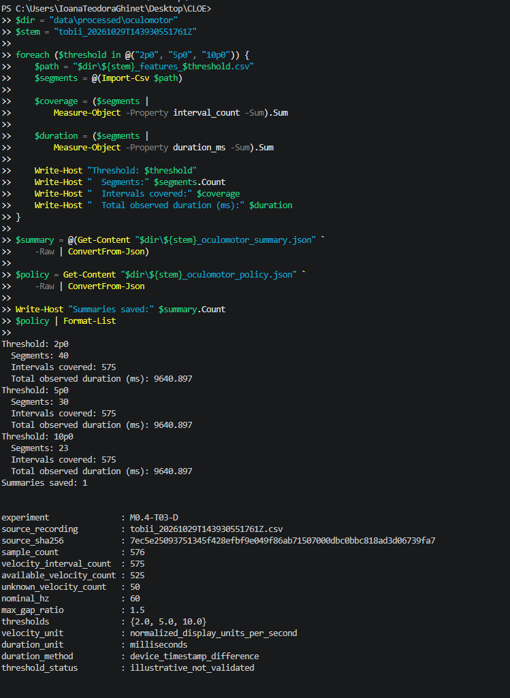

*Figure 16. Independent read-back of segment-level CSV files and experimental JSON metadata.*

---

#### 5.4.23 Key Findings

**Finding 1 — Successful pipeline integration**

The implemented processing components operated sequentially on a real Tobii Pro Nano recording.

The pipeline produced segment-level and recording-level feature data for three experimental velocity thresholds.

**Finding 2 — Consistent temporal and interval accounting**

All three threshold configurations preserved the original 575 velocity intervals and the 9,640.897 ms observed timestamp span.

**Finding 3 — Threshold-sensitive movement characterization**

Increasing the experimental velocity threshold increased LOW_VELOCITY coverage and reduced HIGH_VELOCITY coverage.

This demonstrates the importance of threshold selection for the interpretation of algorithmically derived movement features.

**Finding 4 — Preservation of unavailable measurements**

The pipeline preserved 50 UNKNOWN velocity intervals and their associated cumulative timestamp span across all threshold configurations.

**Finding 5 — Explainable and reproducible processing**

The pipeline exported structured feature datasets and recorded the experimental configuration and source-file digest.

The generated data were independently reloaded and inspected.

#### 5.4.24 Design Decisions

1. Reuse previously tested processing components.
2. Keep raw gaze recordings separate from processed feature datasets.
3. Preserve the original order and timestamps of recorded samples.
4. Calculate velocity intervals once and reuse them across threshold configurations.
5. Preserve UNKNOWN intervals instead of interpolating unavailable gaze measurements.
6. Calculate segment durations from original device timestamps.
7. Maintain separate segment-level and recording-level feature representations.
8. Store explicit experimental threshold configurations.
9. Record source-file identification using SHA-256.
10. Verify exported outputs independently.
11. Avoid presenting experimental movement states as confirmed physiological events.
12. Avoid cognitive-load inference at this stage.

#### 5.4.25 Limitations

The following limitations remain:

- The experiment uses only one real Tobii Pro Nano recording.
- The experimental velocity thresholds have not been calibrated against annotated physiological eye-movement events.
- Velocity is expressed in normalized display units per second rather than angular degrees per second.
- The processing pipeline does not establish fixation or saccade detection accuracy.
- The current approach does not implement smoothing, hysteresis, or minimum physiological event durations.
- UNKNOWN segment spans do not represent confirmed tracking-loss durations.
- Interval proportions and accumulated timestamp spans describe different aspects of movement-state coverage.
- The exported results have not been compared with independently annotated ground-truth eye movements.
- Output file names are deterministic and subsequent executions may overwrite existing results.
- The aggregate CSV read-back does not independently establish every saved segment boundary or numerical feature value.
- The number of individual entries within the summary JSON array requires an additional explicit verification.
- No cognitive-load inference or adaptive UI decision was performed.

#### 5.4.26 Conclusion

**Result: PASS — Integration Testing, Regression Testing, Real Data Evaluation and Aggregate Output Verification**

T03-D successfully integrated the previously implemented oculomotor processing components into a complete offline feature extraction pipeline.

The implementation passed all nine integration tests and the complete 146-test backend regression suite.

The pipeline processed 576 real Tobii gaze samples, generated 575 velocity intervals, and produced movement features using three experimental velocity thresholds.

The resulting feature datasets preserved interval coverage, observed recording duration, and UNKNOWN interval statistics.

Independent output read-back confirmed the expected segment counts and aggregate duration totals.

T03-D is complete at the defined initial software and real-data integration validation level.

Further validation is required before the extracted movement features can be treated as reliable physiological fixation or saccade measurements or used as validated indicators of cognitive load.


## 6. T04 — Window-Level Oculomotor Integration

**Date opened:** 2026-11-17  
**Status:** IN PROGRESS — T04-A Software Validation Completed

### 6.1 Overview

#### 6.1.1 Objective

Integrate the oculomotor feature extraction pipeline developed in M0.4 with the temporal sliding-window processing and data-quality assessment components implemented in M0.3.

The objective is to produce window-level movement summaries while respecting previously established data-quality eligibility decisions.

The integration must prevent windows containing insufficient-quality data from exposing usable feature vectors to downstream processing.

#### 6.1.2 Background

Previous milestones established two complementary processing workflows.

**M0.3 — Temporal Processing and Data Quality**

- Gaze point validation and binocular fusion.
- Temporal sampling analysis.
- Invalid gaze detection.
- Sliding-window feature extraction.
- Configurable data-quality assessment.
- Quality Gate decisions: ELIGIBLE or UNKNOWN.

**M0.4 — Oculomotor Feature Extraction**

- Average gaze displacement velocity calculation.
- Velocity-state classification.
- Consecutive movement-state segmentation.
- Segment duration calculation.
- Segment velocity statistics.
- Recording-level movement feature summaries.

T04 introduces temporal alignment between these workflows.

The resulting processing component distinguishes between the ability to calculate numerical features and the eligibility of those features for downstream use.

#### 6.1.3 Planned Subtasks

| Task | Description | Status |
|---|---|---|
| T04-A | Temporal Alignment and Window Feature Extraction | PASS — Software Validation |
| T04-B | Quality Gate Decision Integration | PLANNED |
| T04-C | Real Tobii Recording Evaluation | PLANNED |
| T04-D | Output Verification and Documentation | PLANNED |

---

### 6.2 T04-A — Temporal Alignment and Window Feature Extraction

**Date:** 2026-11-17  
**Status:** PASS — Unit Testing and Regression Validation

**Implementation:** `backend/processing/window_oculomotor.py`  
**Tests:** `backend/tests/test_window_oculomotor.py`

#### 6.2.1 Objective

Implement a reusable component that extracts oculomotor movement features from velocity intervals contained within explicitly defined temporal windows.

The component must preserve original device timestamps, handle window boundaries, maintain UNKNOWN velocity intervals, and respect externally supplied Quality Gate decisions.

#### 6.2.2 Implementation

**Function:**

`extract_window_oculomotor_features(timestamps, velocity_results, start_s, end_s, threshold, quality_gate_status)`

The function receives:

| Parameter | Description |
|---|---|
| `timestamps` | Original Tobii device timestamps in microseconds |
| `velocity_results` | Previously calculated consecutive gaze velocity results |
| `start_s` | Window start in seconds |
| `end_s` | Window end in seconds |
| `threshold` | Experimental velocity classification threshold |
| `quality_gate_status` | Externally supplied ELIGIBLE or UNKNOWN decision |

Window boundaries are defined relative to the first recorded device timestamp.

Velocity thresholds are expressed in normalized display units per second.

#### 6.2.3 Processing Methodology

The implementation performs the following operations:

1. Validates the experimental velocity threshold.
2. Validates the supplied Quality Gate status.
3. Checks that the window boundaries are finite and correctly ordered.
4. Verifies that device timestamps are integer values expressed in microseconds.
5. Ensures that timestamps are strictly increasing.
6. Checks consistency between the number of timestamps and velocity intervals.
7. Identifies velocity intervals fully contained within the requested temporal window.
8. Evaluates the supplied Quality Gate decision.
9. Prevents feature exposure when the Quality Gate status is UNKNOWN.
10. Returns an unavailable result when no velocity intervals are fully contained in the window.
11. Segments the selected intervals using the existing velocity-state classification algorithm.
12. Calculates segment durations using original timestamps.
13. Calculates segment-level velocity statistics.
14. Aggregates movement segments into a window-level summary.
15. Returns the feature status, diagnostics, and extracted features.

#### 6.2.4 Temporal Alignment Method

A velocity interval is included in a window only when both of its timestamp endpoints fall within the window boundaries.

For velocity interval \(i\), bounded by timestamps \(t_i\) and \(t_{i+1}\):

$$
t_i \geq t_{\mathrm{window,start}}
$$

$$
t_{i+1} \leq t_{\mathrm{window,end}}
$$

Device timestamps are converted to relative seconds using the first recorded timestamp as the temporal origin.

Intervals crossing a window boundary are excluded.

This conservative alignment policy avoids assigning an entire velocity estimate to a window when its underlying measurement pair extends beyond that window.

The selected intervals may cover less than the nominal window duration.

This difference must not automatically be interpreted as missing eye-tracking data.

#### 6.2.5 Processing Sequence

The implementation reuses the previously developed M0.4 components.

```text
Original Device Timestamps
             |
             v
Interval-Level Velocity Results
             |
             v
Temporal Window Alignment
             |
             v
M0.3 Quality Gate Decision
             |
        +----+----+
        |         |
     ELIGIBLE   UNKNOWN
        |         |
        v         v
Movement-State   UNAVAILABLE
 Segmentation    No usable features
        |
        v
Segment Durations
        |
        v
Segment Velocity Statistics
        |
        v
Window-Level Movement Summary
        |
        v
AVAILABLE Feature Vector
```

The Quality Gate does not determine the movement-state classification threshold.

These are separate experimental parameters with distinct responsibilities.

#### 6.2.6 Output Structure

The function returns a dictionary containing:

| Field | Description |
|---|---|
| `start_s` | Window start in relative seconds |
| `end_s` | Window end in relative seconds |
| `threshold` | Experimental velocity threshold |
| `quality_gate_status` | Original external Quality Gate decision |
| `selected_interval_count` | Number of fully contained velocity intervals |
| `feature_status` | AVAILABLE or UNAVAILABLE |
| `feature_reason` | Reason why usable features were not produced |
| `features` | Extracted movement summary or None |

For available windows, the feature summary includes:

- Movement-state interval counts.
- Movement-state interval proportions.
- Segment counts by state.
- Total, mean, and maximum segment durations.
- State transition counts.
- Direct LOW/HIGH transitions.
- Internal UNKNOWN interruptions.

#### 6.2.7 Quality Gate Integration Rules

The component distinguishes between two separate statuses.

**Quality Gate Status**

| Status | Meaning |
|---|---|
| ELIGIBLE | Window satisfies the externally configured data-quality requirements |
| UNKNOWN | Window does not satisfy the configured eligibility requirements |

**Feature Status**

| Status | Meaning |
|---|---|
| AVAILABLE | Window-level movement features were generated |
| UNAVAILABLE | No usable feature vector is exposed |

The following rules are implemented:

1. A window marked UNKNOWN by the Quality Gate must not expose a usable feature vector.
2. An ELIGIBLE window with no fully contained intervals must return UNAVAILABLE.
3. An ELIGIBLE window containing UNKNOWN velocity intervals may still produce a summary that explicitly includes their count.
4. A Quality Gate decision of ELIGIBLE does not imply scientifically validated cognitive-load inference.

The implementation also returns diagnostic reasons.

| Reason | Meaning |
|---|---|
| `QUALITY_GATE_UNKNOWN` | The external Quality Gate rejected the window |
| `NO_CONTAINED_INTERVALS` | No velocity intervals are fully contained in the window |

These reasons support explainability and debugging.

#### 6.2.8 UNKNOWN Handling

UNKNOWN velocity intervals are preserved inside eligible windows.

The component does not:

- Convert unavailable velocities into zero.
- Interpolate missing gaze measurements.
- Merge movement segments across UNKNOWN intervals.
- Interpret UNKNOWN as a physiological event.
- Treat UNKNOWN as a high cognitive-load state.

When the Quality Gate rejects the entire window, the component returns `features = None`.

This prevents downstream systems from treating an unavailable feature vector as a valid observation.

#### 6.2.9 Design Decisions

The following decisions were adopted:

1. Keep temporal alignment independent of gaze velocity calculation.
2. Reuse previously tested movement segmentation and feature extraction functions.
3. Preserve original device timestamps.
4. Use relative window boundaries with an explicit temporal origin.
5. Include only fully contained velocity intervals.
6. Avoid interpolation across window boundaries.
7. Preserve UNKNOWN intervals in eligible windows.
8. Prevent rejected quality windows from exposing usable feature vectors.
9. Distinguish Quality Gate eligibility from feature availability.
10. Require explicitly configured velocity thresholds.
11. Preserve the original velocity interval ordering.
12. Avoid interpreting movement states as physiologically validated fixation or saccade events.
13. Avoid cognitive-load inference at this stage.

---

#### 6.2.10 Unit Testing

**Test file:** `backend/tests/test_window_oculomotor.py`

**Execution command:**

```powershell
py -3.10 -m pytest backend\tests\test_window_oculomotor.py -v
```

Thirteen unit tests were executed.

**Observed results:**

| Test | Expected behavior | Result |
|---|---|---|
| `test_full_window` | Extract all contained intervals | PASS |
| `test_partial_window_interval_alignment` | Select only intervals within partial window boundaries | PASS |
| `test_boundary_crossing_intervals_excluded` | Exclude boundary-crossing intervals | PASS |
| `test_quality_gate_unknown` | Return unavailable features for rejected windows | PASS |
| `test_no_contained_intervals` | Handle windows without contained intervals | PASS |
| `test_unknown_velocity_preserved` | Preserve unavailable velocity intervals | PASS |
| `test_invalid_quality_status` | Reject unsupported Quality Gate statuses | PASS |
| `test_invalid_window_boundaries` | Reject invalid temporal boundaries | PASS |
| `test_mismatched_velocity_count` | Reject mismatched timestamps and velocity counts | PASS |
| `test_duplicate_timestamps` | Reject duplicate device timestamps | PASS |
| `test_unknown_result_does_not_expose_features` | Prevent feature exposure for UNKNOWN quality decisions | PASS |
| `test_threshold_changes_classification` | Verify sensitivity to experimental velocity thresholds | PASS |
| `test_empty_recording` | Return unavailable features for empty recordings | PASS |

**Observed unit test summary:**

```text
collected 13 items

13 passed in 0.03s
```

**Result: PASS — Unit Testing**

All thirteen tests passed.

These tests verify the expected behavior of temporal window alignment, data-quality eligibility handling, velocity state preservation, and input validation for the defined synthetic scenarios.

#### 6.2.11 Evidence — Unit Testing

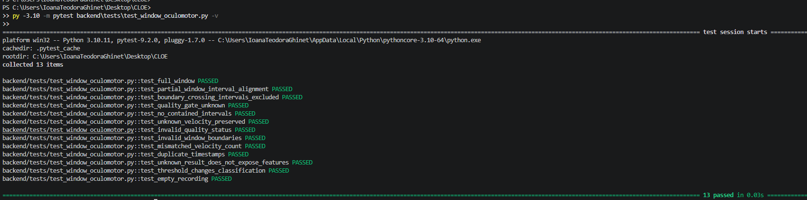

*Figure 17. Successful execution of all thirteen T04-A window-level oculomotor feature extraction tests.*

---

#### 6.2.12 Regression Testing

The complete backend regression suite was executed after implementing the new window-level feature extraction component.

**Execution command:**

```powershell
py -3.10 -m pytest backend\tests -v
```

**Observed result:** 159/159 PASSED in 0.22 seconds.

**Execution environment:**

- Operating system: Windows 11 Education, 64-bit.
- Python version: 3.10.11.
- pytest version: 9.2.0.

The regression suite included the previously implemented gaze validation, temporal processing, data-quality assessment, Quality Gate, velocity calculation, movement segmentation, segment feature extraction, and recording-level movement summary tests.

All existing tests passed.

No regressions were detected by the current automated test suite.

**Result: PASS — Regression Testing**

#### 6.2.13 Evidence — Regression Testing

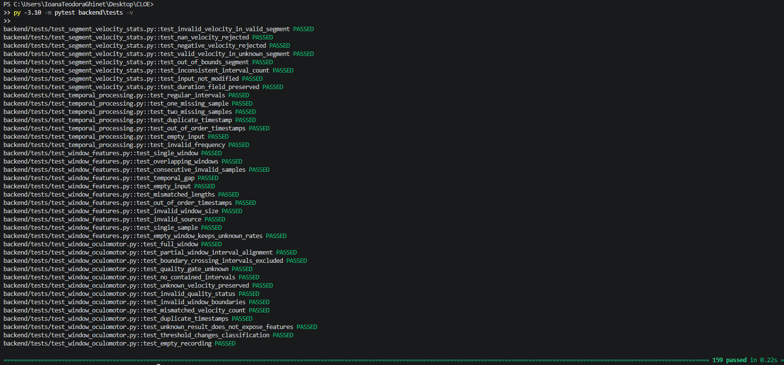

*Figure 18. Complete backend regression suite after T04-A — 159 tests passed.*

---

#### 6.2.14 Interpretation

The T04-A unit tests demonstrate that the window-level oculomotor feature extraction component behaves as expected across the thirteen defined synthetic scenarios.

The implementation correctly selects velocity intervals fully contained within requested temporal windows.

Boundary-crossing intervals are excluded instead of being interpolated.

The component successfully incorporates externally supplied Quality Gate decisions and prevents UNKNOWN quality windows from exposing usable feature vectors.

The tests also confirm that unavailable velocity intervals are preserved in eligible windows and that changes to experimental velocity thresholds affect movement-state classification.

The complete regression suite passed, providing evidence that T04-A did not introduce failures detectable by the existing tests.

These results support the software-level correctness of the component for the defined scenarios.

However, the component has not yet been connected to the saved M0.3 Quality Gate decision dataset.

#### 6.2.15 Limitations

The current implementation has the following limitations:

- The fully contained interval policy excludes velocity intervals crossing window boundaries.
- The selected intervals may cover less than the nominal window duration.
- The function relies on consistent correspondence between the supplied device timestamps and velocity results.
- Quality Gate decisions are currently supplied as function arguments.
- Saved M0.3 quality decisions have not yet been loaded automatically.
- The quality-policy parameters are not validated physiological thresholds.
- The movement-state classification threshold is experimental.
- The component has not yet been evaluated using the real 20-window Tobii dataset.
- No independent output persistence verification has been performed for window-level features.
- No cognitive-load inference or adaptive UI action has been evaluated.

#### 6.2.16 Conclusion

**Result: PASS — Unit Testing and Regression Validation**

T04-A was successfully implemented and verified using thirteen unit tests.

The complete backend regression suite passed, with 159 successful tests.

The component is ready for integration with the saved M0.3 sliding-window Quality Gate decisions.

Real-data evaluation and output artifact verification remain future work.

---
### 6.3 T04-B — Quality Gate Decision Integration

**Date:** 2026-11-17  
**Status:** PASS — Unit Testing, Regression Testing and Real Quality Decision CSV Read-Back

**Implementation:** `backend/processing/quality_window_integration.py`  
**Tests:** `backend/tests/test_quality_window_integration.py`

---

#### 6.3.1 Objective

Implement and validate a reusable integration component that loads saved M0.3 Quality Gate decisions and associates them with the corresponding temporal windows used by the M0.4 oculomotor feature extraction pipeline.

The implementation must preserve original quality decisions and rejection reasons, reject malformed input records, and prevent windows marked UNKNOWN from exposing usable oculomotor feature vectors.

#### 6.3.2 Background

M0.3 implemented a configurable Quality Gate that evaluates sliding temporal windows according to predefined data-quality criteria.

The Quality Gate produces the following statuses:

- **ELIGIBLE:** The window satisfies the configured eligibility requirements.
- **UNKNOWN:** The window does not satisfy the conditions required for downstream eligibility.

T04-A introduced window-level oculomotor feature extraction using externally supplied Quality Gate decisions.

However, the status was previously passed directly as a function argument.

T04-B extends this functionality by loading the previously generated M0.3 decision dataset and connecting the decisions to the T04-A extraction component.

The integration preserves the distinction between data-quality eligibility and feature availability.

#### 6.3.3 Input Dataset

**Input file:**

`data/processed/tobii_20261029T143930551761Z_quality_decisions.csv`

The dataset was generated during M0.3/T05-C using the original Tobii Pro Nano recording.

**Previously observed characteristics:**

| Property | Value |
|---|---:|
| Total temporal windows | 20 |
| ELIGIBLE windows | 16 |
| UNKNOWN windows | 4 |

The input contains temporal window boundaries, Quality Gate decisions, and diagnostic rejection reasons.

#### 6.3.4 Implementation Architecture

The integration is implemented in:

`backend/processing/quality_window_integration.py`

The module provides three functions.

| Function | Responsibility |
|---|---|
| `load_quality_decisions()` | Load and validate the M0.3 Quality Gate CSV |
| `integrate_quality_windows()` | Apply T04-A extraction to the supplied quality windows |
| `summarize_feature_availability()` | Summarize Quality Gate and feature availability statuses |

The implementation reuses the existing `extract_window_oculomotor_features()` function rather than duplicating its processing logic.

#### 6.3.5 Quality Decision Loading

**Function:** `load_quality_decisions(csv_path)`

The CSV loader requires the following columns:

| Column | Description |
|---|---|
| `start_s` | Relative window start time in seconds |
| `end_s` | Relative window end time in seconds |
| `status` | Quality Gate decision |
| `reasons` | Original rejection reasons |

Additional columns are permitted.

The loader performs the following validations:

1. Verifies that the CSV contains a header.
2. Rejects duplicate column names.
3. Checks the presence of required columns.
4. Rejects malformed rows with missing or unexpected fields.
5. Converts temporal boundaries to numerical values.
6. Rejects non-finite or invalid window boundaries.
7. Accepts only ELIGIBLE and UNKNOWN statuses.
8. Verifies that window start times are strictly increasing.
9. Preserves the original decision order.
10. Preserves rejection reasons without modification.

The loader allows overlapping windows, provided their start times are strictly increasing.

This is necessary because the original M0.3 sliding-window configuration uses overlapping temporal windows.

#### 6.3.6 Quality Gate and Oculomotor Integration

**Function:** `integrate_quality_windows(timestamps, velocity_results, quality_decisions, threshold)`

The function receives:

- Original gaze device timestamps.
- Previously calculated interval-level velocities.
- Validated Quality Gate decisions.
- An explicitly configured experimental velocity threshold.

For every quality decision, the function calls the previously implemented T04-A extraction component using the corresponding temporal boundaries and status.

The integration preserves one output record for every input quality decision.

Each result contains:

- Original window boundaries.
- Experimental velocity threshold.
- Original Quality Gate status.
- Original Quality Gate rejection reasons.
- Number of selected velocity intervals.
- Feature availability status.
- Feature availability diagnostic reason.
- Extracted oculomotor feature summary, when available.

The function explicitly checks that windows marked UNKNOWN cannot expose usable feature vectors.

If an UNKNOWN quality window produces an AVAILABLE result or a non-null feature vector, the integration raises a `ValueError`.

#### 6.3.7 Feature Availability Summary

**Function:** `summarize_feature_availability(results)`

The function produces an aggregate summary containing:

| Feature | Description |
|---|---|
| `window_count` | Total number of processed windows |
| `quality_gate_counts` | Number of ELIGIBLE and UNKNOWN decisions |
| `feature_status_counts` | Number of AVAILABLE and UNAVAILABLE feature results |
| `unavailable_reasons` | Distribution of feature unavailability reasons |

Quality Gate decisions and feature availability results are counted separately.

This allows the pipeline to distinguish insufficient-quality input from an inability to extract features within an otherwise eligible window.

#### 6.3.8 Eligibility and Availability Rules

The following relationships are expected:

| Quality Gate status | Feature status | Interpretation |
|---|---|---|
| ELIGIBLE | AVAILABLE | Quality requirements satisfied and features generated |
| ELIGIBLE | UNAVAILABLE | Quality requirements satisfied, but feature extraction unavailable |
| UNKNOWN | UNAVAILABLE | Quality Gate prevents exposure of usable features |
| UNKNOWN | AVAILABLE | Invalid integration outcome |

An ELIGIBLE decision does not guarantee that a feature vector can be generated.

An UNKNOWN decision must prevent the exposure of usable features.

These states do not represent cognitive-load levels.

#### 6.3.9 Unit Testing

**Test file:** `backend/tests/test_quality_window_integration.py`

**Execution command:**

```powershell
py -3.10 -m pytest backend\tests\test_quality_window_integration.py -v
```

Ten unit tests were implemented and executed.

**Observed results:**

| Test | Expected behavior | Result |
|---|---|---|
| `test_load_valid_decisions` | Correctly load valid quality decisions | PASS |
| `test_rejection_reasons_preserved` | Preserve original rejection reasons | PASS |
| `test_invalid_status_rejected` | Reject unsupported quality statuses | PASS |
| `test_invalid_window_rejected` | Reject invalid temporal boundaries | PASS |
| `test_unordered_windows_rejected` | Reject unordered window start times | PASS |
| `test_missing_column_rejected` | Reject missing required CSV columns | PASS |
| `test_eligible_window_produces_features` | Extract features for eligible synthetic window | PASS |
| `test_unknown_window_blocks_features` | Prevent feature exposure for UNKNOWN window | PASS |
| `test_all_windows_preserved` | Preserve one result per input window | PASS |
| `test_availability_summary` | Correctly summarize quality and feature statuses | PASS |

**Observed unit test summary:**

```text
collected 10 items

10 passed in 0.17s
```

**Result: PASS — Unit Testing**

All ten tests passed, confirming the expected software behavior for the defined synthetic scenarios.

#### 6.3.10 Evidence — Unit Testing

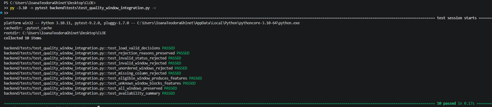

*Figure 19. Successful execution of all ten T04-B Quality Gate integration tests.*

---

#### 6.3.11 Regression Testing

The complete backend regression suite was executed after implementing the new integration component.

**Execution command:**

```powershell
py -3.10 -m pytest backend\tests -v
```

**Observed result:** 169/169 PASSED in 0.23 seconds.

**Execution environment:**

- Operating system: Windows 11 Education, 64-bit.
- Python version: 3.10.11.
- pytest version: 9.2.0.

The regression suite included the previously implemented gaze processing, temporal processing, data-quality assessment, Quality Gate, velocity calculation, movement segmentation, segment feature extraction, recording-level summary, and window-level feature extraction tests.

No regressions were detected by the current test suite.

**Result: PASS — Regression Testing**

#### 6.3.12 Evidence — Regression Testing

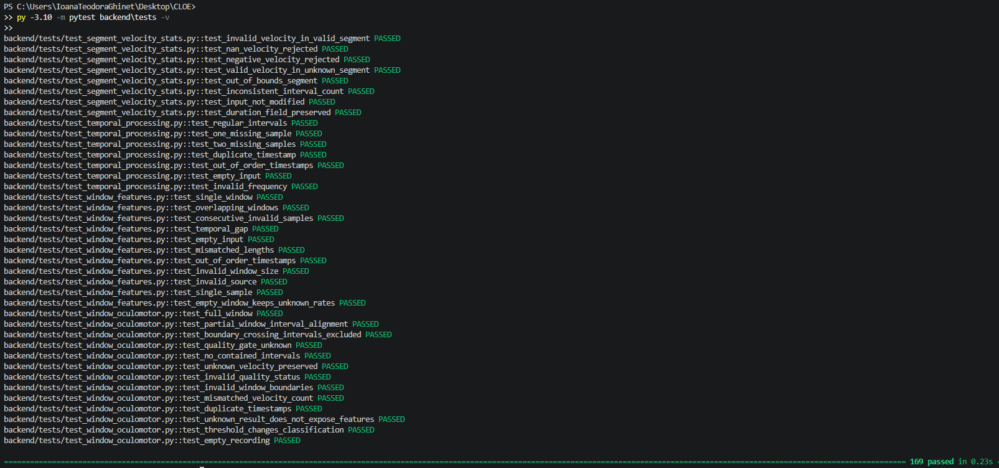

*Figure 20. Complete backend regression suite after T04-B — 169 tests passed.*

---

#### 6.3.13 Real Quality Gate Dataset Read-Back

The Quality Gate CSV generated during M0.3 was loaded using the newly implemented `load_quality_decisions()` function.

**Input:**

`data/processed/tobii_20261029T143930551761Z_quality_decisions.csv`

**Observed results:**

| Metric | Value |
|---|---:|
| Windows successfully loaded | 20 |
| ELIGIBLE windows | 16 |
| UNKNOWN windows | 4 |
| ELIGIBLE proportion | 80% |
| UNKNOWN proportion | 20% |

The observed counts match the earlier M0.3 Quality Gate evaluation.

The loader successfully preserved the original rejection reasons for the UNKNOWN windows.

#### 6.3.14 UNKNOWN Window Analysis

The four UNKNOWN windows were identified as follows:

| Window | Rejection reasons |
|---|---|
| 6.50–7.50 s | `LOW_AVAILABILITY`, `LOW_USABLE_NOMINAL_RATIO` |
| 7.00–8.00 s | `LOW_AVAILABILITY`, `LOW_USABLE_NOMINAL_RATIO` |
| 9.00–10.00 s | `PARTIAL_WINDOW`, `LOW_NOMINAL_SAMPLE_RATIO`, `LOW_USABLE_NOMINAL_RATIO` |
| 9.50–10.50 s | `PARTIAL_WINDOW`, `LOW_NOMINAL_SAMPLE_RATIO`, `LOW_USABLE_NOMINAL_RATIO` |

The first two windows were marked UNKNOWN due to insufficient usable gaze measurements according to the configured M0.3 policy.

The final two windows were marked UNKNOWN because they extended beyond the observed recording boundaries and did not satisfy the required nominal sample coverage and usable-sample criteria.

The reasons were loaded from the existing decision file rather than recalculated by the T04-B component.

#### 6.3.15 Evidence — Real CSV Read-Back

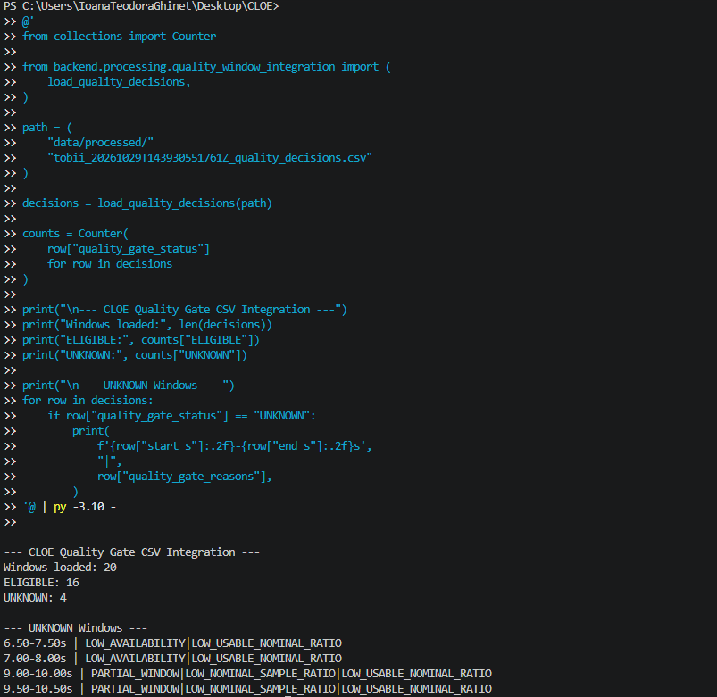

*Figure 21. Successful read-back of 20 M0.3 Quality Gate decisions, including four UNKNOWN windows and their original rejection reasons.*

---

#### 6.3.16 Interpretation

The T04-B unit tests demonstrate that the integration module behaves as expected for the ten defined synthetic test scenarios.

The implementation correctly validates Quality Gate CSV structure, temporal boundaries, decision values, and row ordering.

It preserves original rejection reasons and prevents UNKNOWN quality windows from exposing usable feature vectors in the tested integration scenarios.

The complete regression suite passed, with 169 successful tests.

The real M0.3 Quality Gate CSV was successfully loaded, and its 20 decisions matched the previously observed distribution of 16 ELIGIBLE and four UNKNOWN windows.

These results support the initial correctness of the Quality Gate decision-loading component and its compatibility with the existing T04-A extraction interface.

However, the actual feature availability outcomes for all 20 real windows have not yet been evaluated.

#### 6.3.17 Design Decisions

The following decisions were adopted:

1. Keep Quality Gate decision loading separate from oculomotor feature extraction.
2. Reuse the existing T04-A window-level feature extraction function.
3. Preserve original M0.3 Quality Gate decisions.
4. Preserve original diagnostic rejection reasons.
5. Validate the decision CSV before processing.
6. Preserve original temporal window ordering.
7. Allow overlapping sliding windows.
8. Maintain one output record for each input decision.
9. Prevent UNKNOWN quality windows from exposing usable feature vectors.
10. Distinguish quality eligibility from feature availability.
11. Keep velocity thresholds explicit and configurable.
12. Avoid cognitive-load inference at this stage.

#### 6.3.18 Limitations

The current experiment has the following limitations:

- Unit tests use synthetic gaze and quality decision data.
- The real M0.3 CSV was loaded and inspected, but the complete feature extraction pipeline has not yet been executed on all 20 real windows.
- The module trusts the saved Quality Gate decisions and does not independently recalculate the original quality metrics.
- Window boundaries are validated for increasing start times, but exact identity matching against the original M0.3 window feature file has not yet been independently verified.
- The quality decision CSV is not cryptographically associated with the raw Tobii recording.
- The experimental Quality Gate thresholds remain engineering parameters rather than validated physiological limits.
- The velocity-state classification thresholds remain experimental.
- No window-level output dataset has yet undergone real-data read-back verification.
- No fixation, saccade, or cognitive-load classification accuracy has been established.

#### 6.3.19 Conclusion

**Result: PASS — Unit Testing, Regression Testing and Real Quality Decision CSV Read-Back**

T04-B successfully implemented the loading and validation of saved M0.3 Quality Gate decisions and their integration interface with the T04-A window-level oculomotor feature extraction component.

All ten unit tests passed.

The complete backend regression suite passed, with 169 successful tests.

The real M0.3 Quality Gate decision file was successfully loaded, preserving 20 temporal windows, including 16 ELIGIBLE and four UNKNOWN decisions with their original rejection reasons.

T04-B is complete at the defined software-validation and real decision-file read-back level.

Full evaluation of window-level oculomotor feature availability on the real Tobii recording remains part of T04-C.

---

### 6.4 T04-C — Real Tobii Window-Level Evaluation

**Date:** 2026-11-17  
**Status:** PASS — Integration Testing, Regression Testing and Initial Real Data Evaluation

**Implementation:** `backend/processing/analyze_real_windows.py`  
**Tests:** `backend/tests/test_real_window_integration.py`

---

#### 6.4.1 Objective

Integrate the original Tobii Pro Nano gaze recording, the M0.3 sliding-window feature dataset, and the saved Quality Gate decisions into a complete real-data window-level oculomotor processing pipeline.

The experiment aims to verify temporal window alignment, preserve data-quality decisions, and evaluate oculomotor feature availability across multiple experimental velocity thresholds.

The implementation must prevent windows marked UNKNOWN by the Quality Gate from exposing usable oculomotor feature vectors.

#### 6.4.2 Background

Previous experiments established the following capabilities:

- **M0.3:** Gaze validation, temporal processing, sliding-window extraction, data-quality assessment, and configurable Quality Gate decisions.
- **M0.4/T01–T02:** Gaze velocity calculation and movement-state segmentation.
- **M0.4/T03:** Segment duration calculation, velocity statistics, recording-level feature summaries, and integration with real Tobii recordings.
- **M0.4/T04-A:** Temporal alignment and window-level oculomotor feature extraction.
- **M0.4/T04-B:** Loading and validating saved M0.3 Quality Gate decisions.

T04-C combines these components and evaluates their behavior using the original Tobii Pro Nano recording.

#### 6.4.3 Input Datasets

Three input datasets were used.

**Raw Tobii recording:**

`data/raw/tobii/tobii_20261029T143930551761Z.csv`

**M0.3 sliding-window features:**

`data/processed/tobii_20261029T143930551761Z_window_features.csv`

**M0.3 Quality Gate decisions:**

`data/processed/tobii_20261029T143930551761Z_quality_decisions.csv`

**Previously observed characteristics:**

| Property | Value |
|---|---:|
| Recorded gaze samples | 576 |
| Velocity intervals | 575 |
| Temporal windows | 20 |
| ELIGIBLE Quality Gate decisions | 16 |
| UNKNOWN Quality Gate decisions | 4 |

#### 6.4.4 Experimental Configuration

| Parameter | Value |
|---|---|
| Experiment identifier | M0.4-T04-C |
| Nominal sampling frequency | 60 Hz |
| Maximum temporal gap ratio | 1.5 |
| Experimental velocity thresholds | 2.0, 5.0, 10.0 |
| Temporal window size | 1.0 s |
| Temporal window step | 0.5 s |
| Temporal alignment method | Fully contained velocity intervals |
| Velocity unit | Normalized display units/second |
| Quality Gate decisions | ELIGIBLE, UNKNOWN |
| Feature availability statuses | AVAILABLE, UNAVAILABLE |

The velocity thresholds are illustrative engineering parameters rather than validated physiological thresholds.

The existing M0.3 Quality Gate decisions were reused without recalculating the original quality metrics.

#### 6.4.5 Processing Architecture

The integration workflow is organized as follows:

```text
Original Tobii Recording
          |
          v
Gaze Fusion and Velocity Calculation
          |
          +------------------------------+
          |                              |
          v                              v
M0.4 Velocity Intervals       M0.3 Window Features
          |                              |
          |                              v
          |                    M0.3 Quality Decisions
          |                              |
          +---------------+--------------+
                          |
                          v
              Window Alignment Validation
                          |
                          v
              T04-B Quality Integration
                          |
                          v
             T04-A Oculomotor Extraction
                          |
                   +------+------+
                   |             |
                   v             v
               AVAILABLE     UNAVAILABLE
                   |             |
                   v             v
             Feature Summary   No usable
                               feature vector
```

The pipeline preserves separate responsibilities for temporal alignment, quality assessment, and oculomotor feature extraction.

#### 6.4.6 Implementation

**Module:** `backend/processing/analyze_real_windows.py`

The implementation introduces the following functions:

| Function | Responsibility |
|---|---|
| `sha256_file()` | Calculate source-file SHA-256 digests |
| `validate_recording_identity()` | Check input recording identifiers |
| `validate_window_alignment()` | Verify temporal correspondence between window features and quality decisions |
| `evaluate_real_windows()` | Execute window-level feature extraction for configured thresholds |
| `export_results()` | Export window-level results, summaries, and metadata |

The main processing function loads the input datasets, generates interval-level velocities, evaluates the saved windows, and exports experimental results.

#### 6.4.7 Methodology

The processing pipeline performs the following operations:

1. Checks the existence of all input files.
2. Verifies that input filenames contain the expected recording identifier.
3. Loads the saved M0.3 Quality Gate decisions.
4. Compares window boundaries from the feature and decision datasets.
5. Rejects mismatched window counts or boundaries.
6. Loads the original Tobii gaze recording.
7. Reuses the existing binocular gaze fusion implementation.
8. Calculates velocity values for consecutive received gaze samples.
9. Reuses the same velocity sequence for three experimental threshold configurations.
10. Integrates the saved Quality Gate decisions with T04-A.
11. Extracts movement summaries for eligible windows containing fully aligned velocity intervals.
12. Prevents UNKNOWN quality windows from exposing usable feature vectors.
13. Preserves original rejection reasons.
14. Calculates feature availability summaries.
15. Exports threshold-specific window results and experimental metadata.

#### 6.4.8 Recording Identity and Window Alignment

Input recording identity is checked using the expected filename structure.

The raw recording and both M0.3 datasets must share the same recording identifier.

Window alignment is verified by comparing:

- Total window counts.
- Window start times.
- Window end times.
- Original ordering.

A numerical tolerance of \(10^{-6}\) seconds is applied when comparing stored temporal boundaries.

Overlapping windows are permitted because the sliding-window configuration uses a 0.5-second step with 1.0-second windows.

**Observed result: 20 aligned windows.**

**Result: PASS — Window Alignment Verification**

Filename-based identity and boundary matching establish consistency between the supplied inputs, but do not independently prove their complete data provenance.

---

#### 6.4.9 Integration Unit Testing

**Test file:** `backend/tests/test_real_window_integration.py`

**Execution command:**

```powershell
py -3.10 -m pytest backend\tests\test_real_window_integration.py -v
```

Nine integration tests were implemented and executed.

**Observed results:**

| Test | Expected behavior | Result |
|---|---|---|
| `test_matching_recording_identifiers` | Accept matching recording identifiers | PASS |
| `test_mismatched_recording_identifier` | Reject inconsistent recording identifiers | PASS |
| `test_window_alignment_passes` | Accept aligned temporal windows | PASS |
| `test_window_alignment_mismatch` | Reject mismatched window boundaries | PASS |
| `test_window_count_mismatch` | Reject inconsistent window counts | PASS |
| `test_quality_gate_blocks_real_window_pipeline` | Prevent feature exposure for UNKNOWN quality windows | PASS |
| `test_quality_counts_preserved_across_thresholds` | Preserve quality decisions across experimental thresholds | PASS |
| `test_duplicate_threshold_rejected` | Reject duplicate threshold configurations | PASS |
| `test_export_readback` | Export and reload synthetic window results | PASS |

**Observed unit test summary:**

```text
collected 9 items

9 passed in 0.14s
```

**Result: PASS — Integration Unit Testing**

All nine tests passed for the defined synthetic scenarios.

#### 6.4.10 Evidence — Integration Testing


*Figure 22. Successful execution of all nine T04-C integration tests.*

---

#### 6.4.11 Regression Testing

The complete backend regression suite was executed after implementing the real window-level integration component.

**Execution command:**

```powershell
py -3.10 -m pytest backend\tests -v
```

**Observed result:** 178/178 PASSED in 0.27 seconds.

**Execution environment:**

- Operating system: Windows 11 Education, 64-bit.
- Python version: 3.10.11.
- pytest version: 9.2.0.

All previously implemented tests passed.

No regressions were detected by the current automated test suite.

**Result: PASS — Regression Testing**

#### 6.4.12 Evidence — Regression Testing

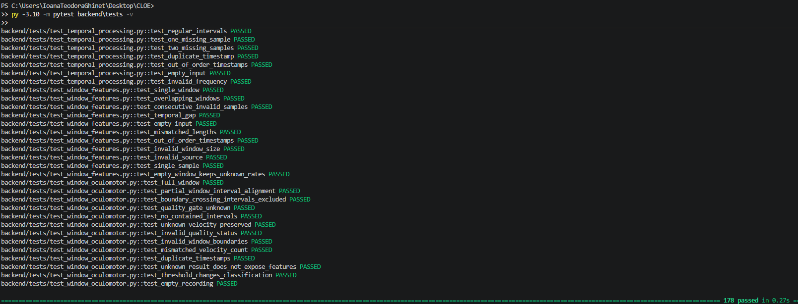

*Figure 23. Complete backend regression suite after T04-C — 178 tests passed.*

---

#### 6.4.13 Real Tobii Recording Evaluation

The real-data integration pipeline was executed using the original Tobii recording and the two M0.3 processed datasets.

**Execution command:**

```powershell
py -3.10 -m backend.processing.analyze_real_windows `
  "data\raw\tobii\tobii_20261029T143930551761Z.csv" `
  "data\processed\tobii_20261029T143930551761Z_window_features.csv" `
  "data\processed\tobii_20261029T143930551761Z_quality_decisions.csv" `
  --thresholds 2.0 5.0 10.0
```

**Observed general results:**

| Metric | Value |
|---|---:|
| Gaze samples processed | 576 |
| Consecutive velocity intervals | 575 |
| Aligned temporal windows | 20 |
| ELIGIBLE quality windows | 16 |
| UNKNOWN quality windows | 4 |
| Experimental velocity thresholds | 3 |
| Window-threshold evaluations | 60 |

The observed sample, interval, and window counts match the previously established M0.3 and M0.4 results.

#### 6.4.14 Feature Availability Results

The following feature availability distribution was observed:

| Metric | Threshold 2.0 | Threshold 5.0 | Threshold 10.0 |
|---|---:|---:|---:|
| Total windows | 20 | 20 | 20 |
| Feature AVAILABLE | 16 | 16 | 16 |
| Feature UNAVAILABLE | 4 | 4 | 4 |
| QUALITY_GATE_UNKNOWN reasons | 4 | 4 | 4 |

**Finding 1 — Successful feature generation for eligible windows**

All sixteen windows marked ELIGIBLE by the saved M0.3 Quality Gate produced available movement feature summaries.

No eligible window was rejected because of an absence of fully contained velocity intervals.

**Finding 2 — Quality Gate enforcement**

All four windows marked UNKNOWN by the saved Quality Gate produced UNAVAILABLE results.

No usable feature vector was exposed for these windows.

**Finding 3 — Availability invariance across thresholds**

Feature availability remained unchanged for the three experimental velocity thresholds.

This is consistent with the implementation's separation between quality eligibility and velocity-state classification.

This invariance does not imply that the numerical feature values are identical across threshold configurations.

#### 6.4.15 UNKNOWN Window Evaluation

Four temporal windows were classified as UNKNOWN by the existing Quality Gate.

**Observed results:**

| Window | Quality Gate status | Feature status | Selected velocity intervals |
|---|---|---|---:|
| 6.50–7.50 s | UNKNOWN | UNAVAILABLE | 57 |
| 7.00–8.00 s | UNKNOWN | UNAVAILABLE | 57 |
| 9.00–10.00 s | UNKNOWN | UNAVAILABLE | 38 |
| 9.50–10.50 s | UNKNOWN | UNAVAILABLE | 8 |

All four windows reported the feature unavailability reason:

`QUALITY_GATE_UNKNOWN`

The original M0.3 rejection reasons remained associated with the corresponding windows through the integration pipeline.

The presence of selected velocity intervals does not override a Quality Gate rejection.

The windows were not treated as having usable feature vectors.

#### 6.4.16 Temporal Interval Alignment Results

The pipeline uses a fully contained interval policy.

A velocity interval is selected only when both corresponding device timestamps lie within the temporal window.

**Observed interval selection behavior:**

- The first window, 0.00–1.00 s, contained 58 selected velocity intervals.
- Most complete windows contained 59 selected velocity intervals.
- The two UNKNOWN windows at 6.50–7.50 s and 7.00–8.00 s contained 57 selected intervals each.
- The partial window at 9.00–10.00 s contained 38 selected intervals.
- The partial window at 9.50–10.50 s contained 8 selected intervals.

The selection counts depend on the original sample timestamps and temporal window boundaries.

They are not necessarily equal to the nominal sampling frequency.

Because sliding windows overlap, an individual velocity interval may be selected by multiple windows.

Therefore, summing interval counts across windows does not represent the number of unique velocity intervals in the recording.

#### 6.4.17 Consistency Verification

The following checks were performed against the observed output.

**Check 1 — Input recording consistency**

The processed recording contained 576 samples and 575 velocity intervals.

**Result: PASS**

**Check 2 — Temporal window alignment**

Twenty saved Quality Gate decisions were aligned with twenty M0.3 window feature records.

**Result: PASS**

**Check 3 — Preservation of Quality Gate decisions**

Sixteen windows remained ELIGIBLE and four remained UNKNOWN across all threshold configurations.

**Result: PASS**

**Check 4 — UNKNOWN feature blocking**

All four UNKNOWN quality windows returned UNAVAILABLE feature status for every threshold.

**Result: PASS**

**Check 5 — Eligible feature extraction**

All sixteen ELIGIBLE windows returned AVAILABLE feature status for every threshold.

**Result: PASS**

**Check 6 — Threshold evaluation count**

Three experimental threshold configurations were evaluated using the same twenty temporal windows.

**Result: PASS**

These checks support consistency of the integrated software pipeline.

They do not independently validate physiological eye-movement classifications or cognitive-load estimation.

#### 6.4.18 Evidence — Real Recording Evaluation

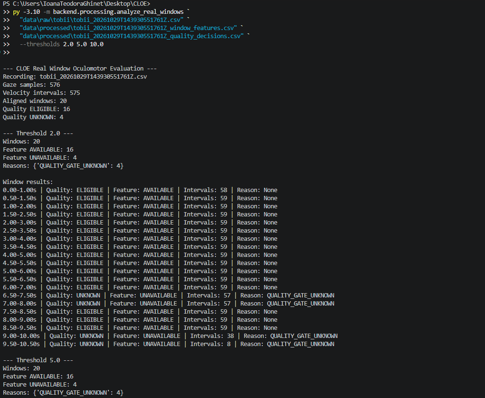

*Figure 24. Real Tobii recording evaluation showing input consistency, window alignment, and feature availability.*

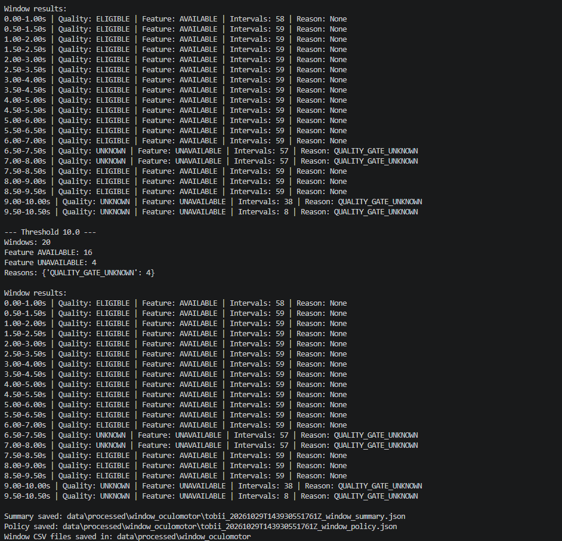

*Figure 25. Window-level feature results across experimental velocity thresholds, including preservation of Quality Gate UNKNOWN decisions.*

---

#### 6.4.19 Generated Output Artifacts

The processing script reported generating the following artifacts in:

`data/processed/window_oculomotor/`

**Window-level feature datasets:**

```text
tobii_20261029T143930551761Z_windows_2p0.csv
tobii_20261029T143930551761Z_windows_5p0.csv
tobii_20261029T143930551761Z_windows_10p0.csv
```

**Feature availability summary:**

```text
tobii_20261029T143930551761Z_window_summary.json
```

**Experimental metadata:**

```text
tobii_20261029T143930551761Z_window_policy.json
```

The policy contains source-file identifiers, file digests, recording characteristics, experimental thresholds, and the temporal alignment method.

The script reported successful export of these files.

Independent real-data output read-back remains part of T04-D.

#### 6.4.20 Interpretation

The T04-C results demonstrate successful integration of the existing M0.3 Quality Gate decisions with the M0.4 window-level oculomotor feature extraction pipeline for the analyzed recording.

The pipeline preserved temporal alignment, Quality Gate decisions, and rejection behavior across three experimental velocity thresholds.

All sixteen eligible windows produced feature summaries.

All four UNKNOWN quality windows remained unavailable.

The complete backend regression suite passed, indicating no regressions detected by the current tests.

These findings support the initial software correctness and data-quality gating behavior of the integrated processing pipeline.

However, feature availability is not equivalent to physiological validity or reliable cognitive-load inference.

#### 6.4.21 Design Decisions

1. Reuse previously tested M0.3 and M0.4 processing components.
2. Verify input recording identifiers before integration.
3. Validate saved temporal window boundaries.
4. Preserve original Quality Gate decisions.
5. Reuse one velocity sequence across threshold configurations.
6. Keep Quality Gate eligibility separate from feature availability.
7. Prevent UNKNOWN quality windows from exposing usable features.
8. Preserve original diagnostic rejection reasons.
9. Use fully contained velocity intervals.
10. Allow overlapping sliding windows.
11. Store threshold-specific results separately.
12. Preserve experiment configuration and source-file digests.
13. Avoid cognitive-load inference during this experiment.

#### 6.4.22 Limitations

- The real-data evaluation uses one Tobii Pro Nano recording.
- The Quality Gate thresholds remain experimental engineering parameters.
- Velocity classification thresholds have not been physiologically calibrated.
- The fully contained interval policy excludes intervals crossing window boundaries.
- Sliding windows overlap, so their feature observations are not statistically independent.
- The pipeline currently uses saved Quality Gate decisions rather than recalculating them during execution.
- Filename-based identity checks and file digests do not independently establish complete data provenance.
- The evaluation verifies feature availability, not the correctness of every extracted numerical feature.
- The real window-level CSV and JSON outputs have not yet undergone independent read-back verification.
- No comparison with annotated physiological eye-movement events has been performed.
- No cognitive-load estimation or adaptive interface action was evaluated.

#### 6.4.23 Conclusion

**Result: PASS — Integration Testing, Regression Testing and Initial Real Data Evaluation**

T04-C successfully integrated the original Tobii recording, M0.3 sliding-window features, and saved Quality Gate decisions into a complete window-level oculomotor processing pipeline.

All nine integration tests passed.

The complete backend regression suite passed, with 178 successful tests.

The pipeline processed 576 gaze samples, generated 575 velocity intervals, and evaluated twenty aligned temporal windows under three experimental velocity thresholds.

All sixteen eligible windows produced available feature summaries, while all four UNKNOWN quality windows remained unavailable.

The results demonstrate the expected software-level behavior for the analyzed recording.

Independent output verification and additional data-quality consistency checks remain part of T04-D.


### 6.5 T04-D — Independent Output Verification

**Date:** 2026-11-17  
**Status:** PASS — Unit Testing, Regression Testing and Independent Real-Data Output Verification

**Implementation:** `backend/processing/verify_window_outputs.py`  
**Tests:** `backend/tests/test_window_output_verification.py`

---

#### 6.5.1 Objective

Develop and validate an independent verification component for the window-level oculomotor datasets generated during T04-C.

The objective is to ensure that exported CSV and JSON artifacts preserve the original temporal windows, Quality Gate decisions, feature availability statuses, experimental configurations, and source-file identities.

The verification component must also detect malformed or inconsistent artifacts rather than silently accepting them.

#### 6.5.2 Background

T04-C implemented and evaluated the complete window-level oculomotor processing pipeline using a real Tobii Pro Nano recording.

The experiment processed 576 gaze samples, generated 575 velocity intervals, and evaluated 20 temporal windows under three experimental velocity thresholds.

The pipeline generated three window-level feature datasets, a recording-level availability summary, and an experimental metadata file.

Although the processing script reported successful execution and export, independent verification was required to confirm that the persisted artifacts were internally consistent and aligned with their original input datasets.

T04-D introduces a separate verification module that reads exported artifacts without invoking the original feature extraction or export functions.

#### 6.5.3 Input Artifacts

**Original source datasets:**

```text
data/raw/tobii/
  tobii_20261029T143930551761Z.csv

data/processed/
  tobii_20261029T143930551761Z_window_features.csv
  tobii_20261029T143930551761Z_quality_decisions.csv
```

**Generated T04-C artifacts:**

```text
data/processed/window_oculomotor/
  tobii_20261029T143930551761Z_windows_2p0.csv
  tobii_20261029T143930551761Z_windows_5p0.csv
  tobii_20261029T143930551761Z_windows_10p0.csv
  tobii_20261029T143930551761Z_window_summary.json
  tobii_20261029T143930551761Z_window_policy.json
```

The verifier uses the original sources as references when checking the exported results.

#### 6.5.4 Implementation

**Module:** `backend/processing/verify_window_outputs.py`

The module includes reusable functions for:

- Reading and validating CSV files.
- Reading JSON documents.
- Calculating source-file SHA-256 digests.
- Validating finite numerical values.
- Validating nonnegative integer counts.
- Comparing temporal boundaries.
- Validating serialized movement feature summaries.
- Verifying cross-file and cross-threshold consistency.

The main verification function is:

`verify_window_outputs(raw_csv, window_csv, quality_csv, output_dir)`

It returns a report for each experimental threshold when all implemented checks pass.

If an inconsistency is detected, the verification process raises an exception.

The command-line interface reports `FAIL` and exits with a nonzero status when supported verification errors are detected.

#### 6.5.5 Verification Methodology

The independent verification process performs the following operations:

1. Validates recording identifiers.
2. Loads the experimental policy and window summary JSON files.
3. Verifies the expected experiment identifier.
4. Calculates SHA-256 digests for the three original input files.
5. Compares calculated digests with the saved policy values.
6. Validates configured experimental velocity thresholds.
7. Verifies the temporal alignment method.
8. Reloads the original window features and Quality Gate decision CSV files.
9. Compares original temporal boundaries and Quality Gate decisions.
10. Reloads every threshold-specific window-level feature CSV.
11. Verifies window counts and ordering.
12. Checks that original Quality Gate statuses and rejection reasons remain unchanged.
13. Verifies feature availability and rejection reason consistency.
14. Parses serialized feature JSON for AVAILABLE windows.
15. Validates interval distributions and segment accounting.
16. Compares alignment and availability information across experimental thresholds.
17. Compares calculated counts against the saved JSON summaries.
18. Produces a final verification result.

#### 6.5.6 Source-File Integrity Verification

The verifier independently calculates SHA-256 digests for the original raw recording, M0.3 window feature dataset, and Quality Gate decision dataset.

The calculated values are compared with the corresponding digests recorded in the T04-C metadata.

A mismatch causes verification failure.

This mechanism detects changes to source files relative to the saved metadata.

However, SHA-256 consistency does not independently establish the authenticity of the original data or the physiological correctness of the measurements.

#### 6.5.7 CSV and JSON Structural Validation

The verifier checks the structural integrity of the exported datasets.

The implemented checks include:

- Required CSV columns.
- Duplicate CSV column detection.
- Missing and unexpected CSV field values.
- Required policy information.
- Valid experimental threshold configuration.
- Expected number of window records.
- Correct temporal window boundaries.
- Valid feature status values.
- Parseable feature JSON.
- Consistent summary counts.

The verifier rejects artifacts that violate these requirements.

#### 6.5.8 Feature Payload Validation

For AVAILABLE windows, the validator parses the serialized `features_json` field and verifies selected structural and mathematical properties.

The checks include:

| Feature | Verification |
|---|---|
| `total_intervals` | Matches selected interval count |
| `interval_count_by_state` | Counts sum to total intervals |
| `interval_share_by_state` | Shares match corresponding interval counts |
| `segment_count` | Matches sum of per-state segment counts |
| `transition_count` | Equals segment count minus one |

The allowed movement states are:

- LOW_VELOCITY
- HIGH_VELOCITY
- UNKNOWN

For windows marked UNAVAILABLE, the verifier requires that no serialized usable feature vector is exposed.

The validator checks these defined consistency properties but does not independently recompute all numerical movement features from the original gaze coordinates.

#### 6.5.9 Quality Gate Preservation

The validator compares the exported Quality Gate statuses and rejection reasons with the original M0.3 decision CSV.

For UNKNOWN quality windows, the following conditions must hold:

- Feature status equals UNAVAILABLE.
- Feature reason equals `QUALITY_GATE_UNKNOWN`.
- The serialized feature payload is empty.

An UNKNOWN quality window containing usable features is treated as invalid.

This check enforces the intended separation between data-quality eligibility and feature availability.

#### 6.5.10 Cross-Threshold Consistency

Three experimental velocity thresholds were evaluated:

| Threshold | Unit |
|---|---|
| 2.0 | Normalized display units/s |
| 5.0 | Normalized display units/s |
| 10.0 | Normalized display units/s |

The verifier checks that changing the movement classification threshold does not alter:

- Temporal window boundaries.
- Original Quality Gate decisions.
- Original rejection reasons.
- Number of selected velocity intervals.
- Feature availability statuses.
- Feature unavailability reasons.

Movement-state distributions and other velocity-dependent numerical features may differ between thresholds.

This distinction is intentional because the experimental velocity threshold affects movement classification, not the original data-quality assessment.

---

#### 6.5.11 Unit Testing

**Test file:** `backend/tests/test_window_output_verification.py`

**Execution command:**

```powershell
py -3.10 -m pytest backend\tests\test_window_output_verification.py -v
```

Ten test scenarios were executed.

**Observed results:**

| Test | Expected behavior | Result |
|---|---|---|
| `test_valid_artifacts_pass` | Accept structurally consistent artifacts | PASS |
| `test_modified_source_hash_rejected` | Detect changes to source files | PASS |
| `test_changed_quality_status_rejected` | Reject altered Quality Gate decisions | PASS |
| `test_unknown_feature_leak_rejected` | Detect feature exposure in UNKNOWN windows | PASS |
| `test_wrong_window_count_rejected` | Reject incorrect window counts | PASS |
| `test_invalid_feature_json_rejected` | Reject malformed serialized feature data | PASS |
| `test_incorrect_feature_interval_count_rejected` | Reject inconsistent interval accounting | PASS |
| `test_changed_threshold_rejected` | Detect altered experimental thresholds | PASS |
| `test_modified_summary_rejected` | Detect mismatched availability summaries | PASS |
| `test_changed_interval_selection_rejected` | Detect inconsistent interval selection | PASS |

**Observed unit test summary:**

```text
collected 10 items

10 passed in 0.37s
```

**Result: PASS — Unit Testing**

All ten tests passed.

The tests included a valid synthetic artifact collection and multiple intentionally corrupted artifact scenarios.

Successful execution of the negative tests indicates that the verifier rejected the specific inconsistencies introduced during testing.

These results support the correctness of the verifier for the defined test scenarios.

#### 6.5.12 Evidence — Unit Testing

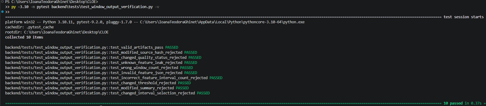

*Figure 26. Successful execution of all ten independent output verification tests, including intentionally corrupted artifact scenarios.*

---

#### 6.5.13 Regression Testing

The complete backend test suite was executed after introducing the independent output verification module.

**Execution command:**

```powershell
py -3.10 -m pytest backend\tests -v
```

**Observed result:** 188/188 PASSED in 0.38 seconds.

**Execution environment:**

- Operating system: Windows 11 Education, 64-bit.
- Python version: 3.10.11.
- pytest version: 9.2.0.

The regression suite included the previously implemented gaze processing, temporal processing, data-quality assessment, movement segmentation, segment feature extraction, recording-level summary, window-level integration, and output verification components.

No regressions were detected by the existing test suite.

**Result: PASS — Regression Testing**

#### 6.5.14 Evidence — Regression Testing

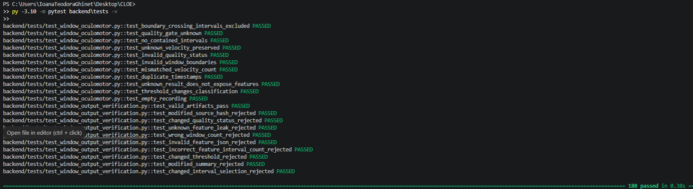

*Figure 27. Complete backend regression suite after T04-D — 188 tests passed.*

---

#### 6.5.15 Independent Real-Data Output Verification

The verifier was executed on the real T04-C output artifacts.

**Execution command:**

```powershell
py -3.10 -m backend.processing.verify_window_outputs `
  "data\raw\tobii\tobii_20261029T143930551761Z.csv" `
  "data\processed\tobii_20261029T143930551761Z_window_features.csv" `
  "data\processed\tobii_20261029T143930551761Z_quality_decisions.csv" `
  --output-dir "data\processed\window_oculomotor"
```

**Observed results:**

| Metric | Threshold 2.0 | Threshold 5.0 | Threshold 10.0 |
|---|---:|---:|---:|
| Exported windows | 20 | 20 | 20 |
| Feature AVAILABLE | 16 | 16 | 16 |
| Feature UNAVAILABLE | 4 | 4 | 4 |
| Quality Gate UNKNOWN | 4 | 4 | 4 |

The observed distributions match the original T04-C evaluation.

The verifier also reported:

```text
Cross-threshold alignment: PASS
Source-file hash verification: PASS
CSV/JSON read-back: PASS
Result: PASS
```

**Result: PASS — Independent Real-Data Output Verification**

The persisted datasets passed the implemented structural, numerical-consistency, quality-preservation, and cross-threshold checks.

#### 6.5.16 Evidence — Real-Data Verification

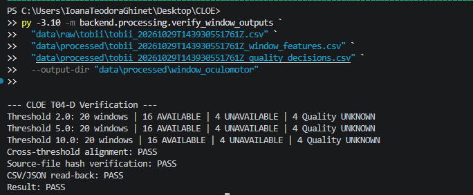

*Figure 28. Independent verification of real Tobii window-level artifacts for thresholds 2.0, 5.0, and 10.0.*

---

#### 6.5.17 Observed Verification Summary

| Verification | Observed result |
|---|---|
| Independent validator unit tests | 10/10 PASSED |
| Complete regression suite | 188/188 PASSED |
| Real threshold 2.0 artifacts | PASS |
| Real threshold 5.0 artifacts | PASS |
| Real threshold 10.0 artifacts | PASS |
| Cross-threshold alignment | PASS |
| Source-file hash consistency | PASS |
| CSV/JSON read-back | PASS |
| UNKNOWN quality feature blocking | PASS |
| Overall output verification | PASS |

The verifier successfully checked the three exported threshold configurations against their original source files and saved experimental metadata.

#### 6.5.18 Key Findings

**Finding 1 — Successful artifact persistence**

All three threshold-specific window datasets were read and verified.

Each contained twenty window-level records.

**Finding 2 — Preserved feature availability**

All three configurations contained sixteen AVAILABLE and four UNAVAILABLE feature results.

These counts match the original real-data evaluation.

**Finding 3 — Preserved Quality Gate decisions**

The four UNKNOWN windows remained unavailable across all threshold configurations.

The validator confirmed that these windows did not expose usable feature payloads.

**Finding 4 — Source-file consistency**

The calculated SHA-256 digests matched the source-file digests stored in the experimental metadata.

This indicates that the verified input files matched the files identified by the saved hashes.

**Finding 5 — Correct cross-threshold alignment**

The temporal boundaries, Quality Gate decisions, selected interval counts, and feature availability information remained consistent across the three experimental thresholds.

**Finding 6 — Detection of intentionally corrupted artifacts**

Negative unit tests demonstrated rejection of selected malformed or inconsistent artifacts, including incorrect hashes, altered quality decisions, invalid feature JSON, and inconsistent summary counts.

#### 6.5.19 Design Decisions

The following decisions were adopted:

1. Implement independent verification rather than reuse the original export logic.
2. Preserve original input datasets without modification.
3. Verify source-file digests before accepting derived results.
4. Validate persisted CSV and JSON structures.
5. Compare every exported window against the original Quality Gate decisions.
6. Prevent UNKNOWN quality windows from exposing feature payloads.
7. Validate movement-state interval and segment accounting.
8. Verify summary consistency across threshold configurations.
9. Detect malformed data explicitly.
10. Use negative tests to verify rejection behavior.
11. Preserve experimental parameters and source-file identification.
12. Avoid interpreting software verification success as physiological validation.

#### 6.5.20 Limitations

The experiment has the following limitations:

- The real-data evaluation uses one Tobii Pro Nano recording.
- The verifier checks selected structural and numerical consistency properties but does not independently recompute every oculomotor feature.
- The current checks do not establish the scientific validity of the velocity classification thresholds.
- Source-file hash consistency does not independently prove the authenticity or original provenance of the recorded data.
- The synthetic tests do not cover every possible malformed dataset.
- The verification does not establish accuracy against annotated fixation or saccade ground truth.
- The sliding windows overlap and must not be treated as independent experimental observations.
- Feature availability does not imply reliable cognitive-load estimation.
- No cognitive-load classifier or adaptive interface decision was evaluated.
- Further tests on additional recordings and controlled experimental conditions are required.

#### 6.5.21 Conclusion

**Result: PASS — Unit Testing, Regression Testing and Independent Real-Data Output Verification**

T04-D successfully implemented and validated an independent verification component for the window-level oculomotor artifacts generated during T04-C.

All ten validator unit tests passed, including scenarios containing intentionally corrupted data.

The complete backend regression suite passed, with 188 successful tests.

The verifier successfully reloaded and checked the real exported datasets for all three experimental velocity thresholds.

Each configuration contained twenty windows, including sixteen AVAILABLE and four UNAVAILABLE feature results.

Cross-threshold alignment, source-file hash consistency, and CSV/JSON read-back verification all passed.

T04-D is complete at the defined software and artifact-consistency validation level.

The results do not establish physiological fixation or saccade accuracy or the reliability of future cognitive-load estimates.

---

### 6.6 T04 — Final Status

**Milestone component:** M0.4 / T04 — Window-Level Oculomotor Integration

**Status:** COMPLETE — Defined Software and Initial Real-Data Validation Objectives

| Subtask | Result |
|---|---|
| T04-A — Temporal Alignment and Window Feature Extraction | PASS |
| T04-B — Quality Gate Decision Integration | PASS |
| T04-C — Real Tobii Window-Level Evaluation | PASS |
| T04-D — Independent Output Verification | PASS |

**Final regression baseline:** 188/188 tests PASSED.

T04 established an initial end-to-end processing workflow that integrates real Tobii gaze measurements, temporal sliding windows, Quality Gate decisions, and algorithmically derived oculomotor features.

The workflow explicitly preserves unavailable measurements and prevents windows failing the configured data-quality requirements from exposing usable feature vectors.

Further physiological validation and evaluation across multiple recordings remain necessary before using these features for cognitive-load estimation.


## 7. T05 — Feature Reliability and Experimental Validation Preparation

**Date opened:** 2026-11-17  
**Status:** IN PROGRESS

### 7.1 T05-A — Feature Availability and Threshold Sensitivity

**Date:** 2026-11-17  
**Status:** PASS — Unit Testing, Regression Testing and Initial Real-Data Sensitivity Analysis

**Implementation:** `backend/processing/feature_reliability.py`  
**Tests:** `backend/tests/test_feature_reliability.py`

---

#### 7.1.1 Objective

Evaluate the availability and sensitivity of previously extracted window-level oculomotor features across multiple experimental velocity classification thresholds.

The experiment aims to quantify how movement-state distributions change when the velocity threshold is modified while preserving temporal window definitions and data-quality decisions.

This analysis provides preliminary evidence about parameter sensitivity, not physiological measurement reliability or cognitive-load estimation accuracy.

#### 7.1.2 Background

M0.4/T04 established a window-level oculomotor processing pipeline integrating real Tobii Pro Nano gaze recordings, movement-state segmentation, and saved M0.3 Quality Gate decisions.

The pipeline was evaluated using three illustrative velocity thresholds: 2.0, 5.0, and 10.0 normalized display units per second.

All three configurations produced sixteen AVAILABLE and four UNAVAILABLE window-level results.

Although the previous experiments verified output consistency and feature availability, the numerical sensitivity of movement-state distributions to threshold selection had not been systematically quantified at the window level.

T05-A introduces this analysis.

#### 7.1.3 Input Datasets

The experiment uses three previously generated and verified T04-C datasets.

**Input directory:** `data/processed/window_oculomotor/`

**Input files:**

```text
tobii_20261029T143930551761Z_windows_2p0.csv
tobii_20261029T143930551761Z_windows_5p0.csv
tobii_20261029T143930551761Z_windows_10p0.csv
```

These datasets originate from the same Tobii Pro Nano recording and contain equivalent temporal window definitions.

**Previously verified characteristics:**

| Property | Value |
|---|---:|
| Original recording samples | 576 |
| Original velocity intervals | 575 |
| Windows per threshold | 20 |
| AVAILABLE windows | 16 |
| UNAVAILABLE windows | 4 |
| Experimental velocity thresholds | 2.0, 5.0, 10.0 |

#### 7.1.4 Implementation

The analysis is implemented in:

`backend/processing/feature_reliability.py`

The module contains three primary functions.

| Function | Responsibility |
|---|---|
| `load_window_features()` | Load and validate saved window-level feature datasets |
| `state_shares()` | Recalculate movement-state proportions using interval counts |
| `analyze_threshold_sensitivity()` | Compare corresponding windows across experimental thresholds |

The implementation operates on existing processed datasets and does not modify the original Tobii recording or previously exported artifacts.

#### 7.1.5 Methodology

The analysis performs the following operations:

1. Loads each experimental threshold dataset.
2. Validates required CSV columns and feature availability statuses.
3. Parses serialized feature objects for AVAILABLE windows.
4. Preserves UNAVAILABLE windows without assigning artificial feature values.
5. Verifies consistent window counts across threshold configurations.
6. Compares window boundaries, Quality Gate decisions, feature statuses, and selected interval counts.
7. Recalculates movement-state proportions from interval counts.
8. Verifies that UNKNOWN interval proportions remain invariant across thresholds.
9. Verifies the expected direction of LOW/HIGH changes as thresholds increase.
10. Calculates per-window movement-state proportion ranges.
11. Calculates descriptive averages over AVAILABLE windows.
12. Produces a recording-level descriptive sensitivity report.

#### 7.1.6 Extracted Metrics

| Feature | Description |
|---|---|
| `window_count` | Number of evaluated temporal windows |
| `available_count` | Number of windows with available features |
| `unavailable_count` | Number of windows without usable feature vectors |
| `availability_rate` | Proportion of AVAILABLE windows |
| `mean_unknown_share` | Mean proportion of UNKNOWN velocity intervals among AVAILABLE windows |
| `mean_low_share_range` | Mean cross-threshold LOW_VELOCITY proportion range |
| `mean_high_share_range` | Mean cross-threshold HIGH_VELOCITY proportion range |
| `per_window` | Individual window-level sensitivity results |

#### 7.1.7 Mathematical Definitions

**Feature availability rate**

For \(N\) windows and \(N_A\) AVAILABLE windows:

$$
A=\frac{N_A}{N}
$$

This metric describes the proportion of windows for which the pipeline exposes a usable feature vector according to the configured processing and quality rules.

It does not estimate the probability that the extracted features are physiologically correct.

**Movement-state interval proportion**

For movement state \(s\), threshold \(\theta\), and window \(w\):

$$
P_{s,w,\theta}=
\frac{N_{s,w,\theta}}{N_{w}}
$$

where:

- \(N_{s,w,\theta}\) represents the number of intervals assigned to state \(s\).
- \(N_w\) represents the number of selected velocity intervals in the window.

**Cross-threshold sensitivity range**

$$
R_{s,w}=
\max_{\theta}P_{s,w,\theta}
-
\min_{\theta}P_{s,w,\theta}
$$

This represents the difference between the maximum and minimum observed state proportions across the selected experimental thresholds.

**Mean cross-threshold sensitivity**

For \(M\) AVAILABLE windows:

$$
\bar{R}_s=
\frac{1}{M}\sum_{w=1}^{M}R_{s,w}
$$

The metric is a descriptive average across windows.

Because sliding windows overlap, the values must not be treated as statistically independent observations.

#### 7.1.8 UNKNOWN Handling

UNKNOWN velocity intervals are preserved as a separate movement-state category.

The analysis distinguishes between:

- UNAVAILABLE windows, for which no usable feature vector is exposed.
- AVAILABLE windows containing a nonzero proportion of UNKNOWN velocity intervals.

UNAVAILABLE windows are excluded from numerical threshold-sensitivity calculations rather than being assigned zero-valued features.

The implementation also verifies that UNKNOWN interval proportions remain unchanged across experimental velocity thresholds for the same window.

A change in UNKNOWN proportion caused solely by modifying the LOW/HIGH threshold is treated as an inconsistency.

#### 7.1.9 Design Decisions

The following decisions were adopted:

1. Analyze existing verified T04-C outputs rather than reprocess raw gaze measurements.
2. Keep experimental feature analysis separate from the production and verification pipeline.
3. Compare identical temporal windows across thresholds.
4. Preserve Quality Gate eligibility and feature availability information.
5. Recalculate state proportions using interval counts.
6. Exclude UNAVAILABLE windows from numerical sensitivity averages.
7. Preserve UNKNOWN interval proportions.
8. Verify the expected monotonic relationship between classification thresholds and LOW/HIGH interval shares.
9. Use descriptive sensitivity ranges rather than an unvalidated reliability score.
10. Avoid cognitive-load inference or physiological event classification claims.

---

#### 7.1.10 Unit Testing

**Test file:** `backend/tests/test_feature_reliability.py`

**Execution command:**

```powershell
py -3.10 -m pytest backend\tests\test_feature_reliability.py -v
```

Ten unit tests were implemented and executed.

**Observed results:**

| Test | Expected behavior | Result |
|---|---|---|
| `test_state_shares` | Calculate correct movement-state proportions | PASS |
| `test_unavailable_window_has_no_shares` | Preserve unavailable feature values | PASS |
| `test_availability_rate` | Calculate correct feature availability | PASS |
| `test_low_share_range` | Calculate correct LOW sensitivity range | PASS |
| `test_high_share_range` | Calculate correct HIGH sensitivity range | PASS |
| `test_unknown_share_preserved` | Preserve UNKNOWN proportions | PASS |
| `test_unavailable_window_not_analyzed` | Exclude unavailable windows from numerical analysis | PASS |
| `test_changed_quality_status_rejected` | Detect cross-threshold Quality Gate inconsistency | PASS |
| `test_changed_unknown_share_rejected` | Detect changes to UNKNOWN proportions | PASS |
| `test_input_not_modified` | Preserve input datasets | PASS |

**Observed result:**

```text
collected 10 items

10 passed in 0.03s
```

**Result: PASS — Unit Testing**

All ten tests passed for the defined synthetic scenarios.

#### 7.1.11 Evidence — Unit Testing

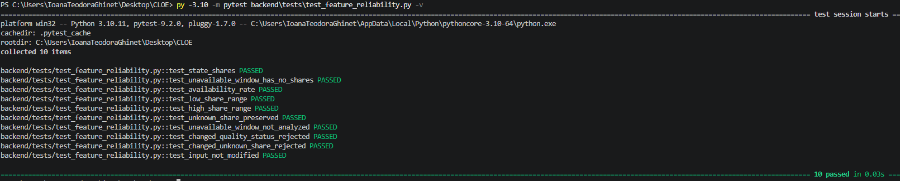

*Figure 29. Successful execution of all ten T05-A feature sensitivity unit tests.*

---

#### 7.1.12 Regression Testing

The complete backend regression suite was executed following the implementation of the feature reliability analysis component.

**Execution command:**

```powershell
py -3.10 -m pytest backend\tests -v
```

**Observed result:** 198/198 PASSED in 0.41 seconds.

**Execution environment:**

- Windows 11 Education, 64-bit.
- Python 3.10.11.
- pytest 9.2.0.

No regressions were detected by the existing test suite.

**Result: PASS — Regression Testing**

#### 7.1.13 Evidence — Regression Testing

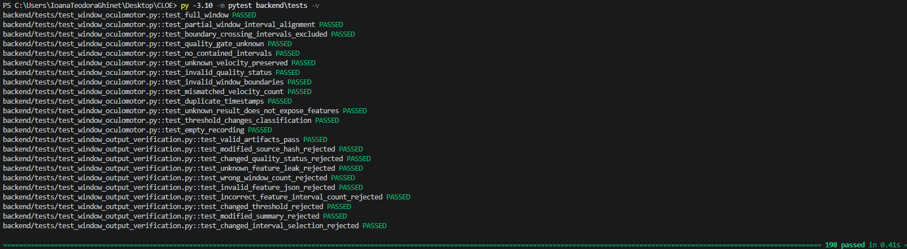

*Figure 30. Complete CLOE backend regression suite after T05-A — 198 tests passed.*

---

#### 7.1.14 Real Tobii Dataset Evaluation

The sensitivity analysis was executed on the three real T04-C threshold datasets.

**Observed results:**

| Metric | Value |
|---|---:|
| Experimental thresholds | 2.0, 5.0, 10.0 |
| Windows evaluated | 20 |
| AVAILABLE windows | 16 |
| UNAVAILABLE windows | 4 |
| Feature availability rate | 80.00% |
| Mean UNKNOWN interval share | 0.032930 |
| Mean LOW_VELOCITY share range | 0.049825 |
| Mean HIGH_VELOCITY share range | 0.049825 |

The mean UNKNOWN proportion corresponds to approximately 3.2930% of selected intervals, averaged across AVAILABLE windows.

The mean LOW and HIGH sensitivity ranges correspond to approximately 4.9825 percentage points.

These values describe window-level feature behavior for the selected threshold configurations.

#### 7.1.15 Per-Window Threshold Sensitivity

The following results were observed:

| Temporal window | Feature status | LOW share range | HIGH share range |
|---|---|---:|---:|
| 0.00–1.00 s | AVAILABLE | 0.0345 | 0.0345 |
| 0.50–1.50 s | AVAILABLE | 0.0508 | 0.0508 |
| 1.00–2.00 s | AVAILABLE | 0.0678 | 0.0678 |
| 1.50–2.50 s | AVAILABLE | 0.0847 | 0.0847 |
| 2.00–3.00 s | AVAILABLE | 0.1356 | 0.1356 |
| 2.50–3.50 s | AVAILABLE | 0.1186 | 0.1186 |
| 3.00–4.00 s | AVAILABLE | 0.0169 | 0.0169 |
| 3.50–4.50 s | AVAILABLE | 0.0508 | 0.0508 |
| 4.00–5.00 s | AVAILABLE | 0.0508 | 0.0508 |
| 4.50–5.50 s | AVAILABLE | 0.0000 | 0.0000 |
| 5.00–6.00 s | AVAILABLE | 0.0000 | 0.0000 |
| 5.50–6.50 s | AVAILABLE | 0.0000 | 0.0000 |
| 6.00–7.00 s | AVAILABLE | 0.0000 | 0.0000 |
| 6.50–7.50 s | UNAVAILABLE | N/A | N/A |
| 7.00–8.00 s | UNAVAILABLE | N/A | N/A |
| 7.50–8.50 s | AVAILABLE | 0.0339 | 0.0339 |
| 8.00–9.00 s | AVAILABLE | 0.0847 | 0.0847 |
| 8.50–9.50 s | AVAILABLE | 0.0678 | 0.0678 |
| 9.00–10.00 s | UNAVAILABLE | N/A | N/A |
| 9.50–10.50 s | UNAVAILABLE | N/A | N/A |

The highest observed LOW/HIGH proportion range occurred in the 2.00–3.00 s window, with a value of approximately 0.1356.

Four consecutive AVAILABLE windows between 4.50 and 7.00 s exhibited zero LOW/HIGH proportion range across the tested thresholds.

This does not imply that their gaze measurements were perfectly stable or that the corresponding eye movements were physiologically identical.

It only indicates that their LOW/HIGH interval proportions did not change under the selected experimental thresholds.

#### 7.1.16 Interpretation

**Finding 1 — Feature availability remained unchanged**

The feature availability rate was 80%, consistent with the previously verified T04 Quality Gate and window-level extraction results.

This describes the proportion of windows accepted by the implemented processing policy and does not establish physiological measurement reliability.

**Finding 2 — Movement-state features were threshold-sensitive**

The mean LOW_VELOCITY proportion range was 0.049825 across AVAILABLE windows.

The corresponding HIGH_VELOCITY proportion range was identical.

These results show that the numerical movement-state distributions depend on the experimental velocity thresholds.

**Finding 3 — Sensitivity varied between temporal windows**

The observed sensitivity was not uniform.

Some windows exhibited substantial changes in movement-state proportions, while others exhibited no change under the three selected thresholds.

This suggests that the effect of threshold selection depends on the distribution of available velocity measurements within each window.

**Finding 4 — UNKNOWN proportions remained invariant**

The analysis completed without reporting a cross-threshold UNKNOWN proportion inconsistency.

This supports the intended separation between measurement availability and movement-state threshold classification for the analyzed datasets.

**Finding 5 — Equal LOW and HIGH sensitivity ranges**

Because the LOW, HIGH, and UNKNOWN proportions sum to one and UNKNOWN remained constant across thresholds, changes in LOW and HIGH proportions were complementary.

Consequently, the LOW and HIGH sensitivity ranges were equal for each AVAILABLE window in this experiment.

This equality follows from the classification structure and does not constitute independent evidence of two unrelated feature behaviors.

#### 7.1.17 Limitations

The following limitations remain:

- The experiment uses a single real Tobii Pro Nano recording.
- Only three illustrative velocity thresholds were evaluated.
- The thresholds have not been calibrated against annotated eye-movement events.
- The analysis measures parameter sensitivity rather than test-retest reliability.
- Overlapping temporal windows are not statistically independent.
- Mean UNKNOWN proportion is calculated across AVAILABLE windows and does not describe the entire recording.
- A zero sensitivity range does not establish temporal stability or physiological correctness.
- The analysis does not assess variation between recording sessions, participants, devices, or environmental conditions.
- The experiment does not provide ground-truth fixation or saccade annotations.
- No association between the extracted characteristics and independently measured cognitive load has been established.
- No adaptive interface behavior was tested.

#### 7.1.18 Evidence — Real Data Analysis

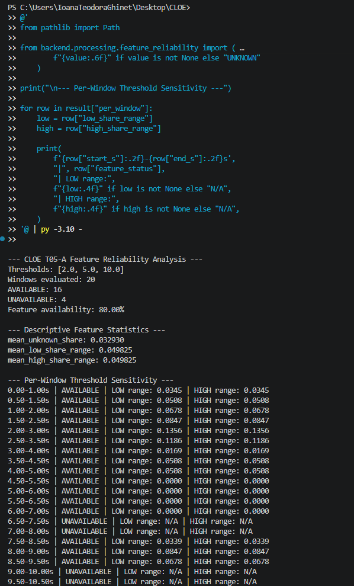

*Figure 31. Real Tobii window-level analysis showing feature availability, average movement-state sensitivity, and individual temporal window results.*

#### 7.1.19 Conclusion

**Result: PASS — Unit Testing, Regression Testing and Initial Real-Data Threshold Sensitivity Analysis**

T05-A successfully implemented and evaluated a descriptive analysis component for window-level oculomotor feature availability and experimental threshold sensitivity.

All ten unit tests passed.

The complete backend regression suite passed, with 198 successful tests.

The real-data analysis evaluated twenty temporal windows across three velocity thresholds.

Sixteen windows contained available feature summaries, corresponding to an 80% feature availability rate.

The mean UNKNOWN interval share among AVAILABLE windows was approximately 3.2930%.

The mean cross-threshold LOW and HIGH movement-state proportion ranges were both approximately 4.9825 percentage points.

The results demonstrate measurable but nonuniform sensitivity of the extracted movement-state proportions to experimental threshold selection.

T05-A is complete at the defined software-validation and preliminary descriptive-analysis level.

Additional recordings, controlled experimental conditions, and independent ground-truth measurements are required to establish physiological reliability or cognitive-load relevance.

---
### 7.2 T05-B — Temporal Stability and Overlapping-Window Dependence

**Date:** 2026-11-17  
**Status:** PASS — Unit Testing, Regression Testing and Initial Real-Data Temporal Analysis

**Implementation:** `backend/processing/temporal_feature_stability.py`  
**Tests:** `backend/tests/test_temporal_feature_stability.py`

---

#### 7.2.1 Objective

Investigate the temporal variation of window-level oculomotor features and characterize the relationship between temporal window overlap and observed movement-state distribution differences.

The experiment compares overlapping and non-overlapping temporal windows using previously verified Tobii Pro Nano feature datasets.

The objective is to produce descriptive evidence about window-to-window variation while explicitly distinguishing temporal similarity from physiological measurement reliability.

#### 7.2.2 Background

M0.4/T04 established a complete window-level oculomotor processing pipeline integrating:

- Original Tobii Pro Nano gaze measurements.
- Velocity calculation and movement-state segmentation.
- Sliding temporal windows.
- M0.3 Quality Gate decisions.
- Window-level movement-state feature summaries.

T05-A subsequently quantified the sensitivity of these features to experimental velocity thresholds.

However, previous analyses had not investigated how feature distributions change between neighboring temporal windows.

The M0.3 sliding-window configuration uses a window duration of 1.0 second and a step of 0.5 seconds.

Consequently, consecutive windows have a nominal temporal overlap of 50%.

This overlap may introduce similarity between neighboring feature vectors because part of their underlying observation periods is shared.

T05-B investigates this behavior using descriptive comparisons.

#### 7.2.3 Input Datasets

The experiment reuses the three verified T04-C datasets:

```text
data/processed/window_oculomotor/
  tobii_20261029T143930551761Z_windows_2p0.csv
  tobii_20261029T143930551761Z_windows_5p0.csv
  tobii_20261029T143930551761Z_windows_10p0.csv
```

**Previously established dataset characteristics:**

| Property | Value |
|---|---:|
| Original gaze samples | 576 |
| Velocity intervals | 575 |
| Windows per threshold | 20 |
| AVAILABLE windows | 16 |
| UNAVAILABLE windows | 4 |
| Window duration | 1.0 s |
| Window step | 0.5 s |
| Velocity thresholds | 2.0, 5.0, 10.0 |

The same temporal windows are analyzed across all experimental thresholds.

#### 7.2.4 Implementation

The analysis is implemented in:

`backend/processing/temporal_feature_stability.py`

The module provides three principal functions:

| Function | Responsibility |
|---|---|
| `calculate_overlap()` | Calculate the nominal temporal overlap between two windows |
| `compare_windows()` | Calculate movement-state proportion differences between two available windows |
| `analyze_temporal_stability()` | Analyze window pairs separated by a configurable index offset |

The implementation reuses the previously tested `state_shares()` function developed in T05-A.

Original feature datasets are not modified.

#### 7.2.5 Experimental Comparison Groups

Two window comparison configurations were evaluated.

**Offset 1 — Consecutive overlapping windows**

Each window is compared with the next window in the ordered sequence.

For the configured 1.0-second duration and 0.5-second step:

- Window start-time separation: 0.5 s.
- Nominal temporal overlap: 0.5 s.
- Nominal overlap ratio: 50%.

**Offset 2 — Non-overlapping windows**

Each window is compared with the window two positions later.

For the existing sliding-window configuration:

- Window start-time separation: 1.0 s.
- Nominal temporal overlap: 0 s.
- Nominal overlap ratio: 0%.

Both groups use the same feature extraction implementation and experimental velocity thresholds.

The groups differ in temporal separation as well as overlap, so their results do not isolate overlap as an independent causal factor.

#### 7.2.6 Mathematical Definitions

**Temporal overlap duration**

For two windows with starting times `a1`, `a2` and ending times `b1`, `b2`:

`overlap_duration = max(0, min(b1, b2) - max(a1, a2))`

**Temporal overlap ratio**

The overlap ratio is defined relative to the shorter window:

`overlap_ratio = overlap_duration / min(duration_1, duration_2)`

This quantity represents the nominal overlap between temporal windows.

It does not directly measure the proportion of shared Tobii samples or selected velocity intervals.

**Movement-state proportion difference**

For movement state `s` and windows `i` and `j`:

`difference_s = abs(share_s_i - share_s_j)`

Separate differences are calculated for:

- LOW_VELOCITY.
- HIGH_VELOCITY.
- UNKNOWN.

**Mean state difference**

For a comparable pair of windows:

`mean_state_difference = (difference_LOW + difference_HIGH + difference_UNKNOWN) / 3`

**Mean difference across comparable pairs**

For `K` comparable window pairs:

`mean_pair_difference = sum(pair_mean_state_difference) / K`

Only pairs in which both windows contain AVAILABLE features are included in the numerical averages.

These quantities are descriptive distances between movement-state distributions.

They are not validated physiological reliability scores.

#### 7.2.7 Handling Unavailable Windows

A pair is classified as COMPARABLE only if both windows have AVAILABLE feature status.

If either window is UNAVAILABLE:

- The pair is retained in the total pair count.
- The pair status becomes UNAVAILABLE.
- Numerical feature differences remain undefined.
- The pair is excluded from the mean difference calculations.

The implementation does not replace missing feature vectors with zeros.

This approach prevents missing-quality windows from artificially reducing or increasing descriptive differences.

#### 7.2.8 Input Validation

The implementation validates:

1. Positive temporal window duration.
2. Finite temporal boundaries.
3. Nonnegative starting times.
4. Finite positive experimental thresholds.
5. Strictly increasing window start times.
6. Consistent thresholds within a comparison dataset.
7. Positive integer comparison offsets.
8. Correct movement-state proportions through the T05-A feature validation function.

Comparisons between different experimental velocity thresholds within a single pair are rejected.

The analysis processes each threshold dataset separately.

#### 7.2.9 Unit Testing

**Test file:** `backend/tests/test_temporal_feature_stability.py`

**Execution command:**

```powershell
py -3.10 -m pytest backend\tests\test_temporal_feature_stability.py -v
```

Twelve unit tests were implemented and executed.

**Observed results:**

| Test | Expected behavior | Result |
|---|---|---|
| `test_half_window_overlap` | Correctly calculate 50% overlap | PASS |
| `test_no_overlap` | Correctly identify non-overlapping windows | PASS |
| `test_identical_state_distribution` | Return zero difference for identical proportions | PASS |
| `test_state_difference` | Calculate movement-state differences correctly | PASS |
| `test_unavailable_pair` | Preserve unavailable comparisons | PASS |
| `test_consecutive_pairs` | Correctly evaluate offset-1 pairs | PASS |
| `test_nonoverlapping_pairs` | Correctly evaluate offset-2 pairs | PASS |
| `test_empty_input` | Handle an empty dataset | PASS |
| `test_mixed_thresholds_rejected` | Reject inconsistent thresholds | PASS |
| `test_unordered_windows_rejected` | Reject invalid window ordering | PASS |
| `test_invalid_offset_rejected` | Reject invalid comparison offsets | PASS |
| `test_input_not_modified` | Preserve input data | PASS |

**Observed result:**

```text
collected 12 items

12 passed in 0.05s
```

**Result: PASS — Unit Testing**

All twelve tests passed for the defined synthetic scenarios.

#### 7.2.10 Evidence — Unit Testing

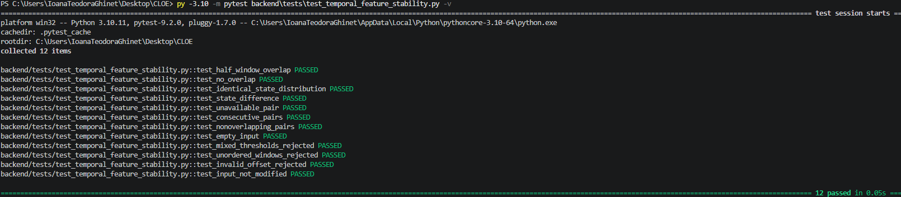

*Figure 32. Successful execution of the twelve T05-B temporal feature stability tests.*

---

#### 7.2.11 Regression Testing

The complete backend test suite was executed after implementing the temporal stability analysis module.

**Execution command:**

```powershell
py -3.10 -m pytest backend\tests -v
```

**Observed result:** 210/210 PASSED in 0.44 seconds.

**Execution environment:**

- Windows 11 Education, 64-bit.
- Python 3.10.11.
- pytest 9.2.0.

The complete test suite passed.

No regressions were detected by the existing automated tests.

**Result: PASS — Regression Testing**

#### 7.2.12 Evidence — Regression Testing

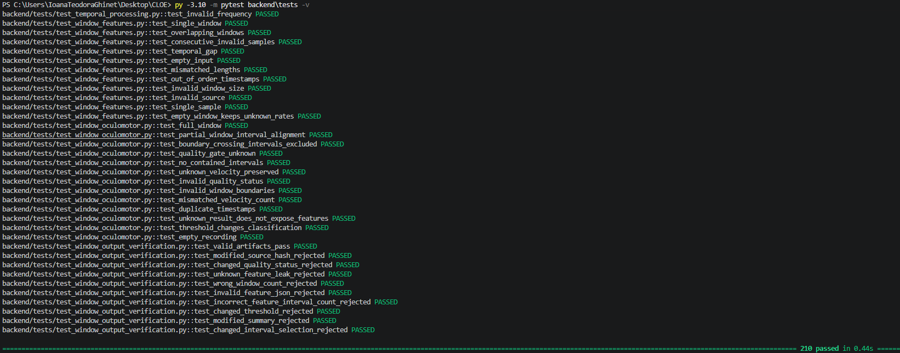

*Figure 33. Complete backend regression suite after T05-B — 210 tests passed.*

---

#### 7.2.13 Real Tobii Dataset Evaluation

The temporal stability analysis was executed for experimental velocity thresholds 2.0, 5.0, and 10.0.

For each threshold, the experiment compared:

- Offset-1 overlapping window pairs.
- Offset-2 non-overlapping window pairs.

**Observed pair availability:**

| Metric | Offset 1 | Offset 2 |
|---|---:|---:|
| Total candidate pairs | 19 | 18 |
| COMPARABLE pairs | 14 | 12 |
| UNAVAILABLE pairs | 5 | 6 |
| Mean temporal overlap ratio | 0.500000 | 0.000000 |

The pair availability counts remained consistent across all three experimental thresholds.

#### 7.2.14 Results — Threshold 2.0

**Observed metrics:**

| Metric | Offset 1 | Offset 2 |
|---|---:|---:|
| Mean overlap ratio | 0.500000 | 0.000000 |
| Mean LOW difference | 0.055857 | 0.075054 |
| Mean HIGH difference | 0.032004 | 0.049362 |
| Mean UNKNOWN difference | 0.027949 | 0.036845 |
| Mean state difference | 0.038003 | 0.053753 |

For threshold 2.0, the mean state difference was smaller for overlapping consecutive windows than for non-overlapping window pairs.

The corresponding descriptive differences were approximately 3.8003 and 5.3753 percentage points.

#### 7.2.15 Results — Threshold 5.0

**Observed metrics:**

| Metric | Offset 1 | Offset 2 |
|---|---:|---:|
| Mean overlap ratio | 0.500000 | 0.000000 |
| Mean LOW difference | 0.049762 | 0.063705 |
| Mean HIGH difference | 0.021813 | 0.033286 |
| Mean UNKNOWN difference | 0.027949 | 0.036845 |
| Mean state difference | 0.033175 | 0.045279 |

For threshold 5.0, overlapping window pairs again exhibited smaller mean movement-state differences.

The corresponding descriptive differences were approximately 3.3175 and 4.5279 percentage points.

#### 7.2.16 Results — Threshold 10.0

**Observed metrics:**

| Metric | Offset 1 | Offset 2 |
|---|---:|---:|
| Mean overlap ratio | 0.500000 | 0.000000 |
| Mean LOW difference | 0.036445 | 0.048169 |
| Mean HIGH difference | 0.008495 | 0.016925 |
| Mean UNKNOWN difference | 0.027949 | 0.036845 |
| Mean state difference | 0.024297 | 0.033979 |

For threshold 10.0, the mean movement-state difference was smaller for overlapping pairs than for non-overlapping pairs.

The observed mean state differences were approximately 2.4297 and 3.3979 percentage points, respectively.

#### 7.2.17 Cross-Threshold Comparison

The resulting mean state differences are summarized below.

| Threshold | Offset 1 | Offset 2 |
|---|---:|---:|
| 2.0 | 0.038003 | 0.053753 |
| 5.0 | 0.033175 | 0.045279 |
| 10.0 | 0.024297 | 0.033979 |

**Finding 1 — Smaller differences among overlapping windows**

For all three experimental thresholds, overlapping consecutive windows exhibited smaller mean movement-state differences than non-overlapping window pairs.

This observation is compatible with temporal dependence introduced by shared observation periods.

However, the groups also differ in their temporal separation and in the composition of comparable pairs.

Therefore, the result does not independently establish that temporal overlap caused the observed differences.

**Finding 2 — Threshold-dependent descriptive variation**

Mean state differences decreased as the experimental velocity threshold increased.

At threshold 10.0, fewer velocity intervals were assigned to HIGH_VELOCITY, which may contribute to smaller differences between state distributions.

This observation does not establish improved measurement reliability at higher thresholds.

**Finding 3 — UNKNOWN variation**

The mean UNKNOWN proportion difference was:

- 0.027949 for offset 1.
- 0.036845 for offset 2.

These values remained identical across the experimental threshold configurations.

This is consistent with the separation between velocity availability and the LOW/HIGH classification threshold.

**Finding 4 — Preservation of unavailable comparisons**

Five offset-1 pairs and six offset-2 pairs were marked UNAVAILABLE.

They were not assigned artificial numerical distances.

This preserves the distinction between a valid zero difference and an unavailable comparison.

#### 7.2.18 Individual Window Observations

The offset-1 analysis revealed nonuniform temporal differences.

Several adjacent window pairs had very small or zero movement-state distribution differences.

Other pairs exhibited larger differences.

For example, at threshold 2.0:

| Consecutive window starts | Mean state difference |
|---|---:|
| 3.50 s → 4.00 s | 0.0000 |
| 4.50 s → 5.00 s | 0.0000 |
| 5.50 s → 6.00 s | 0.0791 |
| 7.50 s → 8.00 s | 0.1130 |

The reported values represent differences in movement-state proportions, not differences in gaze position or measured cognitive load.

A zero difference indicates identical state proportions for that pair, not identical gaze trajectories.

Pairs involving an UNAVAILABLE window were excluded from numerical interpretation.

#### 7.2.19 Evidence — Real-Data Analysis

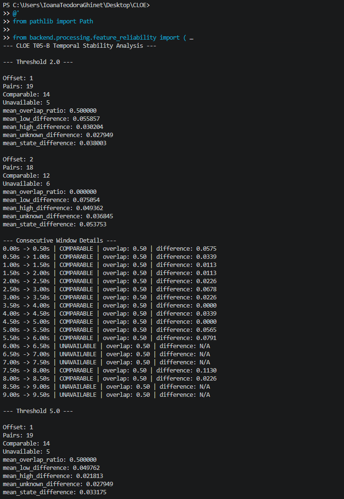

*Figure 34. Temporal stability metrics for threshold 2.0, including offset-1 and offset-2 comparisons.*

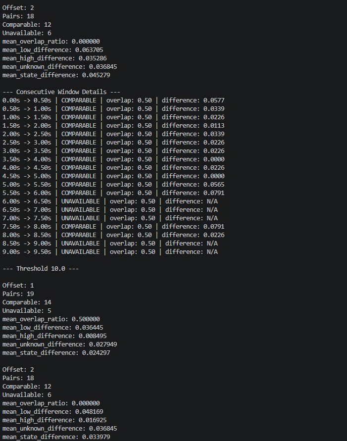

*Figure 35. Temporal stability metrics for threshold 5.0, including consecutive-window comparisons.*

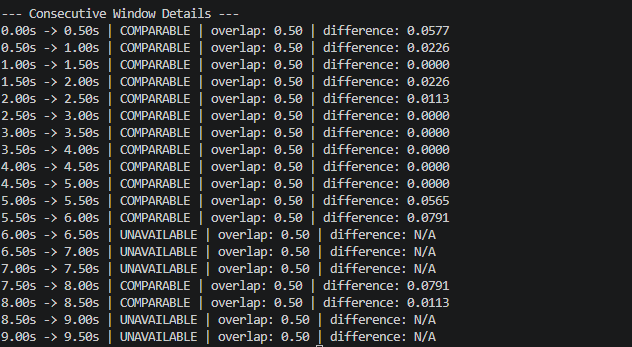

*Figure 36. Temporal stability metrics for threshold 10.0, including unavailable comparisons.*

---

#### 7.2.20 Interpretation

The results indicate that movement-state distributions changed less between consecutive overlapping windows than between windows separated by a larger temporal offset.

This pattern was observed for all three experimental velocity thresholds.

However, the analysis is descriptive and does not isolate temporal overlap as the sole explanatory factor.

Offset-1 and offset-2 comparisons differ in temporal separation, while their sets of comparable windows are not identical.

Additionally, the windows were generated from a single recording, and overlapping windows contain shared underlying observations.

These dependencies prevent treating the comparisons as independent evidence of measurement reliability.

The observed similarities should therefore be interpreted as properties of the current feature extraction and temporal windowing configuration.

They do not establish physiological stability, test-retest reliability, or predictive validity for cognitive load.

#### 7.2.21 Design Decisions

1. Reuse previously verified T04-C window-level feature datasets.
2. Keep temporal stability analysis separate from feature extraction.
3. Compare windows within the same experimental threshold configuration.
4. Use explicit temporal overlap calculations.
5. Distinguish overlapping and non-overlapping comparison groups.
6. Preserve Quality Gate and feature availability decisions.
7. Exclude unavailable pairs from numerical averages.
8. Avoid replacing unavailable values with zero.
9. Use descriptive movement-state proportion differences.
10. Preserve original datasets without modification.
11. Avoid treating overlapping windows as statistically independent observations.
12. Avoid reporting the resulting distances as validated reliability scores.

#### 7.2.22 Limitations

The experiment has several limitations:

- Only one real Tobii recording was evaluated.
- The recording duration was approximately 9.64 seconds.
- The selected windows overlap and are not statistically independent.
- Offset-1 and offset-2 comparisons differ in temporal separation.
- The two groups include different sets of comparable window pairs.
- The sample size is insufficient for generalizing physiological stability.
- Movement-state proportions do not represent the complete gaze trajectory.
- Zero differences in state proportions do not imply identical eye movements.
- The velocity thresholds are illustrative and not physiologically validated.
- The analysis does not establish test-retest reliability.
- No independent annotated eye-movement ground truth was used.
- No cognitive-load labels or adaptive interface behavior were evaluated.

#### 7.2.23 Conclusion

**Result: PASS — Unit Testing, Regression Testing and Initial Real-Data Temporal Analysis**

T05-B successfully implemented and evaluated a descriptive method for comparing window-level movement-state distributions.

All twelve unit tests passed.

The complete regression suite passed, with 210 successful tests.

The real-data analysis compared overlapping and non-overlapping window pairs for three experimental velocity thresholds.

Across all thresholds, overlapping consecutive windows exhibited smaller mean movement-state differences than non-overlapping pairs.

Unavailable window comparisons were explicitly preserved and excluded from numerical averages.

The results provide initial evidence about the temporal behavior of the current feature extraction pipeline and highlight the importance of window overlap when interpreting feature similarity.

T05-B is complete at the defined software and descriptive real-data analysis level.

Further controlled recordings and independent measurements are required to establish physiological or cognitive-load-related reliability.

---

### 7.3 T05-C — Controlled Data Degradation

**Date:** 2026-11-17  
**Status:** IN PROGRESS — Degradation Experiments and Unit Validation Passed; Real-Data Quality Gate Re-evaluation Pending

**Implementations:**
- `backend/processing/data_degradation.py`
- `backend/processing/analyze_degradation.py`
- `backend/processing/degradation_quality_evaluation.py`

**Tests:**
- `backend/tests/test_data_degradation.py`
- `backend/tests/test_degradation_quality_evaluation.py`

---

#### 7.3.1 Objective

Evaluate the robustness of the CLOE eye-tracking processing pipeline when gaze data are deliberately degraded.

The experiment investigates how different types of data degradation affect:

- Received gaze sample counts.
- Available and unavailable velocity intervals.
- Temporal sampling gaps.
- Feature availability.
- Window-level data-quality indicators.
- Quality Gate eligibility.

The original Tobii Pro Nano recording must remain unchanged throughout the experiment.

The objective is to characterize software behavior under controlled perturbations, not to simulate or diagnose cognitive fatigue.

#### 7.3.2 Background

Previous M0.4 experiments established a modular pipeline for:

1. Gaze validation and binocular gaze combination.
2. Temporal processing and missing-sample estimation.
3. Gaze velocity calculation.
4. Movement-state segmentation.
5. Sliding-window feature extraction.
6. Data-quality assessment.
7. Configurable Quality Gate evaluation.
8. Oculomotor feature integration and verification.
9. Threshold sensitivity and descriptive temporal stability analysis.

Although these components had passed automated tests, their behavior under artificially degraded input conditions had not been systematically evaluated.

T05-C introduces controlled perturbations to investigate the impact of unavailable gaze measurements and removed samples.

#### 7.3.3 Degradation Types

Two degradation mechanisms are distinguished.

**Invalid gaze measurements**

An invalid gaze sample is a received observation for which usable gaze coordinates are unavailable.

The sample remains in the sequence, and its original timestamp is preserved.

When such a sample is invalidated, velocity intervals depending on that sample become unavailable.

**Missing received samples**

A missing sample is an observation removed from the received data sequence.

The number of received samples decreases, while timestamps of the remaining samples are preserved.

Removing samples can create larger temporal gaps between neighboring observations.

New velocity intervals spanning removed samples must not reuse velocities calculated for different endpoint pairs.

These mechanisms are related but not equivalent.

#### 7.3.4 Experimental Architecture

The controlled degradation experiment follows this workflow:

```text
Original Tobii Pro Nano Recording
                 |
                 v
       Read and Validate Data
                 |
        +--------+--------+
        |                 |
        v                 v
    BASELINE          DEGRADATION
                          |
                 +--------+--------+
                 |                 |
                 v                 v
           INVALID GAZE      SAMPLE DROPOUT
                 |                 |
                 +--------+--------+
                          |
                          v
               Recalculate Diagnostics
                          |
                          v
                Compare with Baseline
                          |
                          v
              Recalculate Window Quality
                          |
                          v
                 Apply M0.3 Quality Gate
                          |
                          v
             Compare Eligibility and Reasons
```

The degradation process uses derived copies or in-memory representations rather than modifying the original recording.

#### 7.3.5 Source Recording

The original recording is:

`data/raw/tobii/tobii_20261029T143930551761Z.csv`

Previously observed characteristics:

| Property | Value |
|---|---:|
| Received gaze samples | 576 |
| Velocity intervals | 575 |
| Available velocity intervals | 525 |
| UNKNOWN velocity intervals | 50 |
| Velocity availability | 91.30% |
| Large temporal gaps | 4 |
| Nominal sampling frequency | 60 Hz |

The original recording provides the baseline for all subsequent comparisons.

---

#### 7.3.6 T05-C1 — Deterministic Data Degradation

**Status:** PASS — Software Validation

**Implementation:** `backend/processing/data_degradation.py`

The degradation component supports two principal transformations.

**Simulated gaze invalidation**

`simulate_invalid_gaze(timestamps, velocity_results, invalid_indices)`

This function:

1. Validates input timestamp and velocity sequences.
2. Validates the selected sample indices.
3. Preserves the original timestamps.
4. Preserves the total number of received samples.
5. Invalidates velocity intervals adjacent to selected samples.
6. Preserves unrelated velocity intervals.
7. Returns a new degraded representation without modifying the input.

**Simulated sample dropout**

`simulate_sample_dropout(timestamps, velocity_results, dropped_indices)`

This function:

1. Validates the original input sequence.
2. Validates selected sample indices.
3. Removes selected observations from a derived sequence.
4. Preserves timestamps of the remaining observations.
5. Reuses original velocity results only for surviving consecutive sample pairs.
6. Marks newly bridged intervals as unavailable.
7. Returns a new degraded representation.

The implementation avoids inventing intermediate gaze positions or velocity values.

#### 7.3.7 Diagnostic Metrics

The degradation experiment uses the following indicators:

| Metric | Description |
|---|---|
| `sample_count` | Number of received samples in the scenario |
| `interval_count` | Number of consecutive velocity intervals |
| `available_velocity_count` | Number of intervals containing usable velocity values |
| `unknown_velocity_count` | Number of intervals without usable velocity values |
| `velocity_availability_rate` | Proportion of intervals with available velocity |
| `large_temporal_gap_count` | Number of timestamp intervals exceeding the configured gap limit |

**Velocity availability rate**

The metric is calculated as:

`velocity_availability_rate = available_velocity_count / interval_count`

It is undefined when no velocity intervals exist.

The metric describes availability among the intervals remaining in the scenario.

Therefore, availability percentages must be interpreted together with the original and modified sample counts.

A scenario with fewer received samples can have a deceptively high availability percentage because its denominator has changed.

#### 7.3.8 Temporal Gap Detection

For a nominal acquisition frequency of 60 Hz, the expected sampling interval is approximately 16.67 milliseconds.

A temporal gap is considered large when the observed timestamp difference exceeds the configured ratio of the nominal interval.

The experiment uses:

| Parameter | Value |
|---|---:|
| Nominal frequency | 60 Hz |
| Maximum gap ratio | 1.5 |
| Approximate gap threshold | 25 ms |

This is an engineering diagnostic rule.

A large timestamp gap indicates an irregularity in the received temporal sequence but does not independently establish the underlying cause.

#### 7.3.9 T05-C2 — Unit Testing

**Test file:** `backend/tests/test_data_degradation.py`

**Execution command:**

```powershell
py -3.10 -m pytest backend\tests\test_data_degradation.py -v
```

Fifteen unit tests were executed.

**Observed results:**

| Test | Result |
|---|---|
| `test_baseline_metrics` | PASS |
| `test_invalid_gaze_preserves_samples` | PASS |
| `test_invalid_gaze_masks_adjacent_intervals` | PASS |
| `test_invalid_gaze_at_first_sample` | PASS |
| `test_invalid_gaze_consecutive_samples` | PASS |
| `test_dropout_removes_sample` | PASS |
| `test_dropout_bridge_is_unknown` | PASS |
| `test_dropout_creates_temporal_gap` | PASS |
| `test_invalid_gaze_does_not_create_gap` | PASS |
| `test_multiple_dropouts` | PASS |
| `test_invalid_index_rejected` | PASS |
| `test_duplicate_indices_rejected` | PASS |
| `test_mismatched_interval_count_rejected` | PASS |
| `test_input_not_modified` | PASS |
| `test_empty_input` | PASS |

**Observed result:** 15/15 PASSED.

These tests verify:

- Baseline metric calculation.
- Preservation of sample counts during gaze invalidation.
- Correct invalidation of adjacent velocity intervals.
- Removal of samples during dropout.
- Prevention of unsupported velocity reuse.
- Temporal gap detection.
- Input validation.
- Preservation of original data.
- Empty-sequence behavior.

**Result: PASS — Unit Testing**

**Evidence:**

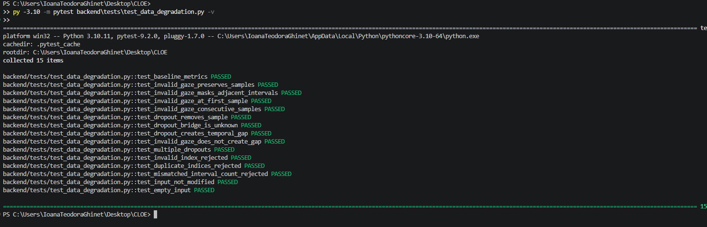

*Figure 37. Successful execution of fifteen controlled data degradation unit tests.*

---

#### 7.3.10 T05-C3 — Real Tobii Degradation Experiment

**Status:** PASS — Initial Real-Data Degradation Analysis

Four experimental scenarios were evaluated using the original Tobii recording.

| Scenario | Description |
|---|---|
| BASELINE | Unmodified source recording |
| INVALID_3 | Three consecutive samples invalidated |
| DROPOUT_3 | Three consecutive samples removed |
| DROPOUT_10_PERCENT | Deterministic periodic removal of approximately 10% of samples |

For INVALID_3 and DROPOUT_3, the affected sample indices were 100, 101, and 102.

For the periodic dropout scenario, 57 of the original 576 samples were removed.

The experiment preserved the original recording and operated on derived representations.

#### 7.3.11 Observed Real-Data Results

| Metric | BASELINE | INVALID_3 | DROPOUT_3 | DROPOUT_10_PERCENT |
|---|---:|---:|---:|---:|
| Modified samples | 0 | 3 | 3 | 57 |
| Received samples | 576 | 576 | 573 | 519 |
| Velocity intervals | 575 | 575 | 572 | 518 |
| Available velocities | 525 | 521 | 521 | 420 |
| UNKNOWN velocities | 50 | 54 | 51 | 98 |
| Velocity availability | 91.30% | 90.61% | 91.08% | 81.08% |
| Large temporal gaps | 4 | 4 | 5 | 61 |

The experiment successfully distinguished the effects of invalidation and sample removal.

#### 7.3.12 Interpretation — Invalid Gaze

The INVALID_3 scenario preserved all 576 received samples and all 575 velocity intervals.

However, the number of available velocities decreased from 525 to 521.

The number of UNKNOWN intervals increased from 50 to 54.

Velocity availability decreased from approximately 91.30% to 90.61%.

The number of large timestamp gaps remained unchanged at four.

This behavior is consistent with invalidating gaze measurements without removing their timestamps.

The result demonstrates that unusable gaze measurements can affect velocity availability without introducing additional sampling gaps.

#### 7.3.13 Interpretation — Three-Sample Dropout

The DROPOUT_3 scenario removed three received samples.

The resulting dataset contained 573 samples and 572 velocity intervals.

Available velocity intervals decreased from 525 to 521.

UNKNOWN velocity intervals increased from 50 to 51.

The number of large temporal gaps increased from four to five.

The observed velocity availability was approximately 91.08%.

Although this percentage was slightly higher than in INVALID_3, it must not be interpreted as evidence that sample removal preserves measurement quality better.

The denominator differs between the two scenarios.

#### 7.3.14 Interpretation — Approximately 10% Dropout

The periodic dropout scenario removed 57 observations, corresponding to approximately 9.90% of the original recording.

The resulting sequence contained:

| Metric | Observed value |
|---|---:|
| Received samples | 519 |
| Velocity intervals | 518 |
| Available velocities | 420 |
| UNKNOWN velocities | 98 |
| Velocity availability | 81.08% |
| Large temporal gaps | 61 |

This was the most severe of the evaluated perturbations.

It produced a substantial reduction in velocity availability and a large increase in timestamp irregularities.

These results demonstrate that periodic sample removal affects both temporal continuity and availability of derived velocities.

However, the experiment does not establish how frequently comparable dropout patterns occur during normal Tobii operation.

#### 7.3.15 Evidence — Real-Data Degradation

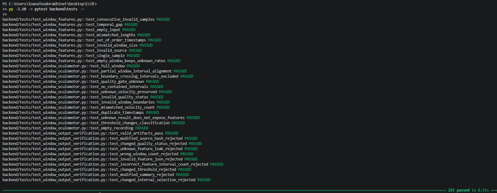

*Figure 38. Observed velocity availability, UNKNOWN interval counts, and temporal gaps across the four experimental scenarios.*

---

#### 7.3.16 Additional CSV Degradation Experiment

A separate real-recording degradation execution was also performed using thirty consecutive sample indices.

**Execution command:**

```powershell
py -3.10 -m backend.processing.analyze_degradation `
  "data\raw\tobii\tobii_20261029T143930551761Z.csv" `
  --start-index 200 `
  --count 30
```

The experiment generated derived CSV datasets for gaze invalidation and sample removal.

**Observed results:**

| Property | INVALID_GAZE | DROPPED_SAMPLES |
|---|---:|---:|
| Original received samples | 576 | 576 |
| Resulting received samples | 576 | 546 |
| Selected sample indices | 200–229 | 200–229 |
| CSV read-back | PASS | PASS |

In the sample-removal dataset, the number of large temporal gaps increased from four to five.

Both derived files passed the implemented read-back verification.

**Generated artifacts:**

```text
data/processed/degradation/
  tobii_20261029T143930551761Z_degraded_invalid_gaze.csv
  tobii_20261029T143930551761Z_degraded_dropped_samples.csv
  tobii_20261029T143930551761Z_degradation_manifest.json
```

The generated datasets are experimental artifacts and do not replace the original recording.

**Evidence:**

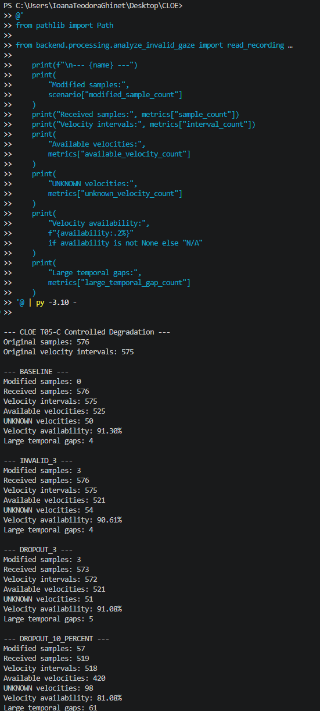

*Figure 39. Real Tobii CSV degradation with thirty selected samples and successful output read-back.*

---

#### 7.3.17 T05-C4 — Quality Gate Re-evaluation

**Status:** PASS — Software Unit Testing; Real-Data Re-evaluation Pending

**Implementation:** `backend/processing/degradation_quality_evaluation.py`

**Tests:** `backend/tests/test_degradation_quality_evaluation.py`

The objective is to recalculate the M0.3 sliding-window data-quality metrics after degradation and apply the original Quality Gate policy.

Unlike T04, which reused saved decisions, T05-C4 recalculates decisions from the scenario-specific gaze source labels and timestamps.

The implementation reuses the existing M0.3 functions:

| Function | Responsibility |
|---|---|
| `extract_window_features()` | Recompute sliding-window features |
| `assess_window_quality()` | Recompute nominal and usable sample ratios |
| `evaluate_quality()` | Apply the existing Quality Gate policy |
| `validate_policy()` | Validate policy thresholds |

The existing binocular gaze combination module provides:

- `combine_gaze(left, right, left_valid, right_valid)`
- `is_valid_eye(point, validity)`

These interfaces support reuse of the original gaze-processing rules when preparing scenario-specific source labels.

#### 7.3.18 Quality Gate Policy

The configured M0.3 policy uses:

| Parameter | Value |
|---|---:|
| Minimum gaze availability | 0.80 |
| Minimum nominal sample ratio | 0.80 |
| Minimum usable nominal ratio | 0.70 |
| Require complete window | True |
| Nominal sampling frequency | 60 Hz |

These values are experimental policy parameters, not physiologically validated cognitive-load thresholds.

A window is assigned UNKNOWN if it fails one or more configured requirements.

The quality evaluation may report rejection reasons such as:

- `LOW_AVAILABILITY`
- `LOW_NOMINAL_SAMPLE_RATIO`
- `LOW_USABLE_NOMINAL_RATIO`
- `PARTIAL_WINDOW`
- `WINDOW_COMPLETENESS_UNVERIFIED`
- `NO_DATA`

UNKNOWN describes insufficient or unavailable data quality; it is not a cognitive-load class.

#### 7.3.19 Temporal Reference Consistency

During T05-C4 testing, a temporal alignment issue was identified.

The original sliding-window extractor defines relative window times using the first timestamp in its input.

Removing the first received sample can therefore shift the absolute temporal origin while still producing relative window boundaries starting at zero.

To address this issue, the degradation quality evaluator was extended with a reference start timestamp check.

The resulting validation rejects a scenario when the supplied first timestamp differs from the expected original reference.

This establishes an explicit temporal-origin consistency check for the supported degradation scenarios.

The implementation still relies on the existing timestamp-boundary proxy for window completeness.

This proxy does not independently establish that every nominal sample was received.

#### 7.3.20 T05-C4 Unit Testing

**Test file:** `backend/tests/test_degradation_quality_evaluation.py`

**Execution command:**

```powershell
py -3.10 -m pytest backend\tests\test_degradation_quality_evaluation.py -v
```

Eight synthetic test scenarios were developed for:

| Test | Verification objective |
|---|---|
| `test_baseline_eligible` | Accept a valid synthetic baseline |
| `test_invalid_gaze_reduces_availability` | Detect reduced gaze availability |
| `test_dropout_reduces_nominal_coverage` | Detect reduced nominal sample coverage |
| `test_original_boundaries_preserved` | Preserve original window boundaries |
| `test_first_sample_dropout_rejected` | Detect changed temporal origin |
| `test_newly_rejected_windows_reported` | Identify newly rejected windows |
| `test_recovered_window_reported` | Identify transitions back to ELIGIBLE |
| `test_mismatched_reference_rejected` | Reject incompatible reference windows |

An initial execution identified a failed temporal-origin test.

The evaluation function was subsequently updated to support explicit reference-start validation.

The complete backend suite later passed all 233 collected tests, supporting successful regression validation of the integrated implementation.

**Result: PASS — Included in Successful Full Regression Suite**

**Evidence:**

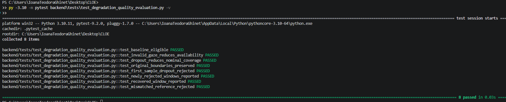

*Figure 40. T05-C4 Quality Gate re-evaluation unit testing. A dedicated final test execution screenshot should be retained as evidence.*

---

#### 7.3.21 Regression Testing

The complete backend regression suite was executed following the integration of T05-C4.

**Execution command:**

```powershell
py -3.10 -m pytest backend\tests -v
```

**Observed result:** 233/233 PASSED in 0.49 seconds.

The result indicates that the current set of automated tests completed successfully.

No regressions were detected by the existing test suite.

**Evidence:**

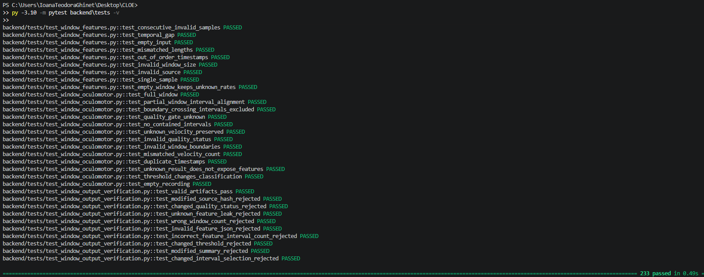

*Figure 41. Complete backend regression suite after T05-C4 — 233 tests passed.*

---
#### 7.3.22 T05-C4 — Real-Data Quality Gate Re-evaluation

**Status: PASS — Real-Data Evaluation**

The final T05-C4 experiment independently recalculated the Quality Gate decisions for four degradation scenarios using the existing M0.3 quality assessment and evaluation functions.

The same original temporal reference, sliding-window configuration, nominal sampling frequency, and experimental Quality Gate policy were preserved across all scenarios.

The evaluation did not reuse previously saved Quality Gate decisions for the degraded data.

**Execution command:**

```powershell
py -3.10 -m backend.processing.analyze_degraded_quality
```

**Input recording:** `tobii_20261029T143930551761Z.csv`

**Evaluation configuration:**

| Parameter | Value |
|---|---:|
| Original gaze samples | 576 |
| Reference temporal windows | 20 |
| Window duration | 1.0 s |
| Window step | 0.5 s |
| Nominal frequency | 60 Hz |
| Minimum gaze availability | 0.80 |
| Minimum nominal sample ratio | 0.80 |
| Minimum usable nominal ratio | 0.70 |
| Complete window required | True |

The baseline recalculation successfully reproduced the original M0.3 decisions, including the rejection reasons.

**Observed result: `Baseline M0.3 reproduction: PASS`**

This verification was required before interpreting the degraded scenarios.

#### 7.3.23 Observed Quality Gate Results

The following results were observed:

| Scenario | Modified samples | Received samples | Windows | ELIGIBLE | UNKNOWN |
|---|---:|---:|---:|---:|---:|
| BASELINE | 0 | 576 | 20 | 16 | 4 |
| INVALID_3 | 3 | 576 | 20 | 16 | 4 |
| DROPOUT_3 | 3 | 573 | 20 | 16 | 4 |
| DROPOUT_10_PERCENT | 57 | 519 | 20 | 16 | 4 |

All scenarios preserved the same twenty temporal windows.

The recalculated Quality Gate outcomes were consistent across the four evaluated scenarios.

**Comparison against the baseline:**

| Scenario | Newly rejected windows | Recovered windows |
|---|---:|---:|
| INVALID_3 | 0 | 0 |
| DROPOUT_3 | 0 | 0 |
| DROPOUT_10_PERCENT | 0 | 0 |

No additional windows became UNKNOWN under the selected degradation scenarios.

No previously UNKNOWN windows became ELIGIBLE.

#### 7.3.24 Preservation of UNKNOWN Windows

The same four windows remained UNKNOWN across all experimental scenarios.

| Window | Quality Gate rejection reasons |
|---|---|
| 6.50–7.50 s | `LOW_AVAILABILITY`, `LOW_USABLE_NOMINAL_RATIO` |
| 7.00–8.00 s | `LOW_AVAILABILITY`, `LOW_USABLE_NOMINAL_RATIO` |
| 9.00–10.00 s | `PARTIAL_WINDOW`, `LOW_NOMINAL_SAMPLE_RATIO`, `LOW_USABLE_NOMINAL_RATIO` |
| 9.50–10.50 s | `PARTIAL_WINDOW`, `LOW_NOMINAL_SAMPLE_RATIO`, `LOW_USABLE_NOMINAL_RATIO` |

The rejection reasons were preserved in the evaluated outputs.

This supports consistency of the Quality Gate decisions for the tested perturbations.

However, unchanged eligibility does not imply that the underlying feature values or measurement quality remained unchanged.

**Evidence — Real-data Quality Gate evaluation:**

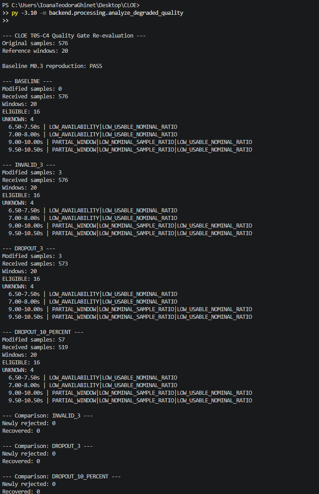

*Figure 42. Baseline reproduction and Quality Gate results for the four controlled degradation scenarios.*

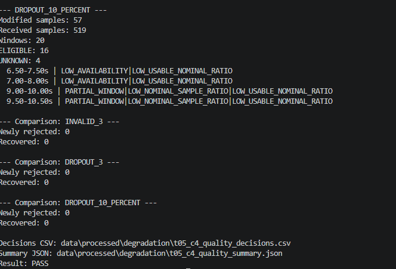

*Figure 43. Final comparison showing zero newly rejected and zero recovered windows, with successful output generation.*

---

#### 7.3.25 Independent CSV/JSON Verification

The T05-C4 execution generated two output artifacts:

```text
data/processed/degradation/
  t05_c4_quality_decisions.csv
  t05_c4_quality_summary.json
```

An independent read-back script loaded both files and verified:

1. The expected total of 80 decision records.
2. The presence of all four experimental scenarios.
3. Exactly twenty windows per scenario.
4. Consistency between CSV status counts and the JSON summary.
5. Preservation of the observed ELIGIBLE and UNKNOWN distributions.

**Observed result:**

```text
BASELINE | ELIGIBLE: 16 | UNKNOWN: 4
INVALID_3 | ELIGIBLE: 16 | UNKNOWN: 4
DROPOUT_3 | ELIGIBLE: 16 | UNKNOWN: 4
DROPOUT_10_PERCENT | ELIGIBLE: 16 | UNKNOWN: 4

CSV/JSON independent read-back: PASS
```

**Result: PASS — Independent Artifact Read-Back**

The verification confirmed consistency between the exported CSV records and JSON summary counts.

It does not independently recompute the original gaze validity or Quality Gate metrics.

**Evidence:**

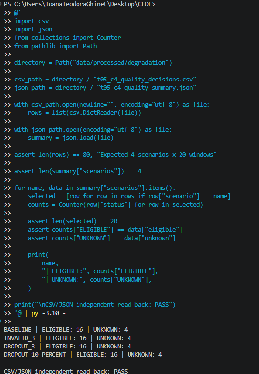

*Figure 44. Independent verification of all eighty exported window-level Quality Gate decisions.*

---

#### 7.3.26 Final Regression Validation

The complete backend regression suite was executed after the T05-C4 integration.

**Command:**

```powershell
py -3.10 -m pytest backend\tests -v
```

**Observed result:** 233/233 PASSED in 0.49 seconds.

No regressions were detected by the existing test suite.

**Result: PASS — Regression Testing**

**Evidence:**

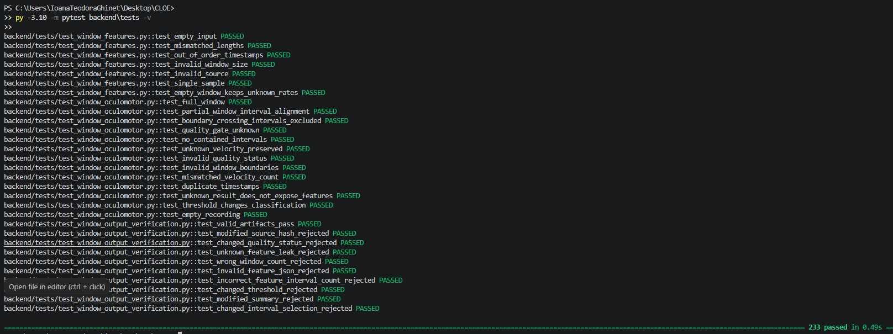

*Figure 45. Complete CLOE backend regression suite after T05-C4, confirming 233 successful tests.*

---

#### 7.3.27 Interpretation of the Final Results

**Finding 1 — Baseline reproducibility**

The original M0.3 Quality Gate decisions were successfully reproduced using the existing processing components and original temporal reference.

This supports consistency between the baseline processing and the re-evaluation pipeline.

**Finding 2 — Invalid gaze and sample dropout have distinct effects**

Earlier T05-C experiments demonstrated that invalidating gaze measurements increases unavailable velocity intervals without removing samples, while sample dropout changes the number of received samples and may increase temporal gaps.

These distinct behaviors were preserved in the controlled experimental design.

**Finding 3 — Degradation did not necessarily change Quality Gate eligibility**

All tested scenarios produced sixteen ELIGIBLE and four UNKNOWN windows.

This result indicates that the selected perturbations did not cause additional windows to cross the configured Quality Gate rejection thresholds.

It does not demonstrate that the degradation had no effect on underlying measurements.

**Finding 4 — Window-level quality differs from velocity availability**

The approximately 10% dropout scenario previously reduced velocity availability to 81.08%.

Nevertheless, the recalculated window-level Quality Gate distribution remained unchanged.

These results illustrate that velocity interval availability and gaze-window quality eligibility measure different properties.

The former concerns availability of derived consecutive-interval measurements, whereas the latter applies configurable rules to received gaze samples and nominal sampling coverage.

**Finding 5 — Quality Gate robustness has defined limits**

The experiment demonstrates consistent software behavior for the selected degradation scenarios and policy configuration.

It does not establish that the policy will reject every dataset unsuitable for downstream oculomotor analysis.

Additional controlled degradation severities and patterns are required to investigate the boundaries of the current policy.

#### 7.3.28 Experimental Limitations

The following limitations remain:

- One original Tobii Pro Nano recording was evaluated.
- The degradation patterns were synthetic and deterministic.
- Only selected invalidation and dropout scenarios were tested.
- The experiment did not systematically identify the degradation level at which each window becomes UNKNOWN.
- Quality Gate eligibility remained unchanged for all tested scenarios.
- Unchanged Quality Gate eligibility does not imply unchanged oculomotor feature values.
- The completeness assessment relies on the existing timestamp-boundary proxy.
- The configured Quality Gate thresholds are engineering parameters, not physiological validation thresholds.
- Sliding temporal windows overlap and must not be treated as statistically independent observations.
- The experiment did not validate fixation or saccade detection against annotated ground truth.
- No cognitive-load measurements or adaptive interface decisions were evaluated.

#### 7.3.29 Final Conclusion

**Result: PASS — Controlled Data Degradation and Real-Data Quality Gate Re-evaluation**

T05-C successfully implemented and evaluated a controlled data degradation workflow for the CLOE eye-tracking processing pipeline.

The experiment distinguished between invalid received gaze measurements and missing samples, preserving the original Tobii recording.

Synthetic degradation tests verified sample-count handling, velocity availability, temporal gaps, input validation, and data immutability.

The complete Quality Gate re-evaluation reproduced the original M0.3 baseline and evaluated four scenarios across twenty temporal windows.

All scenarios resulted in sixteen ELIGIBLE and four UNKNOWN windows, with no newly rejected or recovered windows.

The independent CSV/JSON read-back verified all eighty exported decisions against the saved summary.

The complete regression suite passed with 233 successful tests.

**Final status: COMPLETE — Defined Software and Initial Real-Data Experimental Validation Objectives**

The experiment establishes reproducible behavior under the selected perturbations and identifies limitations requiring further experimental investigation.

It does not establish universal robustness, physiological measurement validity, or cognitive-load prediction accuracy.

---
### 7.4 T05-D — Experimental Validation Readiness Review

**Date:** 2026-11-17  
**Status:** PASS — Software Validation, Artifact Audit and Experimental Readiness Review

**Implementation:** `backend/processing/experimental_readiness.py`  
**Tests:** `backend/tests/test_experimental_readiness.py`  
**Output report:** `data/processed/readiness/m04_readiness_report.json`

---

#### 7.4.1 Objective

Conduct a final readiness review of M0.4 — Oculomotor Feature Extraction.

The review evaluates whether the implemented processing components, experimental artifacts, data provenance records, and verification evidence are sufficiently organized and consistent to support subsequent controlled research.

The experiment distinguishes software verification and experimental preparation from physiological validation and cognitive-load estimation accuracy.

#### 7.4.2 Background

Milestone M0.4 developed and evaluated preliminary oculomotor processing methods using gaze measurements collected with the Tobii Pro Nano eye tracker.

The milestone included:

| Task | Main contribution | Status |
|---|---|---|
| T01 | Gaze velocity calculation | PASS |
| T02 | Movement-state segmentation | PASS |
| T03 | Segment-level duration, velocity statistics and summaries | PASS |
| T04 | Window-level feature integration and artifact verification | PASS |
| T05-A | Experimental threshold sensitivity analysis | PASS |
| T05-B | Temporal stability and window overlap analysis | PASS |
| T05-C | Controlled data degradation and Quality Gate re-evaluation | PASS |

These tasks established a modular processing pipeline, supported by automated tests and initial evaluations using a real Tobii Pro Nano recording.

T05-D consolidates the available verification evidence and performs a final artifact-consistency review.

#### 7.4.3 Readiness Review Scope

The review covers five areas:

1. **Artifact availability:** Verify the presence of required raw and processed experimental files.
2. **Artifact consistency:** Verify agreement between saved M0.3 Quality Gate decisions and T05-C4 results.
3. **Temporal alignment:** Verify consistency of the reference windows across degradation scenarios.
4. **Evidence availability:** Check the existence of expected experimental screenshots.
5. **Provenance information:** Calculate SHA-256 hashes for selected experimental files.

The review is read-only with respect to the original recording and previously generated artifacts.

#### 7.4.4 Implementation

The audit functionality is implemented in:

`backend/processing/experimental_readiness.py`

The module provides the following functions:

| Function | Responsibility |
|---|---|
| `sha256_file()` | Calculate the SHA-256 digest of a file |
| `read_csv()` | Load CSV records and validate basic structure |
| `read_json()` | Read JSON experiment artifacts |
| `verify_quality_artifacts()` | Verify consistency between M0.3 and T05-C4 decisions |
| `audit_project()` | Execute the defined M0.4 artifact readiness checks |

The implementation does not modify original datasets.

It reports failures when required files are missing or when verified artifact relationships are inconsistent.

Missing expected screenshot files are reported separately as warnings.

#### 7.4.5 Artifact Verification

The audit verifies the existence of selected experimental artifacts, including:

- Original Tobii Pro Nano gaze recording.
- M0.3 sliding-window feature CSV.
- M0.3 Quality Gate decisions.
- M0.3 Quality Gate policy.
- T04 window-level oculomotor summaries and policy.
- T04 window-level feature CSV files for thresholds 2.0, 5.0 and 10.0.
- T05-C4 Quality Gate decision CSV.
- T05-C4 JSON summary.

**Observed result:**

```text
PASS: Required artifacts exist
```

No required artifact was reported missing.

**Result: PASS — Artifact Availability**

#### 7.4.6 Quality Gate Artifact Consistency

The audit independently reads the saved Quality Gate artifacts and verifies their structural consistency.

The verification includes:

1. Presence of all four expected degradation scenarios.
2. Twenty windows per scenario.
3. A total of eighty decision records.
4. Consistency between CSV status counts and JSON summary counts.
5. Temporal alignment with the original M0.3 windows.
6. Reproduction of original baseline statuses and rejection reasons.

**Observed result:**

```text
PASS: C4 CSV/JSON and M0.3 baseline consistency
```

The final scenario distributions were:

| Scenario | Windows | ELIGIBLE | UNKNOWN |
|---|---:|---:|---:|
| BASELINE | 20 | 16 | 4 |
| INVALID_3 | 20 | 16 | 4 |
| DROPOUT_3 | 20 | 16 | 4 |
| DROPOUT_10_PERCENT | 20 | 16 | 4 |

The baseline results were consistent with the previously verified M0.3 decisions.

All four scenario datasets preserved the expected temporal window alignment.

**Result: PASS — Quality Gate Artifact Consistency**

#### 7.4.7 Experimental Evidence Review

The audit checks for the presence of selected experimental evidence screenshots under:

`docs/evidence/M0-04/`

The evidence includes unit-testing, threshold sensitivity, temporal stability, controlled degradation, Quality Gate re-evaluation, and regression validation screenshots.

**Observed result:**

```text
--- Evidence Review ---
All expected screenshot files are present.
```

The generated audit report contains:

```json
"warnings": []
```

This confirms that none of the screenshot files expected by the implemented audit were missing.

The automated check verifies file presence, not the scientific correctness or visual completeness of each screenshot.

**Result: PASS — Evidence Availability**

#### 7.4.8 Provenance and SHA-256 Verification

The readiness audit calculates SHA-256 digests for selected files:

| Artifact | Purpose |
|---|---|
| Original Tobii recording | Identify the source dataset |
| M0.3 Quality Gate decisions CSV | Identify baseline quality decisions |
| T05-C4 decisions CSV | Identify degraded-scenario results |
| T05-C4 summary JSON | Identify experiment summary metadata |

Four file hashes were successfully included in the final JSON report.

These hashes provide reproducible file identifiers for future comparisons.

However, a newly computed hash does not independently prove that a file is unchanged from its original creation date.

Such a claim requires comparison against a previously recorded, trusted reference digest.

#### 7.4.9 Unit Testing

**Test file:** `backend/tests/test_experimental_readiness.py`

**Execution command:**

```powershell
py -3.10 -m pytest backend\tests\test_experimental_readiness.py -v
```

Eight unit tests were implemented and executed.

**Observed results:**

| Test | Verification objective | Result |
|---|---|---|
| `test_complete_artifacts_pass` | Accept a consistent artifact collection | PASS |
| `test_missing_artifact_fails` | Detect missing required files | PASS |
| `test_changed_baseline_status_fails` | Detect inconsistent baseline decisions | PASS |
| `test_incorrect_summary_count_fails` | Detect inconsistent scenario counts | PASS |
| `test_window_alignment_mismatch_fails` | Detect temporal alignment discrepancies | PASS |
| `test_missing_screenshots_are_warnings` | Report missing evidence separately | PASS |
| `test_source_hashes_present` | Confirm presence of calculated file hashes | PASS |
| `test_audit_does_not_modify_sources` | Preserve original source files | PASS |

**Observed result:**

```text
collected 8 items

8 passed in 0.30s
```

All eight tests passed for their defined synthetic scenarios.

**Result: PASS — Unit Testing**

**Evidence:**

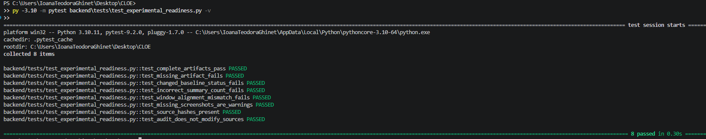

*Figure 46. Successful execution of eight experimental readiness audit unit tests.*

#### 7.4.10 Regression Testing

The complete backend regression suite was executed after the readiness audit implementation.

**Execution command:**

```powershell
py -3.10 -m pytest backend\tests -v
```

**Observed result:**

```text
241 passed in 0.53s
```

**Execution environment:**

- Windows 11 Education, 64-bit.
- Python 3.10.11.
- pytest 9.2.0.

All 241 collected tests passed.

No regressions were detected by the existing automated test suite.

**Result: PASS — Regression Testing**

**Evidence:**


*Figure 47. Complete CLOE backend regression suite after T05-D, confirming 241 successful tests.*

---

#### 7.4.11 Real Project Readiness Audit

The audit was executed against the actual CLOE project directory using the previously generated M0.3 and M0.4 artifacts.

**Observed output:**

```text
--- CLOE M0.4 Experimental Readiness Review ---

PASS: Required artifacts exist
PASS: C4 CSV/JSON and M0.3 baseline consistency

--- Quality Gate Scenarios ---

BASELINE | Windows: 20 | ELIGIBLE: 16 | UNKNOWN: 4
INVALID_3 | Windows: 20 | ELIGIBLE: 16 | UNKNOWN: 4
DROPOUT_3 | Windows: 20 | ELIGIBLE: 16 | UNKNOWN: 4
DROPOUT_10_PERCENT | Windows: 20 | ELIGIBLE: 16 | UNKNOWN: 4

--- Evidence Review ---

All expected screenshot files are present.

Scientific validation: NOT_ESTABLISHED
Artifact audit result: PASS
```

The audit completed successfully.

The results indicate that the selected required artifacts were present, the saved Quality Gate results were structurally consistent, and the expected evidence files were available.

**Result: PASS — Real Project Artifact Audit**

**Evidence:**


*Figure 48. Real CLOE project readiness audit confirming artifact and baseline consistency.*

#### 7.4.12 Generated Readiness Report

The audit generated the following file:

`data/processed/readiness/m04_readiness_report.json`

The report contains:

- Overall audit status.
- Individual verification checks.
- Missing-evidence warnings.
- Quality Gate scenario summaries.
- SHA-256 file digests.
- Scientific validation status.

**Observed report values:**

```json
{
  "status": "PASS",
  "checks": [
    {
      "name": "Required artifacts exist",
      "status": "PASS",
      "details": []
    },
    {
      "name": "C4 CSV/JSON and M0.3 baseline consistency",
      "status": "PASS"
    }
  ],
  "warnings": [],
  "scientific_validation": "NOT_ESTABLISHED"
}
```

*The excerpt above contains selected report fields; the complete generated JSON also includes scenario results and SHA-256 hashes.*

The JSON report was inspected after generation.

**Evidence:**


*Figure 49. Generated readiness report containing successful checks, no warnings, scenario summaries, and scientific validation limitations.*

---

#### 7.4.13 Scientific Validation Readiness Assessment

The technical readiness review must not be interpreted as proof of physiological or cognitive-load measurement validity.

The following distinctions are maintained:

| Validation dimension | Assessment |
|---|---|
| Tobii Pro Nano acquisition | OBSERVED |
| Gaze validity processing | SOFTWARE TESTED |
| Temporal interval processing | SOFTWARE TESTED |
| Velocity calculation | SOFTWARE TESTED |
| Movement-state segmentation | SOFTWARE TESTED |
| Segment-level feature extraction | SOFTWARE TESTED |
| Window-level feature extraction | TESTED ON INITIAL RECORDING |
| Experimental threshold sensitivity | DESCRIPTIVELY ANALYZED |
| Temporal-window dependence | DESCRIPTIVELY ANALYZED |
| Controlled data degradation | TESTED ON INITIAL RECORDING |
| Quality Gate re-evaluation | VERIFIED FOR TESTED SCENARIOS |
| Ground-truth fixation/saccade accuracy | NOT VALIDATED |
| Inter-session measurement reliability | NOT VALIDATED |
| Cognitive-load prediction accuracy | NOT VALIDATED |
| Adaptive interface effectiveness | NOT EVALUATED |

The successful audit establishes readiness of the selected software and experimental artifacts for subsequent work.

It does not establish that the extracted features accurately identify physiological eye-movement events or reliably predict cognitive load.

#### 7.4.14 Remaining Research Requirements

Before using the extracted oculomotor features for cognitive-load estimation, further work is necessary.

**Ground-truth validation**

The current LOW_VELOCITY and HIGH_VELOCITY categories are preliminary engineering classifications.

They should not be treated as validated fixation and saccade events without comparison against an appropriate reference method.

**Repeated recordings**

A single recording cannot establish inter-session or test-retest reliability.

Additional sessions under controlled conditions are needed.

**Experimental workload conditions**

The relationship between oculomotor behavior and cognitive load must be investigated using defined tasks and independent workload measurements.

**Data-quality policy evaluation**

The current Quality Gate thresholds are configurable engineering parameters.

Their suitability must be evaluated under a broader range of natural and synthetic acquisition conditions.

**Participant variability**

Future evaluation should consider differences between participants, calibration quality, viewing conditions, and individual gaze behavior.

**Adaptive interface evaluation**

The ability to extract oculomotor features does not by itself demonstrate that interface adaptation reduces cognitive load or improves task performance.

These outcomes require separate experimental evaluation.

#### 7.4.15 Limitations of the Readiness Audit

The audit has the following limitations:

- It verifies selected files rather than every project artifact.
- It checks structural consistency but does not independently rerun the entire processing pipeline.
- It validates selected T05-C4 outputs against saved baseline decisions.
- It verifies screenshot presence, not screenshot content.
- Calculated hashes are not compared against previously trusted reference hashes.
- It does not establish physiological signal accuracy.
- It does not evaluate whether feature thresholds are optimal.
- It does not establish independence of overlapping window observations.
- It does not validate relationships with cognitive-load labels.
- It does not evaluate real-time adaptive interface behavior.

These limitations do not invalidate the software readiness result, but they restrict the conclusions that may be drawn from it.

#### 7.4.16 Conclusion

**Result: PASS — Experimental Readiness Review**

T05-D successfully completed the defined software and artifact readiness review for CLOE milestone M0.4.

All eight readiness unit tests passed.

The complete backend regression suite passed, with 241 successful tests.

The real-project audit verified the presence of the selected required artifacts and consistency of the saved M0.3 and T05-C4 Quality Gate decisions.

All four experimental scenarios contained twenty windows, with sixteen ELIGIBLE and four UNKNOWN windows.

No expected evidence screenshots were reported missing.

A structured JSON readiness report was generated, including artifact verification results and SHA-256 file identifiers.

The report explicitly preserves the distinction between successful software verification and scientific validation.

**Final T05-D Status: COMPLETE**

---

## 8. M0.4 — Final Milestone Conclusion

**Milestone:** M0.4 — Oculomotor Feature Extraction  
**Date opened:** 2026-11-11  
**Date closed:** 2026-11-17  
**Status:** COMPLETE — Defined Software and Preliminary Experimental Objectives

### 8.1 Milestone Achievements

M0.4 established a modular pipeline for extracting preliminary oculomotor characteristics from Tobii Pro Nano gaze recordings.

The implemented components support gaze velocity calculation, movement-state segmentation, segment-level statistics, temporal window analysis, feature-quality integration, and structured experimental output verification.

The milestone also introduced controlled evaluations of threshold sensitivity, temporal feature variation, and deliberate data degradation.

All defined implementation and verification tasks were completed.

### 8.2 Final Verification Summary

| Task | Final result |
|---|---|
| T01 — Gaze Velocity | PASS |
| T02 — Movement Segmentation | PASS |
| T03 — Segment-Level Features | PASS |
| T04 — Window-Level Oculomotor Integration | PASS |
| T05-A — Threshold Sensitivity | PASS |
| T05-B — Temporal Stability | PASS |
| T05-C — Controlled Data Degradation | PASS |
| T05-D — Experimental Readiness Review | PASS |
| Full backend regression suite | 241/241 PASSED |
| Required artifact audit | PASS |
| Saved Quality Gate consistency | PASS |
| Evidence availability check | PASS |

### 8.3 Milestone Outcome

The main outcome of M0.4 is an implemented, tested, and documented preliminary oculomotor feature extraction pipeline.

The pipeline provides a foundation for subsequent controlled data collection and experimental analysis.

The current results support claims about implemented software functionality and observed behavior for the tested recording and configurations.

They do not establish validated cognitive-load estimation, physiological event classification accuracy, or the effectiveness of adaptive interface changes.

### 8.4 Milestone Closure Decision

**Decision: M0.4 COMPLETE**

The milestone is closed because its defined software implementation, automated testing, initial real-data analysis, and experimental readiness review objectives have been satisfied.

Scientific validation requirements remain open and will be addressed in subsequent project milestones.